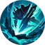
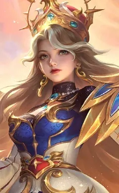

[Тир-лист](https://boostmlbb.ru/heroes/)

# Вексана

C

МагСредняя линия

Победы

48,5%

Выбор

1,1%

Баны

0,4%

[Обзор](https://boostmlbb.ru/#overview)[Сборка](https://boostmlbb.ru/#build)[Как играть](https://boostmlbb.ru/#howto)[Навыки](https://boostmlbb.ru/#skills)[Контрпики](https://boostmlbb.ru/#draft)[Скины](https://boostmlbb.ru/#skins)[История](https://boostmlbb.ru/#lore)

## Обзор

### Характеристики

-   Живучесть**20**
-   Атака**90**
-   Эффекты**50**
-   Сложность**10**

-   Поук
-   Контроль

### Другие маги этой линии

[Кимми](https://boostmlbb.ru/heroes/kimmy.html)[Эйдора](https://boostmlbb.ru/heroes/eudora.html)[Чжусинь](https://boostmlbb.ru/heroes/zhuxin.html)[Валир](https://boostmlbb.ru/heroes/valir.html)[Цзэтянь](https://boostmlbb.ru/heroes/zetian.html)[Ксавьер](https://boostmlbb.ru/heroes/xavier.html)[Лилия](https://boostmlbb.ru/heroes/lylia.html)[Люнокс](https://boostmlbb.ru/heroes/lunox.html)

### Места в рейтингах

-   [Лучшие маги MLBB**20 из 32**](https://boostmlbb.ru/heroes/best-mage.html)
-   [Лучшие мидеры MLBB**18 из 29**](https://boostmlbb.ru/heroes/best-mid.html)

## Сборка

Сборка 1Сборка 2Сборка 3

Победы

55,0%

Выбор

10,7%

#### Основные предметы

-   [

    

    Пылающий жезл

    ](https://boostmlbb.ru/items/glowing-wand.html)
-   [

    

    Жезл молний

    ](https://boostmlbb.ru/items/lightning-truncheon.html)
-   [

    

    Божественный меч

    ](https://boostmlbb.ru/items/divine-glaive.html)

#### Заклинание

Вспышка

#### Эмблема и таланты

Эмблема мага

-   

    Разрыв

-   

    Благословение природы

-   

    Нечестивая ярость

Победы

55,8%

Выбор

2,5%

#### Основные предметы

-   [

    

    Пылающий жезл

    ](https://boostmlbb.ru/items/glowing-wand.html)
-   [

    

    Жезл молний

    ](https://boostmlbb.ru/items/lightning-truncheon.html)
-   [

    

    Божественный меч

    ](https://boostmlbb.ru/items/divine-glaive.html)

#### Заклинание

Вспышка

#### Эмблема и таланты

Эмблема мага

-   

    Разрыв

-   

    Мастер оружий

-   

    Нечестивая ярость

Победы

54,3%

Выбор

2,4%

#### Основные предметы

-   [

    

    Пылающий жезл

    ](https://boostmlbb.ru/items/glowing-wand.html)
-   [

    

    Жезл молний

    ](https://boostmlbb.ru/items/lightning-truncheon.html)
-   [

    

    Божественный меч

    ](https://boostmlbb.ru/items/divine-glaive.html)

#### Заклинание

Вспышка

#### Эмблема и таланты

Эмблема мага

-   

    Разрыв

-   

    Мастер оружий

-   

    Смертельное воспламенение

## Как играть за Вексану

### Комбо Вексаны

#### В драке

1.  Ульт
2.  2
3.  1

Начинайте драку контролем или добавляйте свой после чужого. Ульт, когда враги кучно, затем связка второй + первый для контроля и урона.

#### На линии

1.  1
2.  2

Напугайте первым навыком и добавьте второй для гарантированного урона.

### Когда сильнее всего

Сильнее в начале: на 10–12 минутах выигрывает 54,5%. Давите на линии, забирайте объекты и заканчивайте, пока преимущество не растаяло.

1.  **54,5**10–12
2.  **51,1**12–14
3.  **49,2**14–16
4.  **47,7**16–18
5.  **47,3**18–20
6.  **47,2**20+

Проценты побед по длине матча в минутах, все ранги. Пунктир: 50%

### Приоритет прокачки

1.  Вечный страж
2.  Проклятый взрыв
3.  Смертельная хватка

## Навыки

Пассивный**Прикосновение пустоты**1-й навык**Смертельная хватка**2-й навык**Проклятый взрыв**Ультимейт**Вечный страж**

Пассивный

### Прикосновение пустоты

Вексана и Вечный страж при попадании накладывают на врагов "Прикосновение пустоты".

Метка действует в течение 5 сек. и после смерти заставляет пораженного врага взорваться, нанося 108-500 (+60% общей магической силы) единиц магического урона ближайшим врагам (базовый урон зависит от уровня).

1-й навык

### Смертельная хватка

Перезарядка **14 Mana Cost: 80 с**

Вексана выпускает "Смертельную хватку" в указанном направлении, нанося 200 (+60% общей магической силы) единиц магического урона врагам на пути. Снаряд остановится при попадании во вражеского героя, повергая его в ужас и отбрасывая его. После небольшой задержки он взорвется, нанося 200 (+60% общей магической силы) единиц магического урона ближайшим врагам и повергая их в ужас на 1 сек.

2-й навык

### Проклятый взрыв

Перезарядка **7 Mana Cost: 60 с**

Вексана отмечает выбранную область силой нежити, поражая ее после задержки в 0.8 сек. и нанося пораженным врагам 580 (+165% общей магической силы) единиц магического урона.

Ультимейт

### Вечный страж

Перезарядка **60 Mana Cost: 120 с**

Вексана призывает Вечного стража в указанном месте, нанося 480 (+60% общей магической силы) единиц магического урона пораженным врагам и подбрасывая их на 0.8 сек. Затем Вечный страж присоединяется к Вексане в битве на 15 сек. Его атаки наносят 200 (+40% общей магической силы) (+5% от цели) единиц магического урона и распространяющийся урон в большой области.

## Контрпики Вексаны

### Кто контрит Вексану

[Глу](https://boostmlbb.ru/heroes/gloo.html)[Заск](https://boostmlbb.ru/heroes/zhask.html)[Одетта](https://boostmlbb.ru/heroes/odette.html)[Чип](https://boostmlbb.ru/heroes/chip.html)[Лолита](https://boostmlbb.ru/heroes/lolita.html)

## Скины Вексаны

[Вечная клятваДелюкс · 2026](https://boostmlbb.ru/skins/vexana/eternal-vow.html)[Сумеречная звездаГрандиозный · 2025](https://boostmlbb.ru/skins/vexana/twilight-star.html)[Искажённая сказкаГрандиозный · 2024](https://boostmlbb.ru/skins/vexana/twisted-fairytale.html)[Солнечная импе­ратрицаИзысканный · 2023](https://boostmlbb.ru/skins/vexana/the-sun-empress.html)[Цирковая волшебницаИсключительный · 2022](https://boostmlbb.ru/skins/vexana/circus-magician.html)[Проклятые оковыОбычный · 2019](https://boostmlbb.ru/skins/vexana/cursed-shackle.html)[Кровавая розаДелюкс · 2018](https://boostmlbb.ru/skins/vexana/sanguine-rose.html)[Светлый маякОбычный · 2017](https://boostmlbb.ru/skins/vexana/lucent-beacon.html)

[Все 8 скинов Вексаны: цены и как получить](https://boostmlbb.ru/skins/vexana.html)

## История

> Юная герцогиня, охраняющая Некрокип.

[Читать полную историю ↗](https://play.mobilelegends.com/lore/hero/Vexana)Официальный сайт Mobile Legends [Характеристики на сайте игры ↗](https://www.mobilelegends.com/hero/detail?heroid=38)

**Поднимем ранг на герое «Вексана»**Цена считается в калькуляторе

[Рассчитать цену](https://boostmlbb.ru/order.html?type=hero)

## Частые вопросы

Кто контрит Вексану в MLBB?

За последние 30 дней Вексану чаще всего обыгрывают Глу, Заск, Одетта, Чип и Лолита.

Как играть за Вексану?

В первую очередь качайте «Проклятый взрыв», ульт берите, как только доступен. Сильнее в начале: на 10–12 минутах выигрывает 54,5%. Давите на линии, забирайте объекты и заканчивайте, пока преимущество не растаяло. Комбо для драки: Начинайте драку контролем или добавляйте свой после чужого. Ульт, когда враги кучно, затем связка второй + первый для контроля и урона.

Какой процент побед у Вексаны сейчас?

48,45% в Мифической славе за последние 7 дней и 49,26% на всех рангах за 30 дней, данные на 27 ноября 2026 года.

Какая роль и линия у Вексаны?

Маг, играет на средней линии.

Стоит ли брать Вексану в текущей мете?

Тир C, 77-е место из 133 героев и 20-е среди магов. Тир учитывает, как часто героя берут и банят и как он выигрывает в Мифической славе за 7 дней: бан в 0,4% матчей, 48,5% побед. В профессиональных матчах за месяц героя драфтуют в 0,0% катков.

Какая сборка на Вексану лучшая?

Самая популярная сборка в рейтинге: ключевые предметы «Пылающий жезл», «Жезл молний» и «Божественный меч», эмблема мага с талантами «Разрыв», «Благословение природы» и «Нечестивая ярость» и заклинание «Вспышка». С ней выигрывают 55,04% матчей.
