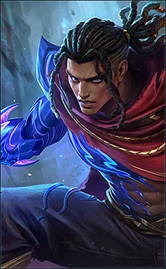

[Тир-лист](https://boostmlbb.ru/heroes/)[Новости и гайды](https://boostmlbb.ru/news/)

# Ванван

D

СтрелокЛиния золота

Победы

47,1%

Выбор

0,2%

Баны

0,1%

[Обзор](https://boostmlbb.ru/#overview)[Сборка](https://boostmlbb.ru/#build)[Навыки](https://boostmlbb.ru/#skills)[Контрпики](https://boostmlbb.ru/#draft)[История](https://boostmlbb.ru/#lore)

## Обзор

### Характеристики

-   Живучесть**20**
-   Атака**60**
-   Эффекты**30**
-   Сложность**80**

-   Добивание
-   Разрушительный урон

### Победы по рангам, 30 дней

1.  **45,8%**Эпик
2.  **48,1%**Легенда
3.  **48,1%**Мифик
4.  **48,3%**Честь
5.  **47,0%**Слава

Пунктир: 50% побед

### Другие стрелки этой линии

[Обсидия](https://boostmlbb.ru/heroes/obsidia.html)[Бруно](https://boostmlbb.ru/heroes/bruno.html)[Клинт](https://boostmlbb.ru/heroes/clint.html)[Броуди](https://boostmlbb.ru/heroes/brody.html)[Ханаби](https://boostmlbb.ru/heroes/hanabi.html)[Москов](https://boostmlbb.ru/heroes/moskov.html)[Клауд](https://boostmlbb.ru/heroes/claude.html)[Мия](https://boostmlbb.ru/heroes/miya.html)

### Места в рейтингах

-   [Лучшие стрелки MLBB**22 из 23**](https://boostmlbb.ru/heroes/best-marksman.html)

## Сборка

Сборка 1Сборка 2Сборка 3

Победы

49,3%

Выбор

3,8%

#### Основные предметы

-   

    Коса коррозии

-   

    Говорящий с ветром

-   

    Меч охотника на демонов

-   

    Ветер природы

#### Заклинание

Вдохновение

#### Эмблема и таланты

Эмблема стрелка

-   

    Проворность

-   

    Мастер оружий

-   

    Точно в цель

Победы

57,5%

Выбор

3,1%

#### Основные предметы

-   

    Коса коррозии

-   

    Говорящий с ветром

-   

    Золотой метеор

-   

    Когти Хааса

#### Заклинание

Вдохновение

#### Эмблема и таланты

Эмблема стрелка

-   

    Проворность

-   

    Мастер-убийца

-   

    Точно в цель

Победы

58,9%

Выбор

3,0%

#### Основные предметы

-   

    Коса коррозии

-   

    Говорящий с ветром

-   

    Золотой метеор

-   

    Когти Хааса

#### Заклинание

Вдохновение

#### Эмблема и таланты

Эмблема стрелка

-   

    Проворность

-   

    Мастер оружий

-   

    Точно в цель

## Навыки

Прокачка**Арбалет Тана** _›_**Путь ласточки**_›_**Иглы в цветах**

Пассивный**Шаг тигра**1-й навык**Путь ласточки**2-й навык**Иглы в цветах**Ультимейт**Арбалет Тана** 

Пассивный

### Шаг тигра

Уязвимые места и позиции вражеских героев, пораженных атаками Ванван, будут раскрыты на 5 сек. Поражая уязвимое место врага, Ванван наносит 67 (+3 × ур. героя) единиц дополнительного чистого урона и увеличивает урон, получаемый от ее последующих атак, на 10% на 5 сек.

Ванван может прыгнуть на небольшое расстояние после каждой стрелы, выпущенной базовой атакой. Скорость прыжка зависит от ее скорости атаки.

1-й навык

### Путь ласточки

Перезарядка **12 Mana Cost: 85 с**

Ванван бросает огненную ласточку в указанном направлении, активируя "Шаг тигра" и нанося 120 (+40% общей физической атаки) единиц физического урона врагам на пути. Затем огненная ласточка превращается в 3 кинжала-ласточки, которые после небольшой задержки один за другим возвращаются к Ванван, нанося 120 (+40% общей физической атаки) единиц физического урона врагам на пути и замедляя их на 30% на 1.5 сек. Враги, пораженные кинжалами-ласточками дважды, будут обездвижены на 0.5 сек.

2-й навык

### Иглы в цветах

Перезарядка **24 Mana Cost: 125 с**

Ванван снимает с себя все дебаффы и активирует "Шаг тигра". Тем временем она выбрасывает смертоносные иглы по всем направлениям, нанося пораженным врагам 150 (+60% общей физической атаки) единиц физического урона.

Ультимейт

### Арбалет Тана 

Ванван прыгает в воздух, становится неуловимой для прицела и быстро стреляет в указанного вражеского героя в течение 2.5 сек., каждой стрелой нанося 60 (+35% общей физической атаки) единиц физического урона. Если цель будет убита во время этой атаки, Ванван переключится на другого вражеского героя в пределах дальности атаки, получит 30% дополнительной скорости атаки и продлит навык на 1 сек. (этот эффект может сработать до 3 раз). Во время обстрела Ванван может активировать "Шаг тигра" при убийстве врага, а также в конце обстрела.

"Арбалет Тана" можно использовать только на вражеских героев, у которых поражены все уязвимые места. Ванван получает 100% скорости передвижения во время действия. Этот урон считается уроном от базовой атаки, и скорость стрельбы зависит от скорости атаки Ванван.

## Контрпики

### Контрпики

Побеждают этого героя

[Инь](https://boostmlbb.ru/heroes/yin.html)[Иксия](https://boostmlbb.ru/heroes/ixia.html)[Атлас](https://boostmlbb.ru/heroes/atlas.html)[Гвиневра](https://boostmlbb.ru/heroes/guinevere.html)[Ханаби](https://boostmlbb.ru/heroes/hanabi.html)

### Слабые цели

Этот герой побеждает их

[Пакито](https://boostmlbb.ru/heroes/paquito.html)[Циклоп](https://boostmlbb.ru/heroes/cyclops.html)[Бруно](https://boostmlbb.ru/heroes/bruno.html)[Иритель](https://boostmlbb.ru/heroes/irithel.html)[Люнокс](https://boostmlbb.ru/heroes/lunox.html)[Хуфра](https://boostmlbb.ru/heroes/khufra.html)[Фовиус](https://boostmlbb.ru/heroes/phoveus.html)[Фарамис](https://boostmlbb.ru/heroes/faramis.html)

## История

> Проворная тигрица из Бойцов Востока, жизнерадостная юная девушка, владеющая Арбалетом Тана.

[Читать полную историю ↗](https://play.mobilelegends.com/lore/hero/Wanwan)Официальный сайт Mobile Legends [Характеристики на сайте игры ↗](https://www.mobilelegends.com/hero/detail?heroid=89)

**Поднимем ранг на герое «Ванван»**Цена считается в калькуляторе

[Рассчитать цену](https://boostmlbb.ru/order.html?type=hero)

## Частые вопросы

Кто контрпик для героя «Ванван» в MLBB?

За последние 30 дней чаще всего героя обыгрывают Инь, Иксия, Атлас, Гвиневра и Ханаби.

Какой процент побед у героя «Ванван» сейчас?

47,07% в Мифической славе за последние 7 дней и 47,55% на всех рангах за 30 дней, данные на 25 ноября 2026 года.

Какая роль и линия у героя «Ванван»?

Стрелок, играет на линии золота.

Силён ли герой «Ванван» в текущей мете?

Тир D, 125-е место из 133 героев и 22-е среди стрелков. Тир учитывает, как часто героя берут и банят и как он выигрывает в Мифической славе за 7 дней: бан в 0,1% матчей, 47,1% побед. В профессиональных матчах за месяц героя драфтуют в 0,9% катков.

Какая сборка на героя «Ванван» лучшая?

Самая популярная сборка в рейтинге: ключевые предметы «Коса коррозии», «Говорящий с ветром», «Меч охотника на демонов» и «Ветер природы», эмблема стрелка с талантами «Проворность», «Мастер оружий» и «Точно в цель» и заклинание «Вдохновение». С ней выигрывают 49,34% матчей.
