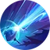

[Главная](https://boostmlbb.ru/) / [Герои](https://boostmlbb.ru/heroes/)

Тир A

# Ксавьер

Маг · Средняя линия

**№ 32 из 133 по доле побед**Все ранги · 30 дней по 23 ноября 2026 года

Победы

51,68%

Выбор

0,75%

Баны

0,40%

Урон · Разрушительный урон · Сложность 50/100

[Сборка](https://boostmlbb.ru/#build)[Контрпики и союзники](https://boostmlbb.ru/#draft)[Навыки](https://boostmlbb.ru/#skills)[Победы по рангам](https://boostmlbb.ru/#ranks)[История](https://boostmlbb.ru/#lore)

## Сборка

Самый частый выбор в рейтинге · Средняя линия

Ключевые предметы

Зачарованный талисманПылающий жезлЖезл молний

Эмблема и таланты

Эмблема магаВдохновениеОхотник за скидкамиНечестивая ярость

Боевое заклинание

Вспышка

Побед с этой сборкой **58,91%**Выбирают в **11,21%** матчей

Другие сборки (2)

Ключевые предметы

Зачарованный талисманПылающий жезлЖезл молний

Эмблема и таланты

Эмблема магаРазрывОхотник за скидкамиНечестивая ярость

Боевое заклинание

Вспышка

Побед с этой сборкой **59,12%**Выбирают в **4,75%** матчей

Ключевые предметы

Зачарованный талисманПронзающий небесаЖезл молний

Эмблема и таланты

Эмблема магаВдохновениеОхотник за скидкамиНечестивая ярость

Боевое заклинание

Вспышка

Побед с этой сборкой **55,58%**Выбирают в **6,53%** матчей

## Контрпики и союзники

### Кто контрит

[Пополь и Купа](https://boostmlbb.ru/heroes/popol-and-kupa.html)[Белерик](https://boostmlbb.ru/heroes/belerick.html)[Атлас](https://boostmlbb.ru/heroes/atlas.html)[Глу](https://boostmlbb.ru/heroes/gloo.html)[Фарамис](https://boostmlbb.ru/heroes/faramis.html)

### Против кого силён

[Зилонг](https://boostmlbb.ru/heroes/zilong.html)[Эймон](https://boostmlbb.ru/heroes/aamon.html)[Хелкарт](https://boostmlbb.ru/heroes/helcurt.html)[Алдос](https://boostmlbb.ru/heroes/aldous.html)[Наталья](https://boostmlbb.ru/heroes/natalia.html)

### Союзники

Прибавка к доле побед в одной команде

[Чжусинь+2,48 п. п.](https://boostmlbb.ru/heroes/zhuxin.html)[Циклоп+2,03 п. п.](https://boostmlbb.ru/heroes/cyclops.html)[Калеа+1,70 п. п.](https://boostmlbb.ru/heroes/kalea.html)[Хуфра+1,64 п. п.](https://boostmlbb.ru/heroes/khufra.html)

## Навыки

Приоритет прокачки · Проблески зари → Бесконечное расширение → Мистическое поле

Пассивный**Превосходство**

Когда навыки Ксавьера попадают по вражеским героям, он получает 60% скорости передвижения на 1.2 сек. (спадает со временем) и 1 заряд энергии. При накоплении 3 зарядов его следующий навык активирует состояние "Превосходства".
"Превосходство": в этом состоянии перезарядка 1-го и 2-го навыков Ксавьера сокращается на 4 сек., а его ультимейта — на 36 сек. "Превосходство" длится 5 сек. и может продлеваться на 1 сек. каждый раз, когда его навыки попадают по врагам.

1-й навык**Бесконечное расширение**

**Перезарядка 6.5 Mana Cost: 45 с**

Ксавьер стреляет "Мистической пулей", которая наносит 480 (+100% общей магической силы) единиц магического урона противникам, через которых проходит.
Дальность полета пули увеличивается каждый раз, когда она поражает врага или "Мистический барьер" (до 5 раз).

2-й навык**Мистическое поле**

**Перезарядка 13 Mana Cost: 80 с**

Ксавьер призывает "Мистический барьер", который существует 5 сек. Враги, соприкоснувшиеся с барьером, будут замедлены на 50%, а союзники получат 50% дополнительной скорости передвижения (спадает за 1.2 сек.).
При попадании другими навыками Ксавьера барьер расширяется в "Мистическое поле" на 3 сек., нанося 440 (+130% общей магической силы) единиц магического урона врагам внутри и обездвиживая их на 0.8 сек.

Ультимейт**Проблески зари**

**Перезарядка 56 Mana Cost: 120 с**

Ксавьер высвобождает луч "Мистической магии" в выбранном направлении, нанося 600 (+180% общей магической силы) единиц магического урона всем врагам на пути.
После применения он также сразу входит в состояние "Превосходства" и сбрасывает продолжительность состояния.

## Победы по рангам

-   Эпик**48,54%**
-   Легенда**49,29%**
-   Мифический**50,49%**
-   Мифическая честь**51,64%**
-   Мифическая слава**52,66%**

## История

Бывший член Рыцарей света, решивший проложить собственный путь.

[Читать историю](https://play.mobilelegends.com/lore/hero/Xavier)[Карточка героя](https://www.mobilelegends.com/hero/detail?heroid=115)[MLBB Wiki](https://mobile-legends.fandom.com/wiki/Xavier)

[Стоимость буста на герое](https://boostmlbb.ru/order.html?type=hero)

## Частые вопросы

Кто контрпик для героя «Ксавьер» в MLBB?

За последние 30 дней чаще всего героя обыгрывают Пополь и Купа, Белерик, Атлас, Глу и Фарамис.

Какой процент побед у героя «Ксавьер» сейчас?

51,68% за последние 30 дней на всех рангах и 52,66% в Мифической славе, данные на 23 ноября 2026 года.

Какая роль и линия у героя «Ксавьер»?

Маг, играет на средней линии.

Силён ли герой «Ксавьер» в текущей мете?

Тир A: 32-е место из 133 героев по проценту побед за 30 дней и 6-е среди магов.

Какая сборка на героя «Ксавьер» лучшая?

Самая популярная сборка в рейтинге: ключевые предметы «Зачарованный талисман», «Пылающий жезл» и «Жезл молний», эмблема мага с талантами «Вдохновение», «Охотник за скидками» и «Нечестивая ярость» и заклинание «Вспышка». С ней выигрывают 58,91% матчей.
