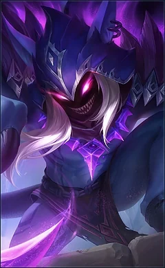

[Тир-лист](https://boostmlbb.ru/heroes/)[Новости и гайды](https://boostmlbb.ru/news/)

# Ксавьер

B

МагСредняя линия

Победы

53,5%

Выбор

1,8%

Баны

1,3%

[Обзор](https://boostmlbb.ru/#overview)[Сборка](https://boostmlbb.ru/#build)[Навыки](https://boostmlbb.ru/#skills)[Контрпики](https://boostmlbb.ru/#draft)[История](https://boostmlbb.ru/#lore)

## Обзор

### Характеристики

-   Живучесть**20**
-   Атака**100**
-   Эффекты**80**
-   Сложность**50**

-   Урон
-   Разрушительный урон

### Победы по рангам, 30 дней

1.  **48,6%**Эпик
2.  **49,3%**Легенда
3.  **50,5%**Мифик
4.  **51,7%**Честь
5.  **52,7%**Слава

Пунктир: 50% побед

### Другие маги этой линии

[Кимми](https://boostmlbb.ru/heroes/kimmy.html)[Эйдора](https://boostmlbb.ru/heroes/eudora.html)[Чжусинь](https://boostmlbb.ru/heroes/zhuxin.html)[Валир](https://boostmlbb.ru/heroes/valir.html)[Цзэтянь](https://boostmlbb.ru/heroes/zetian.html)[Лилия](https://boostmlbb.ru/heroes/lylia.html)[Люнокс](https://boostmlbb.ru/heroes/lunox.html)[Валентина](https://boostmlbb.ru/heroes/valentina.html)

### Места в рейтингах

-   [Лучшие маги MLBB**10 из 32**](https://boostmlbb.ru/heroes/best-mage.html)
-   [Лучшие мидеры MLBB**8 из 29**](https://boostmlbb.ru/heroes/best-mid.html)

## Сборка

Сборка 1Сборка 2Сборка 3

Победы

58,9%

Выбор

11,2%

#### Основные предметы

-   

    Зачарованный талисман

-   

    Пылающий жезл

-   

    Жезл молний

#### Заклинание

Вспышка

#### Эмблема и таланты

Эмблема мага

-   

    Вдохновение

-   

    Охотник за скидками

-   

    Нечестивая ярость

Победы

55,6%

Выбор

6,5%

#### Основные предметы

-   

    Зачарованный талисман

-   

    Пронзающий небеса

-   

    Жезл молний

#### Заклинание

Вспышка

#### Эмблема и таланты

Эмблема мага

-   

    Вдохновение

-   

    Охотник за скидками

-   

    Нечестивая ярость

Победы

59,1%

Выбор

4,8%

#### Основные предметы

-   

    Зачарованный талисман

-   

    Пылающий жезл

-   

    Жезл молний

#### Заклинание

Вспышка

#### Эмблема и таланты

Эмблема мага

-   

    Разрыв

-   

    Охотник за скидками

-   

    Нечестивая ярость

## Навыки

Прокачка**Проблески зари**_›_**Бесконечное расширение**_›_**Мистическое поле**

Пассивный**Превосходство**1-й навык**Бесконечное расширение**2-й навык**Мистическое поле**Ультимейт**Проблески зари**

Пассивный

### Превосходство

Когда навыки Ксавьера попадают по вражеским героям, он получает 60% скорости передвижения на 1.2 сек. (спадает со временем) и 1 заряд энергии. При накоплении 3 зарядов его следующий навык активирует состояние "Превосходства".

**Превосходство:** в этом состоянии перезарядка 1-го и 2-го навыков Ксавьера сокращается на 4 сек., а его ультимейта — на 36 сек. "Превосходство" длится 5 сек. и может продлеваться на 1 сек. каждый раз, когда его навыки попадают по врагам.

1-й навык

### Бесконечное расширение

Перезарядка **6.5 Mana Cost: 45 с**

Ксавьер стреляет "Мистической пулей", которая наносит 480 (+100% общей магической силы) единиц магического урона противникам, через которых проходит.

Дальность полета пули увеличивается каждый раз, когда она поражает врага или "Мистический барьер" (до 5 раз).

2-й навык

### Мистическое поле

Перезарядка **13 Mana Cost: 80 с**

Ксавьер призывает "Мистический барьер", который существует 5 сек. Враги, соприкоснувшиеся с барьером, будут замедлены на 50%, а союзники получат 50% дополнительной скорости передвижения (спадает за 1.2 сек.).

При попадании другими навыками Ксавьера барьер расширяется в "Мистическое поле" на 3 сек., нанося 440 (+130% общей магической силы) единиц магического урона врагам внутри и обездвиживая их на 0.8 сек.

Ультимейт

### Проблески зари

Перезарядка **56 Mana Cost: 120 с**

Ксавьер высвобождает луч "Мистической магии" в выбранном направлении, нанося 600 (+180% общей магической силы) единиц магического урона всем врагам на пути.

После применения он также сразу входит в состояние "Превосходства" и сбрасывает продолжительность состояния.

## Контрпики

### Контрпики

Побеждают этого героя

[Пополь и Купа](https://boostmlbb.ru/heroes/popol-and-kupa.html)[Белерик](https://boostmlbb.ru/heroes/belerick.html)[Атлас](https://boostmlbb.ru/heroes/atlas.html)[Глу](https://boostmlbb.ru/heroes/gloo.html)[Фарамис](https://boostmlbb.ru/heroes/faramis.html)

### Слабые цели

Этот герой побеждает их

[Зилонг](https://boostmlbb.ru/heroes/zilong.html)[Эймон](https://boostmlbb.ru/heroes/aamon.html)[Хелкарт](https://boostmlbb.ru/heroes/helcurt.html)[Алдос](https://boostmlbb.ru/heroes/aldous.html)[Наталья](https://boostmlbb.ru/heroes/natalia.html)

## История

> Бывший член Рыцарей света, решивший проложить собственный путь.

[Читать полную историю ↗](https://play.mobilelegends.com/lore/hero/Xavier)Официальный сайт Mobile Legends [Характеристики на сайте игры ↗](https://www.mobilelegends.com/hero/detail?heroid=115)

**Поднимем ранг на герое «Ксавьер»**Цена считается в калькуляторе

[Рассчитать цену](https://boostmlbb.ru/order.html?type=hero)

## Частые вопросы

Кто контрпик для героя «Ксавьер» в MLBB?

За последние 30 дней чаще всего героя обыгрывают Пополь и Купа, Белерик, Атлас, Глу и Фарамис.

Какой процент побед у героя «Ксавьер» сейчас?

53,52% в Мифической славе за последние 7 дней и 51,78% на всех рангах за 30 дней, данные на 24 ноября 2026 года.

Какая роль и линия у героя «Ксавьер»?

Маг, играет на средней линии.

Силён ли герой «Ксавьер» в текущей мете?

Тир B, 37-е место из 133 героев и 10-е среди магов. Тир учитывает, как часто героя берут и банят и как он выигрывает в Мифической славе за 7 дней: бан в 1,3% матчей, 53,5% побед. В профессиональных матчах за месяц героя драфтуют в 1,0% катков.

Какая сборка на героя «Ксавьер» лучшая?

Самая популярная сборка в рейтинге: ключевые предметы «Зачарованный талисман», «Пылающий жезл» и «Жезл молний», эмблема мага с талантами «Вдохновение», «Охотник за скидками» и «Нечестивая ярость» и заклинание «Вспышка». С ней выигрывают 58,91% матчей.
