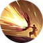

[Главная](https://boostmlbb.ru/) / [Герои](https://boostmlbb.ru/heroes/)

Тир B

# Инь

Боец и убийца · Линия опыта или лес

**№ 76 из 133 по доле побед**Все ранги · 30 дней по 23 ноября 2026 года

Победы

49,62%

Выбор

0,52%

Баны

1,70%

Разрушительный урон · Контроль · Сложность 40/100

[Сборка](https://boostmlbb.ru/#build)[Контрпики и союзники](https://boostmlbb.ru/#draft)[Навыки](https://boostmlbb.ru/#skills)[Победы по рангам](https://boostmlbb.ru/#ranks)[История](https://boostmlbb.ru/#lore)

## Сборка

Самый частый выбор в рейтинге · Линия опыта

Ключевые предметы

Клинок семи морейЗлобный рыкТрезубец

Эмблема и таланты

Эмблема убийцыТрепетМастер-убийцаУдарная волна

Боевое заклинание

Окаменение

Побед с этой сборкой **53,66%**Выбирают в **1,67%** матчей

Другие сборки (2)

Ключевые предметы

Топор войныТрезубецБесконечная битва

Эмблема и таланты

Эмблема бойцаТрепетМастер оружийНечестивая ярость

Боевое заклинание

Окаменение

Побед с этой сборкой **57,66%**Выбирают в **2,76%** матчей

Ключевые предметы

Удар охотникаТрезубецТопор войны

Эмблема и таланты

Эмблема убийцыТрепетМастер оружийНечестивая ярость

Боевое заклинание

Окаменение

Побед с этой сборкой **53,54%**Выбирают в **2,71%** матчей

## Контрпики и союзники

### Кто контрит

[Дигги](https://boostmlbb.ru/heroes/diggie.html)[Минситтар](https://boostmlbb.ru/heroes/minsitthar.html)[Иксия](https://boostmlbb.ru/heroes/ixia.html)[Флорин](https://boostmlbb.ru/heroes/floryn.html)[Эстес](https://boostmlbb.ru/heroes/estes.html)

### Против кого силён

[Обсидия](https://boostmlbb.ru/heroes/obsidia.html)[Су Ё](https://boostmlbb.ru/heroes/suyou.html)[Хирара](https://boostmlbb.ru/heroes/hirara.html)[Хильда](https://boostmlbb.ru/heroes/hilda.html)[Ланселот](https://boostmlbb.ru/heroes/lancelot.html)[Иритель](https://boostmlbb.ru/heroes/irithel.html)[Грок](https://boostmlbb.ru/heroes/grock.html)[Уранус](https://boostmlbb.ru/heroes/uranus.html)[Хилос](https://boostmlbb.ru/heroes/hylos.html)[Роджер](https://boostmlbb.ru/heroes/roger.html)

### Союзники

Прибавка к доле побед в одной команде

[Сан+1,79 п. п.](https://boostmlbb.ru/heroes/sun.html)[Хильда+1,68 п. п.](https://boostmlbb.ru/heroes/hilda.html)[Глу+1,62 п. п.](https://boostmlbb.ru/heroes/gloo.html)[Халид+1,39 п. п.](https://boostmlbb.ru/heroes/khaleed.html)

## Навыки

Приоритет прокачки · Мой ход → Заряженный удар → Мгновенный взрыв

Пассивный**Я разберусь**

Если в пределах 4 единиц от Иня нет союзных героев, его урон увеличивается до 120%, и он получает 8% вампиризма от навыков.

1-й навык**Заряженный удар**

**Перезарядка 10 с**

Инь получает 60% дополнительной скорости передвижения (спадает в течение 3 сек.).
В это время его следующая базовая атака будет усилена и нанесет 25 (+100% общей физической атаки) единиц физического урона. Если усиленная базовая атака попадет по врагу, Инь совершит заряженный удар вперед, нанося 360 (+200% дополнительной физической атаки) единиц физического урона врагам на пути.
Успешное применение заряженного удара сократит перезарядку навыка на 35%.

2-й навык**Мгновенный взрыв**

**Перезарядка 12 с**

Инь устремляется вперед, оставляя золотое кольцо позади, в то же время нанося 75 (+35% дополнительной физической атаки) единиц физического урона врагам на своем пути. Он получит дополнительно 30% к снижению урона на 4 сек. при попадании по вражескому герою.
Через 1 сек. золотое кольцо догонит Иня, нанесет 150 (+70% дополнительной физической атаки) единиц физического урона врагам, через которых пройдет, и оглушит их на 1 сек.

Ультимейт**Мой ход**

**Перезарядка 52 с**

После небольшой задержки Инь захватывает в цель вражеского героя (невозможно взять в цель питомцев и клонов) и утягивает его во владения на период до 8 сек., а сам становится Лие. Во владениях на них не могут влиять навыки других героев.
Лие имеет усиленные навыки и получает 50 доп. и на 8 сек.
Владения исчезнут раньше, если кто-то из двоих погибнет. Если Лие успешно убьет врага, то восстановит 20% от своих макс. ОЗ, покинет владения, сбросив перезарядку навыков "Безбашенный удар" и "Мгновенный взрыв", и продолжит драться в форме Лие в течение 8 сек.
Если Инь не сможет утянуть цель во владения, навык войдет в перезарядку на 3 сек.

## Победы по рангам

-   Эпик**49,97%**
-   Легенда**49,56%**
-   Мифический**49,88%**
-   Мифическая честь**49,05%**
-   Мифическая слава**49,85%**

## История

Молодой мастер боевых искусств отправляется в путешествие, чтобы победить Злобного бога, живущего внутри него.

[Читать историю](https://play.mobilelegends.com/lore/hero/Yin)[Карточка героя](https://www.mobilelegends.com/hero/detail?heroid=113)[MLBB Wiki](https://mobile-legends.fandom.com/wiki/Yin)

[Стоимость буста на герое](https://boostmlbb.ru/order.html?type=hero)

## Частые вопросы

Кто контрпик для героя «Инь» в MLBB?

За последние 30 дней чаще всего героя обыгрывают Дигги, Минситтар, Иксия, Флорин и Эстес.

Какой процент побед у героя «Инь» сейчас?

49,62% за последние 30 дней на всех рангах и 49,85% в Мифической славе, данные на 23 ноября 2026 года.

Какая роль и линия у героя «Инь»?

Боец и убийца, играет на линии опыта или в лесу.

Силён ли герой «Инь» в текущей мете?

Тир B: 76-е место из 133 героев по проценту побед за 30 дней и 24-е среди бойцов.

Какая сборка на героя «Инь» лучшая?

Самая популярная сборка в рейтинге: ключевые предметы «Клинок семи морей», «Злобный рык» и «Трезубец», эмблема убийцы с талантами «Трепет», «Мастер-убийца» и «Ударная волна» и заклинание «Окаменение». С ней выигрывают 53,66% матчей.
