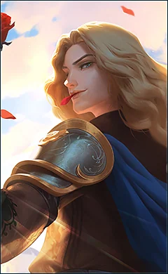

[Тир-лист](https://boostmlbb.ru/heroes/)[Новости и гайды](https://boostmlbb.ru/news/)

# Инь

C

БоецУбийцаЛиния опытаЛес

Победы

49,9%

Выбор

0,3%

Баны

0,5%

[Обзор](https://boostmlbb.ru/#overview)[Сборка](https://boostmlbb.ru/#build)[Навыки](https://boostmlbb.ru/#skills)[Контрпики](https://boostmlbb.ru/#draft)[История](https://boostmlbb.ru/#lore)

## Обзор

### Характеристики

-   Живучесть**50**
-   Атака**60**
-   Эффекты**80**
-   Сложность**40**

-   Разрушительный урон
-   Контроль

### Победы по рангам, 30 дней

1.  **50,0%**Эпик
2.  **49,6%**Легенда
3.  **49,9%**Мифик
4.  **49,1%**Честь
5.  **49,9%**Слава

Пунктир: 50% побед

### Другие бойцы этой линии

[Фрейя](https://boostmlbb.ru/heroes/freya.html)[Аулус](https://boostmlbb.ru/heroes/aulus.html)[Пакито](https://boostmlbb.ru/heroes/paquito.html)[Сан](https://boostmlbb.ru/heroes/sun.html)[Лукас](https://boostmlbb.ru/heroes/lukas.html)[Чичи](https://boostmlbb.ru/heroes/cici.html)[Су Ё](https://boostmlbb.ru/heroes/suyou.html)[Сора](https://boostmlbb.ru/heroes/sora.html)

## Сборка

Сборка 1Сборка 2Сборка 3

Победы

57,7%

Выбор

2,8%

#### Основные предметы

-   

    Топор войны

-   

    Трезубец

-   

    Бесконечная битва

#### Заклинание

Окаменение

#### Эмблема и таланты

Эмблема бойца

-   

    Трепет

-   

    Мастер оружий

-   

    Нечестивая ярость

Победы

53,5%

Выбор

2,7%

#### Основные предметы

-   

    Удар охотника

-   

    Трезубец

-   

    Топор войны

#### Заклинание

Окаменение

#### Эмблема и таланты

Эмблема убийцы

-   

    Трепет

-   

    Мастер оружий

-   

    Нечестивая ярость

Победы

53,7%

Выбор

1,7%

#### Основные предметы

-   

    Клинок семи морей

-   

    Злобный рык

-   

    Трезубец

#### Заклинание

Окаменение

#### Эмблема и таланты

Эмблема убийцы

-   

    Трепет

-   

    Мастер-убийца

-   

    Ударная волна

## Навыки

Прокачка**Мой ход**_›_**Заряженный удар**_›_**Мгновенный взрыв**

Пассивный**Я разберусь**1-й навык**Заряженный удар**2-й навык**Мгновенный взрыв**Ультимейт**Мой ход**

Пассивный

### Я разберусь

Если в пределах 4 единиц от Иня нет союзных героев, его урон увеличивается до 120%, и он получает 8% вампиризма от навыков.

1-й навык

### Заряженный удар

Перезарядка **10 с**

Инь получает 60% дополнительной скорости передвижения (спадает в течение 3 сек.).

В это время его следующая базовая атака будет усилена и нанесет 25 (+100% общей физической атаки) единиц физического урона. Если усиленная базовая атака попадет по врагу, Инь совершит заряженный удар вперед, нанося 360 (+200% дополнительной физической атаки) единиц физического урона врагам на пути.

Успешное применение заряженного удара сократит перезарядку навыка на 35%.

2-й навык

### Мгновенный взрыв

Перезарядка **12 с**

Инь устремляется вперед, оставляя золотое кольцо позади, в то же время нанося 75 (+35% дополнительной физической атаки) единиц физического урона врагам на своем пути. Он получит дополнительно 30% к снижению урона на 4 сек. при попадании по вражескому герою.

Через 1 сек. золотое кольцо догонит Иня, нанесет 150 (+70% дополнительной физической атаки) единиц физического урона врагам, через которых пройдет, и оглушит их на 1 сек.

Ультимейт

### Мой ход

Перезарядка **52 с**

После небольшой задержки Инь захватывает в цель вражеского героя (невозможно взять в цель питомцев и клонов) и утягивает его во владения на период до 8 сек., а сам становится Лие. Во владениях на них не могут влиять навыки других героев.

Лие имеет усиленные навыки и получает 50 доп. и на 8 сек.

Владения исчезнут раньше, если кто-то из двоих погибнет. Если Лие успешно убьет врага, то восстановит 20% от своих макс. ОЗ, покинет владения, сбросив перезарядку навыков "Безбашенный удар" и "Мгновенный взрыв", и продолжит драться в форме Лие в течение 8 сек.

Если Инь не сможет утянуть цель во владения, навык войдет в перезарядку на 3 сек.

## Контрпики

### Контрпики

Побеждают этого героя

[Дигги](https://boostmlbb.ru/heroes/diggie.html)[Минситтар](https://boostmlbb.ru/heroes/minsitthar.html)[Иксия](https://boostmlbb.ru/heroes/ixia.html)[Флорин](https://boostmlbb.ru/heroes/floryn.html)[Эстес](https://boostmlbb.ru/heroes/estes.html)

### Слабые цели

Этот герой побеждает их

[Обсидия](https://boostmlbb.ru/heroes/obsidia.html)[Су Ё](https://boostmlbb.ru/heroes/suyou.html)[Хирара](https://boostmlbb.ru/heroes/hirara.html)[Хильда](https://boostmlbb.ru/heroes/hilda.html)[Ланселот](https://boostmlbb.ru/heroes/lancelot.html)[Иритель](https://boostmlbb.ru/heroes/irithel.html)[Грок](https://boostmlbb.ru/heroes/grock.html)[Уранус](https://boostmlbb.ru/heroes/uranus.html)[Хилос](https://boostmlbb.ru/heroes/hylos.html)[Роджер](https://boostmlbb.ru/heroes/roger.html)

## История

> Молодой мастер боевых искусств отправляется в путешествие, чтобы победить Злобного бога, живущего внутри него.

[Читать полную историю ↗](https://play.mobilelegends.com/lore/hero/Yin)Официальный сайт Mobile Legends [Характеристики на сайте игры ↗](https://www.mobilelegends.com/hero/detail?heroid=113)

**Поднимем ранг на герое «Инь»**Цена считается в калькуляторе

[Рассчитать цену](https://boostmlbb.ru/order.html?type=hero)

## Частые вопросы

Кто контрпик для героя «Инь» в MLBB?

За последние 30 дней чаще всего героя обыгрывают Дигги, Минситтар, Иксия, Флорин и Эстес.

Какой процент побед у героя «Инь» сейчас?

49,92% в Мифической славе за последние 7 дней и 49,64% на всех рангах за 30 дней, данные на 24 ноября 2026 года.

Какая роль и линия у героя «Инь»?

Боец и убийца, играет на линии опыта или в лесу.

Силён ли герой «Инь» в текущей мете?

Тир C, 106-е место из 133 героев и 33-е среди бойцов. Тир учитывает, как часто героя берут и банят и как он выигрывает в Мифической славе за 7 дней: бан в 0,5% матчей, 49,9% побед. В профессиональных матчах за месяц героя драфтуют в 0,0% катков.

Какая сборка на героя «Инь» лучшая?

Самая популярная сборка в рейтинге: ключевые предметы «Топор войны», «Трезубец» и «Бесконечная битва», эмблема бойца с талантами «Трепет», «Мастер оружий» и «Нечестивая ярость» и заклинание «Окаменение». С ней выигрывают 57,66% матчей.
