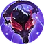

[Тир-лист](https://boostmlbb.ru/heroes/)[Предметы](https://boostmlbb.ru/items/)[Скины](https://boostmlbb.ru/skins/)[Новости и гайды](https://boostmlbb.ru/news/)

[Тир-лист](https://boostmlbb.ru/heroes/)

# Чонг

B

БоецЛиния опыта

Победы

48,7%

Выбор

0,8%

Баны

0,3%

[Обзор](https://boostmlbb.ru/#overview)[Сборка](https://boostmlbb.ru/#build)[Как играть](https://boostmlbb.ru/#howto)[Навыки](https://boostmlbb.ru/#skills)[Контрпики](https://boostmlbb.ru/#draft)[Скины](https://boostmlbb.ru/#skins)[История](https://boostmlbb.ru/#lore)

## Обзор

### Характеристики

-   Живучесть**70**
-   Атака**40**
-   Эффекты**70**
-   Сложность**70**

-   Регенерация
-   Урон

### Победы по рангам, 30 дней

1.  **48,9%**Эпик
2.  **48,6%**Легенда
3.  **48,9%**Мифик
4.  **49,2%**Честь
5.  **48,8%**Слава

Пунктир: 50% побед

### Другие бойцы этой линии

[Фрейя](https://boostmlbb.ru/heroes/freya.html)[Аулус](https://boostmlbb.ru/heroes/aulus.html)[Пакито](https://boostmlbb.ru/heroes/paquito.html)[Сан](https://boostmlbb.ru/heroes/sun.html)[Лукас](https://boostmlbb.ru/heroes/lukas.html)[Чичи](https://boostmlbb.ru/heroes/cici.html)[Сора](https://boostmlbb.ru/heroes/sora.html)[Баданг](https://boostmlbb.ru/heroes/badang.html)

### Места в рейтингах

-   [Лучшие бойцы MLBB**12 из 44**](https://boostmlbb.ru/heroes/best-fighter.html)

## Сборка

Сборка 1Сборка 2Сборка 3

Победы

55,1%

Выбор

6,4%

#### Основные предметы

-   [

    

    Топор войны

    ](https://boostmlbb.ru/items/war-axe.html)
-   [

    

    Удар охотника

    ](https://boostmlbb.ru/items/hunter-strike.html)
-   [

    

    Крылья королевы

    ](https://boostmlbb.ru/items/queens-wings.html)

#### Заклинание

Окаменение

#### Эмблема и таланты

Эмблема бойца

-   

    Разрыв

-   

    Кровавое пиршество

-   

    Боевой клич

Победы

61,0%

Выбор

4,1%

#### Основные предметы

-   [

    

    Удар охотника

    ](https://boostmlbb.ru/items/hunter-strike.html)
-   [

    

    Топор войны

    ](https://boostmlbb.ru/items/war-axe.html)
-   [

    

    Крылья королевы

    ](https://boostmlbb.ru/items/queens-wings.html)

#### Заклинание

Окаменение

#### Эмблема и таланты

Эмблема бойца

-   

    Трепет

-   

    Кровавое пиршество

-   

    Боевой клич

Победы

59,4%

Выбор

2,4%

#### Основные предметы

-   [

    

    Удар охотника

    ](https://boostmlbb.ru/items/hunter-strike.html)
-   [

    

    Топор войны

    ](https://boostmlbb.ru/items/war-axe.html)
-   [

    

    Крылья королевы

    ](https://boostmlbb.ru/items/queens-wings.html)

#### Заклинание

Окаменение

#### Эмблема и таланты

Эмблема бойца

-   

    Разрыв

-   

    Кровавое пиршество

-   

    Боевой клич

## Как играть за Чонга

### Комбо Чонга

#### В драке

1.  Ульт
2.  Ульт
3.  2
4.  3
5.  1
6.  Атака

Начните ультом, влетите в строй и расталкивайте врагов. Когда дальние цели открылись, нажмите ульт ещё раз, обернитесь драконом и бейте: второй, третий, первый навыки и усиленная атака от второго.

#### На линии

1.  2
2.  3
3.  1
4.  Атака

На линии замедлите вторым, прыгните третьим, а на рывке достаньте врага краем первого. Добавьте усиленную атаку и взрыв остатков Ша.

### Когда сильнее всего

Сила ровная всю игру, от 48,0% до 50,0%. Выбирайте драки по готовым предметам, а не по минутам.

1.  **48,0**10–12
2.  **49,3**12–14
3.  **50,0**14–16
4.  **49,6**16–18
5.  **49,0**18–20
6.  **48,8**20+

Проценты побед по длине матча в минутах, все ранги. Пунктир: 50%

### Приоритет прокачки

1.  Форма Черного дракона
2.  Хвост дракона
3.  Яростный прыжок
4.  Захват души

## Навыки

Пассивный**Проклятое касание**1-й навык**Хвост дракона**2-й навык**Захват души**3-й навык**Яростный прыжок**Ультимейт**Форма Черного дракона**

Пассивный

### Проклятое касание

Чонг применяет частицу Ша к вражеским героям каждый раз, когда наносит им урон.

Частица Ша извергается, когда на цели накапливается 5 зарядов. Потом она начинает расходовать 1 заряд кажд. 0.4 сек., чтобы нанести цели физический урон, равный 20 (+20% дополнительной физической атаки) (+2.5% от ). Каждый израсходованный заряд восстанавливает 6% от Чонга. Чонг также получает 30% скорости передвижения на 3 сек.

1-й навык

### Хвост дракона

Перезарядка **6 с**

Чонг наделяет свой плащ силой и превращает его в оружие, которое после небольшой задержки атакует ближайших врагов. Внутренняя область плаща наносит 220 (+100% дополнительной физической атаки) единиц физического урона, а заостренный край наносит 275% урона и применяет 2 заряда частицы Ша.

2-й навык

### Захват души

Перезарядка **12 с**

Чонг высвобождает душу дракона, нанося 150 (+120% дополнительной физической атаки) единиц физического урона всем врагам впереди и замедляя их на 60% на 1 сек.

После попадания по врагу следующая базовая атака Чонга будет усилена и нанесет 108 (+100% общей физической атаки) единиц физического урона. При попадании по нескольким врагам усиленная базовая атака Чонга наложит несколько зарядов частицы Ша и нанесет до 200% урона.

3-й навык

### Яростный прыжок

Перезарядка **14 с**

Чонг прыгает в определенную область изо всех сил, нанося 180 (+90% дополнительной физической атаки) единиц физического урона. Он сможет сделать рывок в направлении движения еще один раз.

После короткой задержки враги в зоне действия будут подброшены в воздух на 0.6 сек. и получат 180 (+90% дополнительной физической атаки) единиц дополнительного физического урона.

Ультимейт

### Форма Черного дракона

Перезарядка **85 с**

После 0.6 сек. подготовки Чонг принимает форму Черного дракона. На время до 7 сек. он не может использовать другие навыки, но может свободно передвигаться и отбрасывать вражеских героев на своем пути, нанося 180 (+80% общей физической атаки) единиц физического урона. Он также получает 1000 (+200% дополнительной физической атаки) , становится невосприимчивым к эффектам контроля и игнорирует препятствия в этой форме.

После выхода из формы Черного дракона Чонг входит в форму драгоноида, увеличивая дальность всех своих навыков на 10 сек.

## Контрпики Чонга

### Кто контрит Чонга

[Глу](https://boostmlbb.ru/heroes/gloo.html)[Сильвана](https://boostmlbb.ru/heroes/silvanna.html)[Минситтар](https://boostmlbb.ru/heroes/minsitthar.html)[Пополь и Купа](https://boostmlbb.ru/heroes/popol-and-kupa.html)[Атлас](https://boostmlbb.ru/heroes/atlas.html)

## Скины Чонга

[Косми­ческий драконГрандиозный · 2023](https://boostmlbb.ru/skins/yu-zhong/cosmic-dragon.html)[Тень драконаДелюкс · 2023](https://boostmlbb.ru/skins/yu-zhong/dragon-s-shade.html)[Экзорцист ЧонгГрандиозный · 2022](https://boostmlbb.ru/skins/yu-zhong/exorcist-yu-zhong.html)[Кровавый змейИзысканный · 2021](https://boostmlbb.ru/skins/yu-zhong/blood-serpent.html)[БиоугрозаИсключительный · 2020](https://boostmlbb.ru/skins/yu-zhong/biohazard.html)[Изумрудный драконОбычный · 2020](https://boostmlbb.ru/skins/yu-zhong/emerald-dragon.html)

[Все 6 скинов Чонга: цены и как получить](https://boostmlbb.ru/skins/yu-zhong.html)

## История

> Чонг, реинкарнация Черного дракона, намерен завоевать и объединить Речную долину Кадиа и привести ее в эпоху процветания.

[Читать полную историю ↗](https://play.mobilelegends.com/lore/hero/Yu_Zhong)Официальный сайт Mobile Legends [Характеристики на сайте игры ↗](https://www.mobilelegends.com/hero/detail?heroid=95)

**Поднимем ранг на герое «Чонг»**Цена считается в калькуляторе

[Рассчитать цену](https://boostmlbb.ru/order.html?type=hero)

## Частые вопросы

Кто контрит Чонга в MLBB?

За последние 30 дней Чонга чаще всего обыгрывают Глу, Сильвана, Минситтар, Пополь и Купа и Атлас.

Как играть за Чонга?

В первую очередь качайте «Хвост дракона», ульт берите, как только доступен. Сила ровная всю игру, от 48,0% до 50,0%. Выбирайте драки по готовым предметам, а не по минутам. Комбо для драки: Начните ультом, влетите в строй и расталкивайте врагов. Когда дальние цели открылись, нажмите ульт ещё раз, обернитесь драконом и бейте: второй, третий, первый навыки и усиленная атака от второго.

Какой процент побед у Чонга сейчас?

48,69% в Мифической славе за последние 7 дней и 48,90% на всех рангах за 30 дней, данные на 26 ноября 2026 года.

Какая роль и линия у Чонга?

Боец, играет на линии опыта.

Стоит ли брать Чонга в текущей мете?

Тир B, 40-е место из 133 героев и 12-е среди бойцов. Тир учитывает, как часто героя берут и банят и как он выигрывает в Мифической славе за 7 дней: бан в 0,3% матчей, 48,7% побед. В профессиональных матчах за месяц героя драфтуют в 27,9% катков.

Какая сборка на Чонга лучшая?

Самая популярная сборка в рейтинге: ключевые предметы «Топор войны», «Удар охотника» и «Крылья королевы», эмблема бойца с талантами «Разрыв», «Кровавое пиршество» и «Боевой клич» и заклинание «Окаменение». С ней выигрывают 55,13% матчей.
