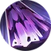

[Главная](https://boostmlbb.ru/) / [Герои](https://boostmlbb.ru/heroes/)

Тир C

# Чонг в Mobile Legends: сборка, контрпики и статистика

Боец, линия опыта. Выигрывает 48,93% матчей за последние 30 дней — 91-е место из 133 героев.

[Буст на этом герое](https://boostmlbb.ru/order.html?type=hero)[Все герои](https://boostmlbb.ru/heroes/)

Статистика герояТир C

**Чонг**Бан 0,75% · Выбор 0,66%

Контрпики

Победы за 30 дней**48,93%**

**48,93%**побед за 30 дней

**0,66%**выбирают в матчах

**0,75%**банят в матчах

**48,84%**побед в Мифической славе

## Сборка на героя «Чонг»

Самая популярная сборка для героя «Чонг» на роли линии опыта в рейтинговых матчах на всех рангах — по данным «Академии» в игре. Процент побед — в матчах именно с этой сборкой.

Ключевые предметы

Топор войныУдар охотникаКрылья королевы

Эмблема и таланты

Эмблема бойцаРазрывКровавое пиршествоБоевой клич

Боевое заклинание

Окаменение

Побед с этой сборкой **55,35%**Выбирают в **6,51%** матчей

### Другие популярные варианты

-   ОкаменениеЭмблема бойцаТрепет · Кровавое пиршество · Боевой клич**61,27%**
-   ОкаменениеЭмблема бойцаРазрыв · Кровавое пиршество · Боевой клич**59,59%**

## Навыки героя «Чонг»

Официальные описания навыков от MOONTON с перезарядкой и типом навыка.

Порядок прокачки: **Форма Черного дракона** → **Хвост дракона** → **Яростный прыжок** → **Захват души**

-   

    **Проклятое касание**Пассивный

    Чонг применяет частицу Ша к вражеским героям каждый раз, когда наносит им урон.
    Частица Ша извергается, когда на цели накапливается 5 зарядов. Потом она начинает расходовать 1 заряд кажд. 0.4 сек., чтобы нанести цели физический урон, равный 20 (+20% дополнительной физической атаки) (+2.5% от ). Каждый израсходованный заряд восстанавливает 6% от Чонга. Чонг также получает 30% скорости передвижения на 3 сек.

-   

    **Хвост дракона**1-й навыкПерезарядка 6 с

    Чонг наделяет свой плащ силой и превращает его в оружие, которое после небольшой задержки атакует ближайших врагов. Внутренняя область плаща наносит 220 (+100% дополнительной физической атаки) единиц физического урона, а заостренный край наносит 275% урона и применяет 2 заряда частицы Ша.

-   

    **Захват души**2-й навыкПерезарядка 12 с

    Чонг высвобождает душу дракона, нанося 150 (+120% дополнительной физической атаки) единиц физического урона всем врагам впереди и замедляя их на 60% на 1 сек.
    После попадания по врагу следующая базовая атака Чонга будет усилена и нанесет 108 (+100% общей физической атаки) единиц физического урона. При попадании по нескольким врагам усиленная базовая атака Чонга наложит несколько зарядов частицы Ша и нанесет до 200% урона.

-   

    **Яростный прыжок**3-й навыкПерезарядка 14 с

    Чонг прыгает в определенную область изо всех сил, нанося 180 (+90% дополнительной физической атаки) единиц физического урона. Он сможет сделать рывок в направлении движения еще один раз.
    После короткой задержки враги в зоне действия будут подброшены в воздух на 0.6 сек. и получат 180 (+90% дополнительной физической атаки) единиц дополнительного физического урона.

-   

    **Форма Черного дракона**УльтимейтПерезарядка 85 с

    После 0.6 сек. подготовки Чонг принимает форму Черного дракона. На время до 7 сек. он не может использовать другие навыки, но может свободно передвигаться и отбрасывать вражеских героев на своем пути, нанося 180 (+80% общей физической атаки) единиц физического урона. Он также получает 1000 (+200% дополнительной физической атаки) , становится невосприимчивым к эффектам контроля и игнорирует препятствия в этой форме.
    После выхода из формы Черного дракона Чонг входит в форму драгоноида, увеличивая дальность всех своих навыков на 10 сек.

## Роль и линия

Место считается по проценту побед за 30 дней среди героев той же роли или линии.

-   Роль**Боец**
-   Линия**Линия опыта**
-   Среди бойцов**30-е из 44**
-   На линии опыта**30-е из 42**
-   Специализация**Регенерация, Урон**
-   Сложность**Высокая (70/100)**

## Кто контрит этого героя

Против этих героев «Чонг» проигрывает чаще всего. Под иконкой — их собственный процент побед. 2 из 5 контрпиков — танки.

[Глу53,45%](https://boostmlbb.ru/heroes/gloo.html)[Минситтар52,08%](https://boostmlbb.ru/heroes/minsitthar.html)[Сильвана51,36%](https://boostmlbb.ru/heroes/silvanna.html)[Пополь и Купа52,09%](https://boostmlbb.ru/heroes/popol-and-kupa.html)[Атлас51,42%](https://boostmlbb.ru/heroes/atlas.html)

## С кем играть в команде

С этими героями в одной команде «Чонг» выигрывает чаще. Число — прибавка к проценту побед в процентных пунктах.

[Тамуз+2,57 п. п.](https://boostmlbb.ru/heroes/thamuz.html)[Бэйн+2,36 п. п.](https://boostmlbb.ru/heroes/bane.html)[Сан+2,08 п. п.](https://boostmlbb.ru/heroes/sun.html)[Джулиан+1,51 п. п.](https://boostmlbb.ru/heroes/julian.html)

## Процент побед по рангам

Лучший результат — на ранге «Мифическая честь» (49,22%), слабее всего — «Легенда» (48,64%). Данные за последние 30 дней.

-   Эпик**48,83%**
-   Легенда**48,64%**
-   Мифический**49,00%**
-   Мифическая честь**49,22%**
-   Мифическая слава**48,84%**

## Место в мете

«Чонг» — тир C в нашем тир-листе по проценту побед, 91-е место из 133 героев. В Мифической славе результат почти такой же: 48,84%. Полный [тир-лист ноября](https://boostmlbb.ru/news/mlbb-meta-tier-list/) и [разбор патча](https://boostmlbb.ru/news/mlbb-current-patch/).

## Другие герои линии опыта

Самые сильные по проценту побед за последние 30 дней.

[Маша60,40%](https://boostmlbb.ru/heroes/masha.html)[Аргус56,78%](https://boostmlbb.ru/heroes/argus.html)[Сан53,72%](https://boostmlbb.ru/heroes/sun.html)[Аулус53,46%](https://boostmlbb.ru/heroes/aulus.html)[Глу53,45%](https://boostmlbb.ru/heroes/gloo.html)[Эдит52,67%](https://boostmlbb.ru/heroes/edith.html)

## История героя

«Чонг, реинкарнация Черного дракона, намерен завоевать и объединить Речную долину Кадиа и привести ее в эпоху процветания.»

Полная история героя «Чонг» — на официальном сайте лора MOONTON. Карточка героя с навыками и советами разработчиков — на mobilelegends.com, реплики, облики и история изменений — в MLBB Wiki.

[Читать историю](https://play.mobilelegends.com/lore/hero/Yu_Zhong)[Карточка героя](https://www.mobilelegends.com/hero/detail?heroid=95)[MLBB Wiki](https://mobile-legends.fandom.com/wiki/Yu_Zhong)

## Буст на герое «Чонг»

Бустер играет только этим героем: вместе с рангом растёт и рейтинг героя.

[Рассчитать стоимость](https://boostmlbb.ru/order.html?type=hero)

Статистика — официальный рейтинг героев MOONTON (mobilelegends.com/rank) за последние 30 дней, обновление 23 ноября 2026 года, страница обновляется каждый день. Роли и линии — с официальной страницы героев. Сборки, навыки и союзники — данные «Академии» MOONTON через Rone Arena API (ridwaanhall / RoneAI).

## Частые вопросы

Кто контрпик для героя «Чонг» в MLBB?

За последние 30 дней чаще всего героя обыгрывают Глу, Минситтар, Сильвана, Пополь и Купа и Атлас.

Какой процент побед у героя «Чонг» сейчас?

48,93% за последние 30 дней на всех рангах и 48,84% в Мифической славе, данные на 23 ноября 2026 года.

Какая роль и линия у героя «Чонг»?

Боец, играет на линии опыта.

Силён ли герой «Чонг» в текущей мете?

Тир C: 91-е место из 133 героев по проценту побед за 30 дней и 30-е среди бойцов.

Какая сборка на героя «Чонг» лучшая?

Самая популярная сборка в рейтинге: ключевые предметы «Топор войны», «Удар охотника» и «Крылья королевы», эмблема бойца с талантами «Разрыв», «Кровавое пиршество» и «Боевой клич» и заклинание «Окаменение». С ней выигрывают 55,35% матчей.

Редакция MLBB Boost · Обновлено 23 ноября 2026
