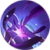

[Тир-лист](https://boostmlbb.ru/heroes/)[Новости и гайды](https://boostmlbb.ru/news/)

Тир C

# Чонг

Боец · Линия опыта

Победы

48,93%

Выбор

0,66%

Баны

0,75%

**№ 91 из 133 по доле побед**Все ранги · 30 дней по 23 ноября 2026 года

[Сборка](https://boostmlbb.ru/#build)[Контрпики](https://boostmlbb.ru/#draft)[Навыки](https://boostmlbb.ru/#skills)[Статистика](https://boostmlbb.ru/#ranks)[История](https://boostmlbb.ru/#lore)

Регенерация · Урон · Сложность 70/100

## Сборка

Самый частый выбор в рейтинге · Линия опыта

Ключевые предметы

Топор войныУдар охотникаКрылья королевы

Эмблема и таланты

Эмблема бойцаРазрывКровавое пиршествоБоевой клич

Боевое заклинание

Окаменение

Побед с этой сборкой **55,35%**Выбирают в **6,51%** матчей

Другие сборки (2)

Ключевые предметы

Удар охотникаТопор войныКрылья королевы

Эмблема и таланты

Эмблема бойцаТрепетКровавое пиршествоБоевой клич

Боевое заклинание

Окаменение

Побед с этой сборкой **61,27%**Выбирают в **3,91%** матчей

Ключевые предметы

Удар охотникаТопор войныКрылья королевы

Эмблема и таланты

Эмблема бойцаРазрывКровавое пиршествоБоевой клич

Боевое заклинание

Окаменение

Побед с этой сборкой **59,59%**Выбирают в **2,49%** матчей

## Контрпики и союзники

### Кто контрит

[Глу](https://boostmlbb.ru/heroes/gloo.html)[Минситтар](https://boostmlbb.ru/heroes/minsitthar.html)[Сильвана](https://boostmlbb.ru/heroes/silvanna.html)[Пополь и Купа](https://boostmlbb.ru/heroes/popol-and-kupa.html)[Атлас](https://boostmlbb.ru/heroes/atlas.html)

### Союзники

Изменение винрейта в паре

[Тамуз+2,57 п. п.](https://boostmlbb.ru/heroes/thamuz.html)[Бэйн+2,36 п. п.](https://boostmlbb.ru/heroes/bane.html)[Сан+2,08 п. п.](https://boostmlbb.ru/heroes/sun.html)[Джулиан+1,51 п. п.](https://boostmlbb.ru/heroes/julian.html)

## Навыки

Приоритет прокачки · Форма Черного дракона → Хвост дракона → Яростный прыжок → Захват души

Пассивный**Проклятое касание**

Чонг применяет частицу Ша к вражеским героям каждый раз, когда наносит им урон.
Частица Ша извергается, когда на цели накапливается 5 зарядов. Потом она начинает расходовать 1 заряд кажд. 0.4 сек., чтобы нанести цели физический урон, равный 20 (+20% дополнительной физической атаки) (+2.5% от ). Каждый израсходованный заряд восстанавливает 6% от Чонга. Чонг также получает 30% скорости передвижения на 3 сек.

1-й навык**Хвост дракона**

**Перезарядка 6 с**

Чонг наделяет свой плащ силой и превращает его в оружие, которое после небольшой задержки атакует ближайших врагов. Внутренняя область плаща наносит 220 (+100% дополнительной физической атаки) единиц физического урона, а заостренный край наносит 275% урона и применяет 2 заряда частицы Ша.

2-й навык**Захват души**

**Перезарядка 12 с**

Чонг высвобождает душу дракона, нанося 150 (+120% дополнительной физической атаки) единиц физического урона всем врагам впереди и замедляя их на 60% на 1 сек.
После попадания по врагу следующая базовая атака Чонга будет усилена и нанесет 108 (+100% общей физической атаки) единиц физического урона. При попадании по нескольким врагам усиленная базовая атака Чонга наложит несколько зарядов частицы Ша и нанесет до 200% урона.

3-й навык**Яростный прыжок**

**Перезарядка 14 с**

Чонг прыгает в определенную область изо всех сил, нанося 180 (+90% дополнительной физической атаки) единиц физического урона. Он сможет сделать рывок в направлении движения еще один раз.
После короткой задержки враги в зоне действия будут подброшены в воздух на 0.6 сек. и получат 180 (+90% дополнительной физической атаки) единиц дополнительного физического урона.

Ультимейт**Форма Черного дракона**

**Перезарядка 85 с**

После 0.6 сек. подготовки Чонг принимает форму Черного дракона. На время до 7 сек. он не может использовать другие навыки, но может свободно передвигаться и отбрасывать вражеских героев на своем пути, нанося 180 (+80% общей физической атаки) единиц физического урона. Он также получает 1000 (+200% дополнительной физической атаки) , становится невосприимчивым к эффектам контроля и игнорирует препятствия в этой форме.
После выхода из формы Черного дракона Чонг входит в форму драгоноида, увеличивая дальность всех своих навыков на 10 сек.

## Победы по рангам

-   Эпик**48,83%**
-   Легенда**48,64%**
-   Мифический**49,00%**
-   Мифическая честь**49,22%**
-   Мифическая слава**48,84%**

## История

Чонг, реинкарнация Черного дракона, намерен завоевать и объединить Речную долину Кадиа и привести ее в эпоху процветания.

[Читать полную историю ↗](https://play.mobilelegends.com/lore/hero/Yu_Zhong)Официальный сайт Mobile Legends

[Характеристики на сайте игры](https://www.mobilelegends.com/hero/detail?heroid=95)

[Стоимость буста на герое](https://boostmlbb.ru/order.html?type=hero)

## Частые вопросы

Кто контрпик для героя «Чонг» в MLBB?

За последние 30 дней чаще всего героя обыгрывают Глу, Минситтар, Сильвана, Пополь и Купа и Атлас.

Какой процент побед у героя «Чонг» сейчас?

48,93% за последние 30 дней на всех рангах и 48,84% в Мифической славе, данные на 23 ноября 2026 года.

Какая роль и линия у героя «Чонг»?

Боец, играет на линии опыта.

Силён ли герой «Чонг» в текущей мете?

Тир C: 91-е место из 133 героев по проценту побед за 30 дней и 30-е среди бойцов.

Какая сборка на героя «Чонг» лучшая?

Самая популярная сборка в рейтинге: ключевые предметы «Топор войны», «Удар охотника» и «Крылья королевы», эмблема бойца с талантами «Разрыв», «Кровавое пиршество» и «Боевой клич» и заклинание «Окаменение». С ней выигрывают 55,35% матчей.
