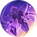
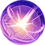
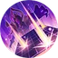

[Главная](https://boostmlbb.ru/) / [Герои](https://boostmlbb.ru/heroes/)

Тир A

# Ив

Маг · Средняя линия

**№ 24 из 133 по доле побед**Все ранги · 30 дней по 23 ноября 2026 года

Победы

52,26%

Выбор

0,06%

Баны

0,04%

Поук · Разрушительный урон · Сложность 50/100

[Сборка](https://boostmlbb.ru/#build)[Контрпики и союзники](https://boostmlbb.ru/#draft)[Навыки](https://boostmlbb.ru/#skills)[Победы по рангам](https://boostmlbb.ru/#ranks)[История](https://boostmlbb.ru/#lore)

## Сборка

Самый частый выбор в рейтинге · Средняя линия

Ключевые предметы

Пылающий жезлЖезл снежной королевыЖезл молний

Эмблема и таланты

Обычная эмблемаВдохновениеБлагословение природыНечестивая ярость

Боевое заклинание

Вспышка

Побед с этой сборкой **58,04%**Выбирают в **6,38%** матчей

Другие сборки (2)

Ключевые предметы

Пылающий жезлФонарь желанийКираса грубой силы

Эмблема и таланты

Обычная эмблемаЛовкостьОхотник за скидкамиНечестивая ярость

Боевое заклинание

Вспышка

Побед с этой сборкой **55,71%**Выбирают в **2,09%** матчей

Ключевые предметы

Пылающий жезлПалочка генияКираса грубой силы

Эмблема и таланты

Обычная эмблемаЛовкостьОхотник за скидкамиНечестивая ярость

Боевое заклинание

Вспышка

Побед с этой сборкой **52,14%**Выбирают в **1,66%** матчей

## Контрпики и союзники

### Кто контрит

[Лолита](https://boostmlbb.ru/heroes/lolita.html)[Хилос](https://boostmlbb.ru/heroes/hylos.html)[Бартс](https://boostmlbb.ru/heroes/barats.html)[Алиса](https://boostmlbb.ru/heroes/alice.html)[Икс.Борг](https://boostmlbb.ru/heroes/x-borg.html)

### Против кого силён

[Нолан](https://boostmlbb.ru/heroes/nolan.html)[Селена](https://boostmlbb.ru/heroes/selena.html)[Грейнджер](https://boostmlbb.ru/heroes/granger.html)[Госсен](https://boostmlbb.ru/heroes/gusion.html)[Сабер](https://boostmlbb.ru/heroes/saber.html)[Фрейя](https://boostmlbb.ru/heroes/freya.html)[Гвиневра](https://boostmlbb.ru/heroes/guinevere.html)[Хаябуса](https://boostmlbb.ru/heroes/hayabusa.html)[Калеа](https://boostmlbb.ru/heroes/kalea.html)[Фанни](https://boostmlbb.ru/heroes/fanny.html)

### Союзники

Прибавка к доле побед в одной команде

[Чжусинь+9,26 п. п.](https://boostmlbb.ru/heroes/zhuxin.html)[Валентина+5,63 п. п.](https://boostmlbb.ru/heroes/valentina.html)[Калеа+2,92 п. п.](https://boostmlbb.ru/heroes/kalea.html)[Грейнджер+2,80 п. п.](https://boostmlbb.ru/heroes/granger.html)

## Навыки

Приоритет прокачки · Управление реальностью → Пустотный взрыв → Кристалл пустоты

Пассивный**Галактическая сила**

Когда Ив наносит урон вражеским героям навыками, она получает "Галактическую силу" (перезарядка: 0.5 сек.), до 3 зарядов. Каждый заряд дает Ив 120 (+10\*Hero Level) (+50% общей магической силы) ед. щита на 3 сек.

1-й навык**Пустотный взрыв**

**Перезарядка 3 Mana Cost: 40 с**

Ив взрывает галактическую энергию в указанном месте, нанося 290 (+150% общей магической силы) единиц магического урона врагам в области.
При попадании Ив получит 55% доп. скорости передвижения (уменьшается вдвое, если поражен враг, не являющийся героем), которая быстро снижается за 1 сек.

2-й навык**Кристалл пустоты**

**Перезарядка 14 Mana Cost: 80 с**

Ив призывает кристалл пустоты в указанном месте, нанося 220 (+40% общей магической силы) единиц магического урона ближайшим врагам.
Повторное использование: Ив приказывает кристаллу выпускать материализованную энергию в указанном направлении в течение 2.7 сек., нанося врагам 75 (+10% общей магической силы) единиц магического урона каждые 0.45 сек. и замедляя их на 20%. Враги, пораженные несколько раз, будут замедляться дополнительно на 4% за каждый удар после первого попадания (до 40%).

Ультимейт**Управление реальностью**

**Перезарядка 60 Mana Cost: 180 с**

Ив создает звездное поле, которое существует 15 сек. В этот период касайтесь или проводите по экрану, чтобы атаковать до 20 р.
Касание: наносит врагам в указанной области 340 (+150% общей магической силы) единиц магического урона.
Слайд: наносит врагам в указанной области 85 (+10% общей магической силы) единиц магического урона каждые 0.45 сек. на 2.7 сек. и замедляет их на 40%.
Враги, покидающие или входящие в звездное поле, будут обездвижены на 0.8 сек. (Только один раз против одной и той же цели.)
Ив невозможно переместить, пока активно звездное поле. Даже если Ив будет находиться под контролем (за исключением подавления), звездное поле все равно останется.

## Победы по рангам

-   Эпик**52,01%**
-   Легенда**51,39%**
-   Мифический**51,35%**
-   Мифическая честь**52,30%**
-   Мифическая слава**52,47%**

## История

Хранительница равновесия Вселенной.

[Читать историю](https://play.mobilelegends.com/lore/hero/Yve)[Карточка героя](https://www.mobilelegends.com/hero/detail?heroid=101)[MLBB Wiki](https://mobile-legends.fandom.com/wiki/Yve)

[Стоимость буста на герое](https://boostmlbb.ru/order.html?type=hero)

## Частые вопросы

Кто контрпик для героя «Ив» в MLBB?

За последние 30 дней чаще всего героя обыгрывают Лолита, Хилос, Бартс, Алиса и Икс.Борг.

Какой процент побед у героя «Ив» сейчас?

52,26% за последние 30 дней на всех рангах и 52,47% в Мифической славе, данные на 23 ноября 2026 года.

Какая роль и линия у героя «Ив»?

Маг, играет на средней линии.

Силён ли герой «Ив» в текущей мете?

Тир A: 24-е место из 133 героев по проценту побед за 30 дней и 4-е среди магов.

Какая сборка на героя «Ив» лучшая?

Самая популярная сборка в рейтинге: ключевые предметы «Пылающий жезл», «Жезл снежной королевы» и «Жезл молний», обычная эмблема с талантами «Вдохновение», «Благословение природы» и «Нечестивая ярость» и заклинание «Вспышка». С ней выигрывают 58,04% матчей.
