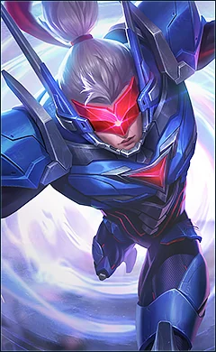

[Тир-лист](https://boostmlbb.ru/heroes/)

# Ив

C

МагСредняя линия

Победы

51,5%

Выбор

0,1%

Баны

0,0%

[Обзор](https://boostmlbb.ru/#overview)[Сборка](https://boostmlbb.ru/#build)[Как играть](https://boostmlbb.ru/#howto)[Навыки](https://boostmlbb.ru/#skills)[Контрпики](https://boostmlbb.ru/#draft)[Скины](https://boostmlbb.ru/#skins)[История](https://boostmlbb.ru/#lore)

## Обзор

### Характеристики

-   Живучесть**40**
-   Атака**80**
-   Эффекты**40**
-   Сложность**50**

-   Поук
-   Разрушительный урон

### Победы по рангам, 30 дней

1.  **52,3%**Эпик
2.  **51,5%**Легенда
3.  **51,3%**Мифик
4.  **52,2%**Честь
5.  **52,2%**Слава

Пунктир: 50% побед

### Другие маги этой линии

[Кимми](https://boostmlbb.ru/heroes/kimmy.html)[Эйдора](https://boostmlbb.ru/heroes/eudora.html)[Чжусинь](https://boostmlbb.ru/heroes/zhuxin.html)[Валир](https://boostmlbb.ru/heroes/valir.html)[Цзэтянь](https://boostmlbb.ru/heroes/zetian.html)[Ксавьер](https://boostmlbb.ru/heroes/xavier.html)[Лилия](https://boostmlbb.ru/heroes/lylia.html)[Люнокс](https://boostmlbb.ru/heroes/lunox.html)

### Места в рейтингах

-   [Лучшие маги MLBB**21 из 32**](https://boostmlbb.ru/heroes/best-mage.html)
-   [Лучшие мидеры MLBB**19 из 29**](https://boostmlbb.ru/heroes/best-mid.html)

## Сборка

Сборка 1Сборка 2Сборка 3

Победы

57,7%

Выбор

5,2%

#### Основные предметы

-   [

    

    Пылающий жезл

    ](https://boostmlbb.ru/items/glowing-wand.html)
-   [

    

    Жезл снежной королевы

    ](https://boostmlbb.ru/items/ice-queen-wand.html)
-   [

    

    Жезл молний

    ](https://boostmlbb.ru/items/lightning-truncheon.html)

#### Заклинание

Вспышка

#### Эмблема и таланты

Обычная эмблема

-   

    Вдохновение

-   

    Благословение природы

-   

    Нечестивая ярость

Победы

52,5%

Выбор

3,2%

#### Основные предметы

-   [

    

    Пылающий жезл

    ](https://boostmlbb.ru/items/glowing-wand.html)
-   [

    

    Палочка гения

    ](https://boostmlbb.ru/items/genius-wand.html)
-   [

    

    Кираса грубой силы

    ](https://boostmlbb.ru/items/brute-force-breastplate.html)

#### Заклинание

Вспышка

#### Эмблема и таланты

Обычная эмблема

-   

    Ловкость

-   

    Охотник за скидками

-   

    Нечестивая ярость

Победы

57,4%

Выбор

2,3%

#### Основные предметы

-   [

    

    Пылающий жезл

    ](https://boostmlbb.ru/items/glowing-wand.html)
-   [

    

    Жезл снежной королевы

    ](https://boostmlbb.ru/items/ice-queen-wand.html)
-   [

    

    Жезл молний

    ](https://boostmlbb.ru/items/lightning-truncheon.html)

#### Заклинание

Вспышка

#### Эмблема и таланты

Обычная эмблема

-   

    Вдохновение

-   

    Охотник за скидками

-   

    Нечестивая ярость

## Как играть за Ив

### Комбо Ив

#### В драке

1.  Ульт
2.  2
3.  1

В драке накройте ультом как можно больше врагов и бейте по ним. Когда они вышли из зоны, отмените ульт, замедлите вторым и добейте первым.

#### На линии

1.  2
2.  1

На линии сначала замедлите врага издалека вторым навыком, затем попадите центром первого.

### Когда сильнее всего

Сильнее в начале: на 10–12 минутах выигрывает 57,2%. Давите на линии, забирайте объекты и заканчивайте, пока преимущество не растаяло.

1.  **57,2**10–12
2.  **52,7**12–14
3.  **50,1**14–16
4.  **49,5**16–18
5.  **49,3**18–20
6.  **49,4**20+

Проценты побед по длине матча в минутах, все ранги. Пунктир: 50%

### Приоритет прокачки

1.  Управление реальностью
2.  Пустотный взрыв
3.  Кристалл пустоты

## Навыки

Пассивный**Галактическая сила**1-й навык**Пустотный взрыв**2-й навык**Кристалл пустоты**Ультимейт**Управление реальностью**

Пассивный

### Галактическая сила

Когда Ив наносит урон вражеским героям навыками, она получает "Галактическую силу" (перезарядка: 0.5 сек.), до 3 зарядов. Каждый заряд дает Ив 120 (+10 × ур. героя) (+50% общей магической силы) ед. щита на 3 сек.

1-й навык

### Пустотный взрыв

Перезарядка **3 Mana Cost: 40 с**

Ив взрывает галактическую энергию в указанном месте, нанося 290 (+150% общей магической силы) единиц магического урона врагам в области.

При попадании Ив получит 55% доп. скорости передвижения (уменьшается вдвое, если поражен враг, не являющийся героем), которая быстро снижается за 1 сек.

2-й навык

### Кристалл пустоты

Перезарядка **14 Mana Cost: 80 с**

Ив призывает кристалл пустоты в указанном месте, нанося 220 (+40% общей магической силы) единиц магического урона ближайшим врагам.

**Повторное использование:** Ив приказывает кристаллу выпускать материализованную энергию в указанном направлении в течение 2.7 сек., нанося врагам 75 (+10% общей магической силы) единиц магического урона каждые 0.45 сек. и замедляя их на 20%. Враги, пораженные несколько раз, будут замедляться дополнительно на 4% за каждый удар после первого попадания (до 40%).

Ультимейт

### Управление реальностью

Перезарядка **60 Mana Cost: 180 с**

Ив создает звездное поле, которое существует 15 сек. В этот период касайтесь или проводите по экрану, чтобы атаковать до 20 р.

**Касание:** наносит врагам в указанной области 340 (+150% общей магической силы) единиц магического урона.

**Слайд:** наносит врагам в указанной области 85 (+10% общей магической силы) единиц магического урона каждые 0.45 сек. на 2.7 сек. и замедляет их на 40%.

Враги, покидающие или входящие в звездное поле, будут обездвижены на 0.8 сек. (Только один раз против одной и той же цели.)

Ив невозможно переместить, пока активно звездное поле. Даже если Ив будет находиться под контролем (за исключением подавления), звездное поле все равно останется.

## Контрпики Ив

### Кто контрит Ив

[Лолита](https://boostmlbb.ru/heroes/lolita.html)[Хилос](https://boostmlbb.ru/heroes/hylos.html)[Бартс](https://boostmlbb.ru/heroes/barats.html)[Икс.Борг](https://boostmlbb.ru/heroes/x-borg.html)[Алиса](https://boostmlbb.ru/heroes/alice.html)

### Кого контрит Ив

[Нолан](https://boostmlbb.ru/heroes/nolan.html)[Грейнджер](https://boostmlbb.ru/heroes/granger.html)[Госсен](https://boostmlbb.ru/heroes/gusion.html)[Сабер](https://boostmlbb.ru/heroes/saber.html)[Фрейя](https://boostmlbb.ru/heroes/freya.html)[Гвиневра](https://boostmlbb.ru/heroes/guinevere.html)[Хаябуса](https://boostmlbb.ru/heroes/hayabusa.html)[Калеа](https://boostmlbb.ru/heroes/kalea.html)[Фанни](https://boostmlbb.ru/heroes/fanny.html)[Фаша](https://boostmlbb.ru/heroes/pharsa.html)

## Скины Ив

[Огненный лотосИсключительный · 2025](https://boostmlbb.ru/skins/yve/flame-lotus.html)[Защитница руинОбычный · 2022](https://boostmlbb.ru/skins/yve/ruin-protectress.html)[Лесной гимнОбычный · 2021](https://boostmlbb.ru/skins/yve/forest-hymn.html)

[Все 3 скина Ив: цены и как получить](https://boostmlbb.ru/skins/yve.html)

## История

> Хранительница равновесия Вселенной.

[Читать полную историю ↗](https://play.mobilelegends.com/lore/hero/Yve)Официальный сайт Mobile Legends [Характеристики на сайте игры ↗](https://www.mobilelegends.com/hero/detail?heroid=101)

**Поднимем ранг на герое «Ив»**Цена считается в калькуляторе

[Рассчитать цену](https://boostmlbb.ru/order.html?type=hero)

## Частые вопросы

Кто контрит Ив в MLBB?

За последние 30 дней Ив чаще всего обыгрывают Лолита, Хилос, Бартс, Икс.Борг и Алиса.

Как играть за Ив?

В первую очередь качайте «Пустотный взрыв», ульт берите, как только доступен. Сильнее в начале: на 10–12 минутах выигрывает 57,2%. Давите на линии, забирайте объекты и заканчивайте, пока преимущество не растаяло. Комбо для драки: В драке накройте ультом как можно больше врагов и бейте по ним. Когда они вышли из зоны, отмените ульт, замедлите вторым и добейте первым.

Какой процент побед у Ив сейчас?

51,50% в Мифической славе за последние 7 дней и 52,09% на всех рангах за 30 дней, данные на 27 ноября 2026 года.

Какая роль и линия у Ив?

Маг, играет на средней линии.

Стоит ли брать Ив в текущей мете?

Тир C, 85-е место из 133 героев и 21-е среди магов. Тир учитывает, как часто героя берут и банят и как он выигрывает в Мифической славе за 7 дней: бан в 0,0% матчей, 51,5% побед. В профессиональных матчах за месяц героя драфтуют в 16,6% катков.

Какая сборка на Ив лучшая?

Самая популярная сборка в рейтинге: ключевые предметы «Пылающий жезл», «Жезл снежной королевы» и «Жезл молний», обычная эмблема с талантами «Вдохновение», «Благословение природы» и «Нечестивая ярость» и заклинание «Вспышка». С ней выигрывают 57,73% матчей.
