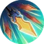

[Главная](https://boostmlbb.ru/) / [Герои](https://boostmlbb.ru/heroes/)

Тир D

# Зилонг

Боец и убийца · Линия опыта

**№ 123 из 133 по доле побед**Все ранги · 30 дней по 23 ноября 2026 года

Победы

46,27%

Выбор

0,71%

Баны

0,49%

Преследование · Урон · Сложность 10/100

[Сборка](https://boostmlbb.ru/#build)[Контрпики и союзники](https://boostmlbb.ru/#draft)[Навыки](https://boostmlbb.ru/#skills)[Победы по рангам](https://boostmlbb.ru/#ranks)[История](https://boostmlbb.ru/#lore)

## Сборка

Самый частый выбор в рейтинге · Линия опыта

Ключевые предметы

Коса коррозииПронзающий небесаЗолотой метеор

Эмблема и таланты

Эмблема бойцаПроворностьМастер-убийцаУбийственный пир

Боевое заклинание

Вдохновение

Побед с этой сборкой **53,04%**Выбирают в **3,04%** матчей

Другие сборки (2)

Ключевые предметы

Говорящий с ветромКогти ХаасаЯрость берсерка

Эмблема и таланты

Эмблема убийцыФатальностьМастер-убийцаУбийственный пир

Боевое заклинание

Вдохновение

Побед с этой сборкой **52,97%**Выбирают в **6,59%** матчей

Ключевые предметы

Золотой метеорГоворящий с ветромКогти Хааса

Эмблема и таланты

Эмблема бойцаФатальностьМастер-убийцаБоевой клич

Боевое заклинание

Вдохновение

Побед с этой сборкой **52,77%**Выбирают в **2,24%** матчей

## Контрпики и союзники

### Кто контрит

[Икс.Борг](https://boostmlbb.ru/heroes/x-borg.html)[Чичи](https://boostmlbb.ru/heroes/cici.html)[Ксавьер](https://boostmlbb.ru/heroes/xavier.html)[Дигги](https://boostmlbb.ru/heroes/diggie.html)[Фанни](https://boostmlbb.ru/heroes/fanny.html)

### Против кого силён

[Тигрил](https://boostmlbb.ru/heroes/tigreal.html)[Эйдора](https://boostmlbb.ru/heroes/eudora.html)[Белерик](https://boostmlbb.ru/heroes/belerick.html)[Цзэтянь](https://boostmlbb.ru/heroes/zetian.html)[Баданг](https://boostmlbb.ru/heroes/badang.html)[Джонсон](https://boostmlbb.ru/heroes/johnson.html)[Гатоткача](https://boostmlbb.ru/heroes/gatotkaca.html)[Пополь и Купа](https://boostmlbb.ru/heroes/popol-and-kupa.html)[Хилос](https://boostmlbb.ru/heroes/hylos.html)[Чип](https://boostmlbb.ru/heroes/chip.html)

### Союзники

Прибавка к доле побед в одной команде

[Глу+2,92 п. п.](https://boostmlbb.ru/heroes/gloo.html)[Белерик+2,91 п. п.](https://boostmlbb.ru/heroes/belerick.html)[Хильда+2,26 п. п.](https://boostmlbb.ru/heroes/hilda.html)[Тигрил+1,97 п. п.](https://boostmlbb.ru/heroes/tigreal.html)

## Навыки

Приоритет прокачки · Великий воин → Удар копья → Бросок копьем

Пассивный**Огонь дракона**

После нанесения урона базовыми атаками или навыками 3 р. Зилонг активирует "Огонь дракона" при следующей базовой атаке, нанося цели удар 3 р. Каждый удар наносит 80 (+30% общей физической атаки) урона базовой атаки и восстанавливает себе 50 (+20% общей физической атаки) ОЗ.
Базовая атака Зилонга наносит 100 (+80% общей физической атаки) единиц физического урона.
Если ОЗ цели ниже 50%, весь урон, наносимый навыками и базовыми атаками Зилонга, увеличивается на 30.

1-й навык**Бросок копьем**

**Перезарядка 12 Mana Cost: 80 с**

Зилонг ​​перебрасывает указанного врага за спину, нанося 250 (+80% общей физической атаки) единиц физического урона.

2-й навык**Удар копья**

**Перезарядка 12 Mana Cost: 40 с**

Зилонг бросается к указанному врагу, нанося 250 (+60% общей физической атаки) единиц физического урона и снижая цели на 15 на 2 сек.
Перезарядка "Удара копья" сбрасывается каждый раз, когда Зилонг убивает врага.

Ультимейт**Великий воин**

**Перезарядка 35 Mana Cost: 120 с**

Зилонг снимает с себя все эффекты замедления и получает 40% скорости передвижения, 35% скорости атаки и иммунитет к замедлению на 7.5 сек.
В этот период "Огонь дракона" срабатывает после каждых 2 базовых атак (вместо 3).

## Победы по рангам

-   Эпик**47,18%**
-   Легенда**46,76%**
-   Мифический**46,79%**
-   Мифическая честь**45,54%**
-   Мифическая слава**44,40%**

## История

Хранитель Алтаря дракона и Боец Востока, унаследовавший силу Облачного дракона.

[Читать историю](https://play.mobilelegends.com/lore/hero/Zilong)[Карточка героя](https://www.mobilelegends.com/hero/detail?heroid=16)[MLBB Wiki](https://mobile-legends.fandom.com/wiki/Zilong)

[Стоимость буста на герое](https://boostmlbb.ru/order.html?type=hero)

## Частые вопросы

Кто контрпик для героя «Зилонг» в MLBB?

За последние 30 дней чаще всего героя обыгрывают Икс.Борг, Чичи, Ксавьер, Дигги и Фанни.

Какой процент побед у героя «Зилонг» сейчас?

46,27% за последние 30 дней на всех рангах и 44,40% в Мифической славе, данные на 23 ноября 2026 года.

Какая роль и линия у героя «Зилонг»?

Боец и убийца, играет на линии опыта.

Силён ли герой «Зилонг» в текущей мете?

Тир D: 123-е место из 133 героев по проценту побед за 30 дней и 42-е среди бойцов.

Какая сборка на героя «Зилонг» лучшая?

Самая популярная сборка в рейтинге: ключевые предметы «Коса коррозии», «Пронзающий небеса» и «Золотой метеор», эмблема бойца с талантами «Проворность», «Мастер-убийца» и «Убийственный пир» и заклинание «Вдохновение». С ней выигрывают 53,04% матчей.
