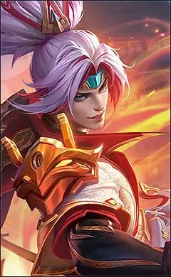

[Тир-лист](https://boostmlbb.ru/heroes/)[Предметы](https://boostmlbb.ru/items/)[Скины](https://boostmlbb.ru/skins/)[Новости и гайды](https://boostmlbb.ru/news/)

# Зилонг

C

БоецУбийцаЛиния опыта

Победы

44,9%

Выбор

0,3%

Баны

0,3%

[Обзор](https://boostmlbb.ru/#overview)[Сборка](https://boostmlbb.ru/#build)[Как играть](https://boostmlbb.ru/#howto)[Навыки](https://boostmlbb.ru/#skills)[Контрпики](https://boostmlbb.ru/#draft)[Скины](https://boostmlbb.ru/#skins)[История](https://boostmlbb.ru/#lore)

## Обзор

### Характеристики

-   Живучесть**20**
-   Атака**50**
-   Эффекты**60**
-   Сложность**10**

-   Преследование
-   Урон

### Победы по рангам, 30 дней

1.  **47,2%**Эпик
2.  **46,8%**Легенда
3.  **46,8%**Мифик
4.  **45,6%**Честь
5.  **44,5%**Слава

Пунктир: 50% побед

### Другие бойцы этой линии

[Фрейя](https://boostmlbb.ru/heroes/freya.html)[Аулус](https://boostmlbb.ru/heroes/aulus.html)[Пакито](https://boostmlbb.ru/heroes/paquito.html)[Сан](https://boostmlbb.ru/heroes/sun.html)[Лукас](https://boostmlbb.ru/heroes/lukas.html)[Чичи](https://boostmlbb.ru/heroes/cici.html)[Сора](https://boostmlbb.ru/heroes/sora.html)[Чонг](https://boostmlbb.ru/heroes/yu-zhong.html)

### Места в рейтингах

-   [Лучшие бойцы MLBB**44 из 44**](https://boostmlbb.ru/heroes/best-fighter.html)
-   [Лучшие убийцы MLBB**27 из 29**](https://boostmlbb.ru/heroes/best-assassin.html)

## Сборка

Сборка 1Сборка 2Сборка 3

Победы

53,0%

Выбор

6,6%

#### Основные предметы

-   [

    

    Говорящий с ветром

    ](https://boostmlbb.ru/items/windtalker.html)
-   [

    

    Когти Хааса

    ](https://boostmlbb.ru/items/haas-claws.html)
-   [

    

    Ярость берсерка

    ](https://boostmlbb.ru/items/berserkers-fury.html)

#### Заклинание

Вдохновение

#### Эмблема и таланты

Эмблема убийцы

-   

    Фатальность

-   

    Мастер-убийца

-   

    Убийственный пир

Победы

53,0%

Выбор

3,0%

#### Основные предметы

-   [

    

    Коса коррозии

    ](https://boostmlbb.ru/items/corrosion-scythe.html)
-   [

    

    Пронзающий небеса

    ](https://boostmlbb.ru/items/sky-piercer.html)
-   [

    

    Золотой метеор

    ](https://boostmlbb.ru/items/rose-gold-meteor.html)

#### Заклинание

Вдохновение

#### Эмблема и таланты

Эмблема бойца

-   

    Проворность

-   

    Мастер-убийца

-   

    Убийственный пир

Победы

52,8%

Выбор

2,2%

#### Основные предметы

-   [

    

    Золотой метеор

    ](https://boostmlbb.ru/items/rose-gold-meteor.html)
-   [

    

    Говорящий с ветром

    ](https://boostmlbb.ru/items/windtalker.html)
-   [

    

    Когти Хааса

    ](https://boostmlbb.ru/items/haas-claws.html)

#### Заклинание

Вдохновение

#### Эмблема и таланты

Эмблема бойца

-   

    Фатальность

-   

    Мастер-убийца

-   

    Боевой клич

## Как играть за Зилонга

### Комбо Зилонга

#### В драке

1.  Ульт
2.  2
3.  1
4.  Атака

В драке ультом ускорьтесь, вторым налетите на цель, первым перебросьте и атаками включите пассивку.

#### На линии

1.  2
2.  1
3.  Атака

На линии вторым подойдите и снизьте защиту, первым перебросьте через спину и бейте атаками для пассивки.

### Когда сильнее всего

Сильнее в долгой игре: после 20-й минуты выигрывает 50,4%. Не рискуйте в начале, фармите и ввязывайтесь в драки вместе с командой.

1.  **44,9**10–12
2.  **45,8**12–14
3.  **46,4**14–16
4.  **48,1**16–18
5.  **49,1**18–20
6.  **50,4**20+

Проценты побед по длине матча в минутах, все ранги. Пунктир: 50%

### Приоритет прокачки

1.  Великий воин
2.  Удар копья
3.  Бросок копьем

## Навыки

Пассивный**Огонь дракона**1-й навык**Бросок копьем**2-й навык**Удар копья**Ультимейт**Великий воин**

Пассивный

### Огонь дракона

После нанесения урона базовыми атаками или навыками 3 р. Зилонг активирует "Огонь дракона" при следующей базовой атаке, нанося цели удар 3 р. Каждый удар наносит 80 (+30% общей физической атаки) урона базовой атаки и восстанавливает себе 50 (+20% общей физической атаки) ОЗ.

Базовая атака Зилонга наносит 100 (+80% общей физической атаки) единиц физического урона.

Если ОЗ цели ниже 50%, весь урон, наносимый навыками и базовыми атаками Зилонга, увеличивается на 30.

1-й навык

### Бросок копьем

Перезарядка **12 Mana Cost: 80 с**

Зилонг ​​перебрасывает указанного врага за спину, нанося 250 (+80% общей физической атаки) единиц физического урона.

2-й навык

### Удар копья

Перезарядка **12 Mana Cost: 40 с**

Зилонг бросается к указанному врагу, нанося 250 (+60% общей физической атаки) единиц физического урона и снижая цели на 15 на 2 сек.

Перезарядка "Удара копья" сбрасывается каждый раз, когда Зилонг убивает врага.

Ультимейт

### Великий воин

Перезарядка **35 Mana Cost: 120 с**

Зилонг снимает с себя все эффекты замедления и получает 40% скорости передвижения, 35% скорости атаки и иммунитет к замедлению на 7.5 сек.

В этот период "Огонь дракона" срабатывает после каждых 2 базовых атак (вместо 3).

## Контрпики Зилонга

### Кто контрит Зилонга

[Икс.Борг](https://boostmlbb.ru/heroes/x-borg.html)[Чичи](https://boostmlbb.ru/heroes/cici.html)[Дигги](https://boostmlbb.ru/heroes/diggie.html)[Ксавьер](https://boostmlbb.ru/heroes/xavier.html)[Фанни](https://boostmlbb.ru/heroes/fanny.html)

### Кого контрит Зилонг

[Тигрил](https://boostmlbb.ru/heroes/tigreal.html)[Эйдора](https://boostmlbb.ru/heroes/eudora.html)[Белерик](https://boostmlbb.ru/heroes/belerick.html)[Цзэтянь](https://boostmlbb.ru/heroes/zetian.html)[Баданг](https://boostmlbb.ru/heroes/badang.html)[Джонсон](https://boostmlbb.ru/heroes/johnson.html)[Гатоткача](https://boostmlbb.ru/heroes/gatotkaca.html)[Пополь и Купа](https://boostmlbb.ru/heroes/popol-and-kupa.html)[Хилос](https://boostmlbb.ru/heroes/hylos.html)[Чип](https://boostmlbb.ru/heroes/chip.html)

## Скины Зилонга

[Восходящий пламениДелюкс · 2026](https://boostmlbb.ru/skins/zilong/ascendant-of-flame.html)[Дракон процве­танияДелюкс · 2024](https://boostmlbb.ru/skins/zilong/dragon-of-prosperity.html)[Небесный паладинИзысканный · 2022](https://boostmlbb.ru/skins/zilong/empyrean-paladin.html)[Всадник буриИсключительный · 2022](https://boostmlbb.ru/skins/zilong/storm-rider.html)[Верное копьёОбычный · 2021](https://boostmlbb.ru/skins/zilong/loyal-spear.html)[Летние волныИсключительный · 2020](https://boostmlbb.ru/skins/zilong/summer-waves.html)[Рож­дественский карнавалИсключительный · 2018](https://boostmlbb.ru/skins/zilong/christmas-carnival.html)[Командир ЧанбаньпоИзысканный · 2018](https://boostmlbb.ru/skins/zilong/changbanpo-commander.html)[Пылающий копейщикОбычный · 2018](https://boostmlbb.ru/skins/zilong/blazing-lancer.html)[Элитный воинОбычный · 2017](https://boostmlbb.ru/skins/zilong/elite-warrior.html)[Восточный воинИсключительный · 2017](https://boostmlbb.ru/skins/zilong/eastern-warrior.html)[Славный генералДелюкс · 2017](https://boostmlbb.ru/skins/zilong/glorious-general.html)

[Все 12 скинов Зилонга: цены и как получить](https://boostmlbb.ru/skins/zilong.html)

## История

> Хранитель Алтаря дракона и Боец Востока, унаследовавший силу Облачного дракона.

[Читать полную историю ↗](https://play.mobilelegends.com/lore/hero/Zilong)Официальный сайт Mobile Legends [Характеристики на сайте игры ↗](https://www.mobilelegends.com/hero/detail?heroid=16)

**Поднимем ранг на герое «Зилонг»**Цена считается в калькуляторе

[Рассчитать цену](https://boostmlbb.ru/order.html?type=hero)

## Частые вопросы

Кто контрит Зилонга в MLBB?

За последние 30 дней Зилонга чаще всего обыгрывают Икс.Борг, Чичи, Дигги, Ксавьер и Фанни.

Как играть за Зилонга?

В первую очередь качайте «Удар копья», ульт берите, как только доступен. Сильнее в долгой игре: после 20-й минуты выигрывает 50,4%. Не рискуйте в начале, фармите и ввязывайтесь в драки вместе с командой. Комбо для драки: В драке ультом ускорьтесь, вторым налетите на цель, первым перебросьте и атаками включите пассивку.

Какой процент побед у Зилонга сейчас?

44,85% в Мифической славе за последние 7 дней и 46,27% на всех рангах за 30 дней, данные на 25 ноября 2026 года.

Какая роль и линия у Зилонга?

Боец и убийца, играет на линии опыта.

Стоит ли брать Зилонга в текущей мете?

Тир C, 127-е место из 133 героев и 44-е среди бойцов. Тир учитывает, как часто героя берут и банят и как он выигрывает в Мифической славе за 7 дней: бан в 0,3% матчей, 44,9% побед. В профессиональных матчах за месяц героя драфтуют в 0,0% катков.

Какая сборка на Зилонга лучшая?

Самая популярная сборка в рейтинге: ключевые предметы «Говорящий с ветром», «Когти Хааса» и «Ярость берсерка», эмблема убийцы с талантами «Фатальность», «Мастер-убийца» и «Убийственный пир» и заклинание «Вдохновение». С ней выигрывают 52,97% матчей.
