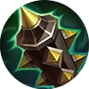

[Все предметы](https://boostmlbb.ru/items/)

# Клинок семи морей

Blade of the Heptaseas

[Атака](https://boostmlbb.ru/items/#attack)Готовый предмет

Цена

1 950

-   **+15**Физическое проникновение
-   **+70**Физическая атака
-   **+250**ОЗ

## Эффект

Уникальный пассивный

### Засада

Если 5 с не получать и не наносить урон (кроме миньонов и монстров), следующая базовая атака наносит 160 (+40% общей физ. атаки) физического урона и замедляет цель на 40% на 1,5 с.

## Сборка

1 950Клинок семи морей

-   [830Молот гнева](https://boostmlbb.ru/items/fury-hammer.html "Молот гнева")
    -   [250Кинжал](https://boostmlbb.ru/items/dagger.html "Кинжал")
-   [650Топор великана](https://boostmlbb.ru/items/ogre-tomahawk.html "Топор великана")
    -   [250Кинжал](https://boostmlbb.ru/items/dagger.html "Кинжал")
    -   [300Кристалл здоровья](https://boostmlbb.ru/items/vitality-crystal.html "Кристалл здоровья")

Детали стоят 1 480, сборка — ещё 470 золота.

## Кто собирает

Герои, у которых предмет есть в популярной сборке в рейтинге, и процент побед с ней

-   [Нолан51,9%](https://boostmlbb.ru/heroes/nolan.html#build)
-   [Броуди53,3%](https://boostmlbb.ru/heroes/brody.html#build)
-   [Фанни47,9%](https://boostmlbb.ru/heroes/fanny.html#build)
-   [Чу51,2%](https://boostmlbb.ru/heroes/chou.html#build)
-   [Дариус61,0%](https://boostmlbb.ru/heroes/dyrroth.html#build)
-   [Бенедетта54,3%](https://boostmlbb.ru/heroes/benedetta.html#build)
-   [Алдос59,2%](https://boostmlbb.ru/heroes/aldous.html#build)
-   [Хелкарт51,9%](https://boostmlbb.ru/heroes/helcurt.html#build)
-   [Инь53,7%](https://boostmlbb.ru/heroes/yin.html#build)
-   [Наталья60,6%](https://boostmlbb.ru/heroes/natalia.html#build)
-   [Кусака57,1%](https://boostmlbb.ru/heroes/jawhead.html#build)

## История

> Клинок, что режет кость как масло, когда-то ушёл на дно вместе с Ледяным королём. Теперь он ждёт часа, чтобы пробудиться.

[Изменения по патчам ↗](https://liquipedia.net/mobilelegends/Blade_of_the_Heptaseas#Version_History)

## Другие предметы атаки

[2 120Губительный пулеметДальность атаки](https://boostmlbb.ru/items/malefic-gun.html)[2 140Копье Великого драконаПерезарядка и крит](https://boostmlbb.ru/items/great-dragon-spear.html)[2 050ТрезубецСнижение исцеления](https://boostmlbb.ru/items/sea-halberd.html)[2 030Золотой метеорЩит при низких ОЗ](https://boostmlbb.ru/items/rose-gold-meteor.html)[2 010Удар охотникаКратковременное ускорение](https://boostmlbb.ru/items/hunter-strike.html)[3 010Клинок отчаянияМакс. физ. атака](https://boostmlbb.ru/items/blade-of-despair.html)[1 880Говорящий с ветромУрон по площади](https://boostmlbb.ru/items/windtalker.html)[2 330Бесконечная битваУсиление базовой атаки](https://boostmlbb.ru/items/endless-battle.html)

[Все предметы](https://boostmlbb.ru/items/#attack)

**Поднимем ранг, пока вы заняты**Цена считается в калькуляторе

[Рассчитать цену](https://boostmlbb.ru/order.html)

## Частые вопросы

Сколько стоит «Клинок семи морей» и из чего собирается?

1 950 золота. Детали: «Молот гнева» (830) и «Топор великана» (650), сборка — ещё 470 золота.

Что даёт «Клинок семи морей»?

+15 физическое проникновение, +70 физическая атака, +250 оз. «Засада»: если 5 с не получать и не наносить урон (кроме миньонов и монстров), следующая базовая атака наносит 160 (+40% общей физ. атаки) физического урона и замедляет цель на 40% на 1,5 с.

Каким героям собирать «Клинок семи морей»?

Предмет есть в популярных сборках 11 героев в рейтинге, среди них Нолан, Броуди, Фанни, Чу, Дариус и Бенедетта.
