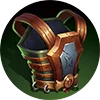

[Тир-лист](https://boostmlbb.ru/heroes/)[Предметы](https://boostmlbb.ru/items/)[Новости и гайды](https://boostmlbb.ru/news/)

# Наплечник наказания

Chastise Pauldron

[Защита](https://boostmlbb.ru/items/#defense)Готовый предмет

Цена

2 100

-   **+900**ОЗ
-   **+40**Физическая защита

## Эффект

Уникальный пассивный

### Наказание

Получая урон, герой снижает скорость атаки атакующего и её предел до 75% на 2 с.

Уникальный пассивный

### Искупление

Если урон опускает ОЗ ниже 30%, за 2 с восстанавливается 20% макс. ОЗ. Перезарядка 60 с.

## Сборка

2 100Наплечник наказания

-   [700Пояс Ареса](https://boostmlbb.ru/items/ares-belt.html "Пояс Ареса")
    -   [300Кристалл здоровья](https://boostmlbb.ru/items/vitality-crystal.html "Кристалл здоровья")
-   [630Стальные ножные латы](https://boostmlbb.ru/items/steel-legplates.html "Стальные ножные латы")
    -   [220Кожаная броня](https://boostmlbb.ru/items/leather-jerkin.html "Кожаная броня")

Детали стоят 1 330, сборка — ещё 770 золота.

## Кто собирает

Герои, у которых предмет есть в популярной сборке в рейтинге, и процент побед с ней

-   [Кармилла58,4%](https://boostmlbb.ru/heroes/carmilla.html#build)
-   [Белерик61,1%](https://boostmlbb.ru/heroes/belerick.html#build)
-   [Атлас56,3%](https://boostmlbb.ru/heroes/atlas.html#build)
-   [Алиса58,8%](https://boostmlbb.ru/heroes/alice.html#build)
-   [Минотавр63,5%](https://boostmlbb.ru/heroes/minotaur.html#build)
-   [Сора56,8%](https://boostmlbb.ru/heroes/sora.html#build)
-   [Уранус56,4%](https://boostmlbb.ru/heroes/uranus.html#build)
-   [Баданг57,3%](https://boostmlbb.ru/heroes/badang.html#build)
-   [Хуфра60,9%](https://boostmlbb.ru/heroes/khufra.html#build)
-   [Фредрин60,5%](https://boostmlbb.ru/heroes/fredrinn.html#build)
-   [Хильда59,0%](https://boostmlbb.ru/heroes/hilda.html#build)
-   [Акай56,5%](https://boostmlbb.ru/heroes/akai.html#build)
-   [Халид55,7%](https://boostmlbb.ru/heroes/khaleed.html#build)
-   [Хилос55,0%](https://boostmlbb.ru/heroes/hylos.html#build)
-   [Грок51,0%](https://boostmlbb.ru/heroes/grock.html#build)
-   [Лолита59,4%](https://boostmlbb.ru/heroes/lolita.html#build)
-   [Бальмонд53,2%](https://boostmlbb.ru/heroes/balmond.html#build)
-   [Чип53,2%](https://boostmlbb.ru/heroes/chip.html#build)
-   [Баксий55,6%](https://boostmlbb.ru/heroes/baxia.html#build)

## История

> На западе Земель Рассвета, среди Туманных гор, страж-кентавр надевает священный наплечник, чтобы покарать любого захватчика.

[Изменения по патчам ↗](https://liquipedia.net/mobilelegends/Chastise_Pauldron#Version_History)

## Другие предметы защиты

[2 050Мимолетное времяПерезарядка ультимейта](https://boostmlbb.ru/items/fleeting-time.html)[1 880Сияющая броняПротив маг. урона](https://boostmlbb.ru/items/radiant-armor.html)[2 070Кираса грубой силыАтака, скорость, сопротивление контролю](https://boostmlbb.ru/items/brute-force-breastplate.html)[2 120БессмертиеВозрождение](https://boostmlbb.ru/items/immortality.html)[2 010Господство льдаСнижение исцеления](https://boostmlbb.ru/items/dominance-ice.html)[2 150Щит валькирииСопротивл. разруш. маг. урону](https://boostmlbb.ru/items/athenas-shield.html)[1 860ОракулУсиление регенерации](https://boostmlbb.ru/items/oracle.html)[2 170Древняя кирасаСнижение физ. АТК](https://boostmlbb.ru/items/antique-cuirass.html)

[Все предметы](https://boostmlbb.ru/items/#defense)

**Поднимем ранг, пока вы заняты**Цена считается в калькуляторе

[Рассчитать цену](https://boostmlbb.ru/order.html)

## Частые вопросы

Сколько стоит «Наплечник наказания» и из чего собирается?

2 100 золота. Детали: «Пояс Ареса» (700) и «Стальные ножные латы» (630), сборка — ещё 770 золота.

Что даёт «Наплечник наказания»?

+900 оз, +40 физическая защита. «Наказание»: получая урон, герой снижает скорость атаки атакующего и её предел до 75% на 2 с. «Искупление»: если урон опускает ОЗ ниже 30%, за 2 с восстанавливается 20% макс. ОЗ. Перезарядка 60 с.

Каким героям собирать «Наплечник наказания»?

Предмет есть в популярных сборках 19 героев в рейтинге, среди них Кармилла, Белерик, Атлас, Алиса, Минотавр и Сора.
