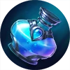
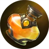

# Предметы MLBB

97 предметов · цены как в игре на 25 ноября 2026

Найти предмет

ВсеАтакаМагияЗащитаПередвижениеЛесРоум

## Атака

[2 120Губительный пулеметДальность атаки](https://boostmlbb.ru/items/malefic-gun.html)[2 140Копье Великого драконаПерезарядка и крит](https://boostmlbb.ru/items/great-dragon-spear.html)[2 050ТрезубецСнижение исцеления](https://boostmlbb.ru/items/sea-halberd.html)[2 030Золотой метеорЩит при низких ОЗ](https://boostmlbb.ru/items/rose-gold-meteor.html)[2 010Удар охотникаКратковременное ускорение](https://boostmlbb.ru/items/hunter-strike.html)[3 010Клинок отчаянияМакс. физ. атака](https://boostmlbb.ru/items/blade-of-despair.html)[1 950Клинок семи морейЛучшее для убийц](https://boostmlbb.ru/items/blade-of-the-heptaseas.html)[1 880Говорящий с ветромУрон по площади](https://boostmlbb.ru/items/windtalker.html)[2 330Бесконечная битваУсиление базовой атаки](https://boostmlbb.ru/items/endless-battle.html)[2 390Ярость берсеркаШанс крита и урон](https://boostmlbb.ru/items/berserkers-fury.html)[2 020Когти ХаасаВампиризм](https://boostmlbb.ru/items/haas-claws.html)[2 060Злобный рыкВысокое физ. проникновение](https://boostmlbb.ru/items/malefic-roar.html)[1 910Зимняя коронаВременная неуязвимость](https://boostmlbb.ru/items/winter-crown.html)[2 050Мимолетное времяПерезарядка ультимейта](https://boostmlbb.ru/items/fleeting-time.html)[1 500Пронзающий небесаЛучшее для добивания](https://boostmlbb.ru/items/sky-piercer.html)[2 100Топор войныУсиление продолжительного урона](https://boostmlbb.ru/items/war-axe.html)[1 910Ветер природыИммунитет к физ. урону](https://boostmlbb.ru/items/wind-of-nature.html)[2 000Золотой посохУлучш. эффекты атаки](https://boostmlbb.ru/items/golden-staff.html)[2 050Коса коррозииЗамедление от урона](https://boostmlbb.ru/items/corrosion-scythe.html)[2 180Меч охотника на демоновУбийца танков](https://boostmlbb.ru/items/demon-hunter-sword.html)

### Детали и зелья

[1 050Магический клинок](https://boostmlbb.ru/items/magic-blade.html)[830Молот гнева](https://boostmlbb.ru/items/fury-hammer.html)[900Кистень грабителя](https://boostmlbb.ru/items/rogue-meteor.html)[650Топор великана](https://boostmlbb.ru/items/ogre-tomahawk.html)[910Меч легионера](https://boostmlbb.ru/items/legion-sword.html)[1 000Быстрый арбалет](https://boostmlbb.ru/items/swift-crossbow.html)[600Обычное копье](https://boostmlbb.ru/items/regular-spear.html)[500Перчатки эксперта](https://boostmlbb.ru/items/expert-gloves.html)[450Железный лук охотника](https://boostmlbb.ru/items/iron-hunting-bow.html)[400Булава вампира](https://boostmlbb.ru/items/vampire-mallet.html)[320Копье](https://boostmlbb.ru/items/javelin.html)[280Нож](https://boostmlbb.ru/items/knife.html)[250Кинжал](https://boostmlbb.ru/items/dagger.html)[1 500Зелье силы](https://boostmlbb.ru/items/power-potion.html)

## Магия

[2 250Фонарь желанийПротив высоких ОЗ](https://boostmlbb.ru/items/wishing-lantern.html)[1 850Фляга ОазисаЗащита союзников](https://boostmlbb.ru/items/flask-of-the-oasis.html)[2 000Палочка генияСнижение маг. защиты](https://boostmlbb.ru/items/genius-wand.html)[2 250Жезл молнийМассовый урон навыками](https://boostmlbb.ru/items/lightning-truncheon.html)[2 100Кровавые крыльяЩит с ускорением](https://boostmlbb.ru/items/blood-wings.html)[2 120Старлиумовая косаУсиление базовой атаки](https://boostmlbb.ru/items/starlium-scythe.html)[2 050Пылающий жезлСнижение исцеления](https://boostmlbb.ru/items/glowing-wand.html)[2 040Жезл снежной королевыЗамедление навыками](https://boostmlbb.ru/items/ice-queen-wand.html)[2 020Концентри­рованная энергияУсиление продолжительного урона](https://boostmlbb.ru/items/concentrated-energy.html)[3 000Священный кристаллМакс. магическая сила](https://boostmlbb.ru/items/holy-crystal.html)[1 970Божественный мечМаг. проникновение](https://boostmlbb.ru/items/divine-glaive.html)[2 030Часы судьбыДля магических танков](https://boostmlbb.ru/items/clock-of-destiny.html)[1 910Зимняя коронаВременная неуязвимость](https://boostmlbb.ru/items/winter-crown.html)[2 050Мимолетное времяПерезарядка ультимейта](https://boostmlbb.ru/items/fleeting-time.html)[1 500Пронзающий небесаЛучшее для добивания](https://boostmlbb.ru/items/sky-piercer.html)[2 030Райское пероМаг. базовая атака](https://boostmlbb.ru/items/feather-of-heaven.html)[2 070Зачарованный талисманМана и перезарядка](https://boostmlbb.ru/items/enchanted-talisman.html)

### Детали, зелья и особые предметы

[700Элегантный самоцвет](https://boostmlbb.ru/items/elegant-gem.html)[600Иноземная маска](https://boostmlbb.ru/items/exotic-veil.html)[600Лазурный клинок](https://boostmlbb.ru/items/azure-blade.html)[950Книга зла](https://boostmlbb.ru/items/tome-of-evil.html)[820Волшебная палочка](https://boostmlbb.ru/items/magic-wand.html)[500Загадочный сосуд](https://boostmlbb.ru/items/mystic-container.html)[500Перчатки эксперта](https://boostmlbb.ru/items/expert-gloves.html)[450Книга мудрости](https://boostmlbb.ru/items/book-of-sages.html)[120Магическое ожерелье](https://boostmlbb.ru/items/magic-necklace.html)[220Кристалл силы](https://boostmlbb.ru/items/power-crystal.html)[300Магическая книга](https://boostmlbb.ru/items/mystery-codex.html)[Фонарь надежды](https://boostmlbb.ru/items/lantern-of-hope.html)[Цветок надежды](https://boostmlbb.ru/items/flower-of-hope.html)[1 500Зелье магии](https://boostmlbb.ru/items/magic-potion.html)

## Защита

[2 050Мимолетное времяПерезарядка ультимейта](https://boostmlbb.ru/items/fleeting-time.html)[1 880Сияющая броняПротив маг. урона](https://boostmlbb.ru/items/radiant-armor.html)[2 100Наплечник наказанияСнижает скорость атаки врага](https://boostmlbb.ru/items/chastise-pauldron.html)[2 070Кираса грубой силыАтака, скорость, сопротивление контролю](https://boostmlbb.ru/items/brute-force-breastplate.html)[2 120БессмертиеВозрождение](https://boostmlbb.ru/items/immortality.html)[2 010Господство льдаСнижение исцеления](https://boostmlbb.ru/items/dominance-ice.html)[2 150Щит валькирииСопротивл. разруш. маг. урону](https://boostmlbb.ru/items/athenas-shield.html)[1 860ОракулУсиление регенерации](https://boostmlbb.ru/items/oracle.html)[2 170Древняя кирасаСнижение физ. АТК](https://boostmlbb.ru/items/antique-cuirass.html)[2 500Защитный шлемПостоянная реген. ОЗ](https://boostmlbb.ru/items/guardian-helmet.html)[1 910Проклятый шлемВыживаемость и зачистка линий](https://boostmlbb.ru/items/cursed-helmet.html)[1 820Штормовой поясУрон для танков](https://boostmlbb.ru/items/thunder-belt.html)[2 250Крылья королевыПротиводействие при низких ОЗ](https://boostmlbb.ru/items/queens-wings.html)[1 910Шипованная броняОтражение урона](https://boostmlbb.ru/items/blade-armor.html)

### Детали и зелья

[630Стальные ножные латы](https://boostmlbb.ru/items/steel-legplates.html)[730Броня неустра­шимости](https://boostmlbb.ru/items/dreadnaught-armor.html)[780Щит из черного льда](https://boostmlbb.ru/items/black-ice-shield.html)[1 020Роба тишины](https://boostmlbb.ru/items/silence-robe.html)[800Распла­вленная субстанция](https://boostmlbb.ru/items/molten-essence.html)[700Пояс Ареса](https://boostmlbb.ru/items/ares-belt.html)[450Кольцо героя](https://boostmlbb.ru/items/heros-ring.html)[140Исцеляющее ожерелье](https://boostmlbb.ru/items/healing-necklace.html)[220Плащ сопроти­вления магии](https://boostmlbb.ru/items/magic-resist-cloak.html)[220Кожаная броня](https://boostmlbb.ru/items/leather-jerkin.html)[300Кристалл здоровья](https://boostmlbb.ru/items/vitality-crystal.html)[1 500Зелье стойкости](https://boostmlbb.ru/items/rock-potion.html)

## Передвижение

[720Ботинки демонаБыстрая регенерация маны](https://boostmlbb.ru/items/demon-boots.html)[720Сапоги-скороходыВысокая скорость передвижения](https://boostmlbb.ru/items/rapid-boots.html)[720Сапоги спешкиСкорость АТК](https://boostmlbb.ru/items/swift-boots.html)[720Сапоги заклинателяМаг. проникновение](https://boostmlbb.ru/items/arcane-boots.html)[720Магические ботинкиСокращение перезарядки](https://boostmlbb.ru/items/magic-boots.html)[720Прочные сапогиСокращение длительности контроля](https://boostmlbb.ru/items/tough-boots.html)[720Сапоги воинаНакапливаемая физ. защита](https://boostmlbb.ru/items/warrior-boots.html)

### Детали и особые предметы

[250Ботинки](https://boostmlbb.ru/items/boots.html)[Разрешение броска](https://boostmlbb.ru/items/allow-throw.html)[Запрет броска](https://boostmlbb.ru/items/throw-forbidden.html)[Разбитое сердце](https://boostmlbb.ru/items/broken-heart.html)

## Лес

[Пламенное ВозмездиеПодходит, когда нужно выиграть дуэль: противник слабеет, вы сильнее.](https://boostmlbb.ru/items/retribution.html#flame)[Ледяное ВозмездиеПодходит, чтобы догнать цель или уйти от погони.](https://boostmlbb.ru/items/retribution.html#ice)[Кровавое ВозмездиеПодходит лесникам, которым важно пережить бой.](https://boostmlbb.ru/items/retribution.html#bloody)

## Роум

[ПоощрениеДля драк всей командой.](https://boostmlbb.ru/items/roam-blessings.html#encourage)[БлагосклонностьДля героев, которые лечат и дают щиты.](https://boostmlbb.ru/items/roam-blessings.html#favor)[Острый ударДля роумеров, которые много бегают и сами начинают драку.](https://boostmlbb.ru/items/roam-blessings.html#dire-hit)[МаскировкаДля засад и быстрых перебежек.](https://boostmlbb.ru/items/roam-blessings.html#conceal)

Такого предмета нет. Проверьте название.

Показать все

## Чаще всего в сборках

-   [Пронзающий небесав сборках 32 героев](https://boostmlbb.ru/items/sky-piercer.html)
-   [Господство льдав сборках 31 героя](https://boostmlbb.ru/items/dominance-ice.html)
-   [Топор войныв сборках 28 героев](https://boostmlbb.ru/items/war-axe.html)
-   [Пылающий жезлв сборках 28 героев](https://boostmlbb.ru/items/glowing-wand.html)
-   [Удар охотникав сборках 20 героев](https://boostmlbb.ru/items/hunter-strike.html)
-   [Крылья королевыв сборках 19 героев](https://boostmlbb.ru/items/queens-wings.html)
-   [Оракулв сборках 18 героев](https://boostmlbb.ru/items/oracle.html)
-   [Коса коррозиив сборках 17 героев](https://boostmlbb.ru/items/corrosion-scythe.html)
-   [Жезл молнийв сборках 17 героев](https://boostmlbb.ru/items/lightning-truncheon.html)
