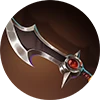
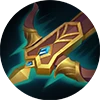

[Тир-лист](https://boostmlbb.ru/heroes/)[Предметы](https://boostmlbb.ru/items/)[Скины](https://boostmlbb.ru/skins/)[Новости и гайды](https://boostmlbb.ru/news/)

# Нож

Knife

[Атака](https://boostmlbb.ru/items/#attack)Деталь

Цена

280

-   **+10%**Скорость атаки

## Сборка

### Входит в

[2 030Золотой метеорЩит при низких ОЗ](https://boostmlbb.ru/items/rose-gold-meteor.html)[1 880Говорящий с ветромУрон по площади](https://boostmlbb.ru/items/windtalker.html)[2 180Меч охотника на демоновУбийца танков](https://boostmlbb.ru/items/demon-hunter-sword.html)[900Кистень грабителя](https://boostmlbb.ru/items/rogue-meteor.html)[600Обычное копье](https://boostmlbb.ru/items/regular-spear.html)[1 000Быстрый арбалет](https://boostmlbb.ru/items/swift-crossbow.html)[2 120Губительный пулеметДальность атаки](https://boostmlbb.ru/items/malefic-gun.html)[720Сапоги спешкиСкорость АТК](https://boostmlbb.ru/items/swift-boots.html)

## Другие предметы атаки

[1 050Магический клинок](https://boostmlbb.ru/items/magic-blade.html)[830Молот гнева](https://boostmlbb.ru/items/fury-hammer.html)[900Кистень грабителя](https://boostmlbb.ru/items/rogue-meteor.html)[650Топор великана](https://boostmlbb.ru/items/ogre-tomahawk.html)[910Меч легионера](https://boostmlbb.ru/items/legion-sword.html)[1 000Быстрый арбалет](https://boostmlbb.ru/items/swift-crossbow.html)[600Обычное копье](https://boostmlbb.ru/items/regular-spear.html)[500Перчатки эксперта](https://boostmlbb.ru/items/expert-gloves.html)

[Все предметы](https://boostmlbb.ru/items/#attack)

**Поднимем ранг, пока вы заняты**Цена считается в калькуляторе

[Рассчитать цену](https://boostmlbb.ru/order.html)

## Частые вопросы

Сколько стоит «Нож»?

280 золота. Это базовая деталь, она не собирается из других и входит в «Золотой метеор», «Говорящий с ветром», «Меч охотника на демонов», «Кистень грабителя», «Обычное копье», «Быстрый арбалет», «Губительный пулемет» и «Сапоги спешки».

Что даёт «Нож»?

+10% скорость атаки.
