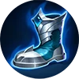

[Тир-лист](https://boostmlbb.ru/heroes/)[Предметы](https://boostmlbb.ru/items/)[Скины](https://boostmlbb.ru/skins/)[Новости и гайды](https://boostmlbb.ru/news/)

# Магические ботинки

Magic Boots

[Передвижение](https://boostmlbb.ru/items/#movement)Готовый предмет

Цена

720

-   **+40**Скорость передвижения
-   **+10%**Сокращение перезарядки
-   **+150**ОЗ

## Сборка

720Магические ботинки

-   [250Ботинки](https://boostmlbb.ru/items/boots.html "Ботинки")
-   [450Кольцо героя](https://boostmlbb.ru/items/heros-ring.html "Кольцо героя")

Детали стоят 700, сборка — ещё 20 золота.

## Другие предметы передвижения

[720Ботинки демонаБыстрая регенерация маны](https://boostmlbb.ru/items/demon-boots.html)[720Сапоги-скороходыВысокая скорость передвижения](https://boostmlbb.ru/items/rapid-boots.html)[720Сапоги спешкиСкорость АТК](https://boostmlbb.ru/items/swift-boots.html)[720Сапоги заклинателяМаг. проникновение](https://boostmlbb.ru/items/arcane-boots.html)[720Прочные сапогиСокращение длительности контроля](https://boostmlbb.ru/items/tough-boots.html)[720Сапоги воинаНакапливаемая физ. защита](https://boostmlbb.ru/items/warrior-boots.html)

[Все предметы](https://boostmlbb.ru/items/#movement)

**Поднимем ранг, пока вы заняты**Цена считается в калькуляторе

[Рассчитать цену](https://boostmlbb.ru/order.html)

## Частые вопросы

Сколько стоит «Магические ботинки» и из чего собирается?

720 золота. Детали: «Ботинки» (250) и «Кольцо героя» (450), сборка — ещё 20 золота.

Что даёт «Магические ботинки»?

+40 скорость передвижения, +10% сокращение перезарядки, +150 оз.
