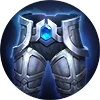

[Тир-лист](https://boostmlbb.ru/heroes/)[Предметы](https://boostmlbb.ru/items/)[Скины](https://boostmlbb.ru/skins/)[Новости и гайды](https://boostmlbb.ru/news/)

[Все предметы](https://boostmlbb.ru/items/)

# Плащ сопротивления магии

Magic Resist Cloak

[Защита](https://boostmlbb.ru/items/#defense)Деталь

Цена

220

-   **+14**Магическая защита

## Сборка

### Входит в

[1 880Сияющая броняПротив маг. урона](https://boostmlbb.ru/items/radiant-armor.html)[2 010Господство льдаСнижение исцеления](https://boostmlbb.ru/items/dominance-ice.html)[1 020Роба тишины](https://boostmlbb.ru/items/silence-robe.html)[780Щит из черного льда](https://boostmlbb.ru/items/black-ice-shield.html)[1 820Штормовой поясУрон для танков](https://boostmlbb.ru/items/thunder-belt.html)[1 910Проклятый шлемВыживаемость и зачистка линий](https://boostmlbb.ru/items/cursed-helmet.html)[720Прочные сапогиСокращение длительности контроля](https://boostmlbb.ru/items/tough-boots.html)

## Другие предметы защиты

[630Стальные ножные латы](https://boostmlbb.ru/items/steel-legplates.html)[730Броня неустра­шимости](https://boostmlbb.ru/items/dreadnaught-armor.html)[780Щит из черного льда](https://boostmlbb.ru/items/black-ice-shield.html)[1 020Роба тишины](https://boostmlbb.ru/items/silence-robe.html)[800Распла­вленная субстанция](https://boostmlbb.ru/items/molten-essence.html)[700Пояс Ареса](https://boostmlbb.ru/items/ares-belt.html)[450Кольцо героя](https://boostmlbb.ru/items/heros-ring.html)[140Исцеляющее ожерелье](https://boostmlbb.ru/items/healing-necklace.html)

[Все предметы](https://boostmlbb.ru/items/#defense)

**Поднимем ранг, пока вы заняты**Цена считается в калькуляторе

[Рассчитать цену](https://boostmlbb.ru/order.html)

## Частые вопросы

Сколько стоит «Плащ сопротивления магии»?

220 золота. Это базовая деталь, она не собирается из других и входит в «Сияющая броня», «Господство льда», «Роба тишины», «Щит из черного льда», «Штормовой пояс», «Проклятый шлем» и «Прочные сапоги».

Что даёт «Плащ сопротивления магии»?

+14 магическая защита.
