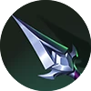

[Тир-лист](https://boostmlbb.ru/heroes/)[Предметы](https://boostmlbb.ru/items/)[Скины](https://boostmlbb.ru/skins/)[Новости и гайды](https://boostmlbb.ru/news/)

[Все предметы](https://boostmlbb.ru/items/)

# Злобный рык

Malefic Roar

[Атака](https://boostmlbb.ru/items/#attack)Готовый предмет

Цена

2 060

-   **+60**Физическая атака

## Эффект

Уникальный пассивный

### Пробивание брони

Физическое проникновение +30%.

Уникальный пассивный

### Разрушитель

При атаке за каждую единицу физической защиты цели физическое проникновение растёт на 0,1%, до 30%.

## Сборка

2 060Злобный рык

-   [910Меч легионера](https://boostmlbb.ru/items/legion-sword.html "Меч легионера")
    -   [250Кинжал](https://boostmlbb.ru/items/dagger.html "Кинжал")
    -   [250Кинжал](https://boostmlbb.ru/items/dagger.html "Кинжал")

Детали стоят 910, сборка — ещё 1 150 золота.

## Кто собирает

Герои, у которых предмет есть в популярной сборке в рейтинге, и процент побед с ней

-   [Нолан51,9%](https://boostmlbb.ru/heroes/nolan.html#build)
-   [Аулус52,7%](https://boostmlbb.ru/heroes/aulus.html#build)
-   [Пакито53,5%](https://boostmlbb.ru/heroes/paquito.html#build)
-   [Фанни47,9%](https://boostmlbb.ru/heroes/fanny.html#build)
-   [Чу51,2%](https://boostmlbb.ru/heroes/chou.html#build)
-   [Аргус63,3%](https://boostmlbb.ru/heroes/argus.html#build)
-   [Арлотт56,0%](https://boostmlbb.ru/heroes/arlott.html#build)
-   [Хаябуса51,4%](https://boostmlbb.ru/heroes/hayabusa.html#build)
-   [Бенедетта54,3%](https://boostmlbb.ru/heroes/benedetta.html#build)
-   [Алдос59,2%](https://boostmlbb.ru/heroes/aldous.html#build)
-   [Грейнджер46,3%](https://boostmlbb.ru/heroes/granger.html#build)
-   [Бэйн51,6%](https://boostmlbb.ru/heroes/bane.html#build)
-   [Наталья60,6%](https://boostmlbb.ru/heroes/natalia.html#build)
-   [Инь53,7%](https://boostmlbb.ru/heroes/yin.html#build)
-   [Кусака57,1%](https://boostmlbb.ru/heroes/jawhead.html#build)

## История

> Его прославил воин по прозвищу Западное Правосудие. Выстрел этого оружия пронзает зло и наводит страх на врагов.

[Изменения по патчам ↗](https://liquipedia.net/mobilelegends/Malefic_Roar#Version_History)

## Другие предметы атаки

[2 120Губительный пулеметДальность атаки](https://boostmlbb.ru/items/malefic-gun.html)[2 140Копье Великого драконаПерезарядка и крит](https://boostmlbb.ru/items/great-dragon-spear.html)[2 050ТрезубецСнижение исцеления](https://boostmlbb.ru/items/sea-halberd.html)[2 030Золотой метеорЩит при низких ОЗ](https://boostmlbb.ru/items/rose-gold-meteor.html)[2 010Удар охотникаКратковременное ускорение](https://boostmlbb.ru/items/hunter-strike.html)[3 010Клинок отчаянияМакс. физ. атака](https://boostmlbb.ru/items/blade-of-despair.html)[1 950Клинок семи морейЛучшее для убийц](https://boostmlbb.ru/items/blade-of-the-heptaseas.html)[1 880Говорящий с ветромУрон по площади](https://boostmlbb.ru/items/windtalker.html)

[Все предметы](https://boostmlbb.ru/items/#attack)

**Поднимем ранг, пока вы заняты**Цена считается в калькуляторе

[Рассчитать цену](https://boostmlbb.ru/order.html)

## Частые вопросы

Сколько стоит «Злобный рык» и из чего собирается?

2 060 золота. Детали: «Меч легионера» (910), сборка — ещё 1 150 золота.

Что даёт «Злобный рык»?

+60 физическая атака. «Пробивание брони»: физическое проникновение +30%. «Разрушитель»: при атаке за каждую единицу физической защиты цели физическое проникновение растёт на 0,1%, до 30%.

Каким героям собирать «Злобный рык»?

Предмет есть в популярных сборках 15 героев в рейтинге, среди них Нолан, Аулус, Пакито, Фанни, Чу и Аргус.
