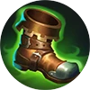

[Все предметы](https://boostmlbb.ru/items/)

# Благословения роума

[Роум](https://boostmlbb.ru/items/#roam)Благословение роума

## Варианты

### Поощрение

Пассивный: вы и союзные герои рядом получаете 20 дополнительной гибридной защиты.

Для драк всей командой.

### Благосклонность

Пассивный: раз в 15 с ваш следующий навык лечения или щита дополнительно восстанавливает 400 ОЗ союзному герою с наименьшим запасом ОЗ в радиусе 5 единиц, включая вас. Навыки, которые действуют только на вас, эффект не запускают.

Для героев, которые лечат и дают щиты.

### Острый удар

Пассивный: во время движения копится «Сила», скорость передвижения постепенно растёт (до 40). На 20 зарядах следующее попадание тратит все заряды и наносит дополнительный чистый урон, который зависит от их числа.

Для роумеров, которые много бегают и сами начинают драку.

### Маскировка

Активный: маскирует вас и союзных героев рядом и даёт 40% скорости передвижения на 5 с. Маскировка спадает, если получить или нанести урон.

Для засад и быстрых перебежек.

## Как работает

### Успешное развитие

Рядом с союзными героями вы получаете 30% опыта и золота от миньонов и монстров. Урон по вражеским героям (раз в 15 с) и обнаружение врагов тоже приносят опыт и золото. Навык благословения открывается, когда от «Успешного развития» накопится 1000 золота.

## Какие ботинки зачаровать

[720Ботинки демонаБыстрая регенерация маны](https://boostmlbb.ru/items/demon-boots.html)[720Сапоги-скороходыВысокая скорость передвижения](https://boostmlbb.ru/items/rapid-boots.html)[720Сапоги спешкиСкорость АТК](https://boostmlbb.ru/items/swift-boots.html)[720Сапоги заклинателяМаг. проникновение](https://boostmlbb.ru/items/arcane-boots.html)[720Магические ботинкиСокращение перезарядки](https://boostmlbb.ru/items/magic-boots.html)[720Прочные сапогиСокращение длительности контроля](https://boostmlbb.ru/items/tough-boots.html)[720Сапоги воинаНакапливаемая физ. защита](https://boostmlbb.ru/items/warrior-boots.html)

**Поднимем ранг, пока вы заняты**Цена считается в калькуляторе

[Рассчитать цену](https://boostmlbb.ru/order.html)

## Частые вопросы

Какие есть благословения роума в MLBB?

В игре 4: Поощрение, Благосклонность, Острый удар и Маскировка. Поощрение — для драк всей командой. Благосклонность — для героев, которые лечат и дают щиты. Острый удар — для роумеров, которые много бегают и сами начинают драку. Маскировка — для засад и быстрых перебежек.
