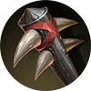

[Тир-лист](https://boostmlbb.ru/heroes/)[Предметы](https://boostmlbb.ru/items/)[Скины](https://boostmlbb.ru/skins/)[Новости и гайды](https://boostmlbb.ru/news/)

[Все предметы](https://boostmlbb.ru/items/)

# Золотой метеор

Rose Gold Meteor

[Атака](https://boostmlbb.ru/items/#attack)Готовый предмет

Цена

2 030

-   **+30**Физическая атака
-   **+20%**Скорость атаки
-   **+10%**Вампиризм

## Эффект

Уникальный пассивный

### Драконья чешуя

Каждые 4 единицы дополнительной физической атаки дают 1 гибридную защиту, до 50. Если основная роль героя не боец, эффект вдвое слабее.

Уникальный пассивный

### Спасение

Если урон опускает ОЗ ниже 30%, герой получает щит (120 × уровень героя) и 50% скорости передвижения, которая быстро спадает за 3 с. Перезарядка 60 с.

## Сборка

2 030Золотой метеор

-   [1 050Магический клинок](https://boostmlbb.ru/items/magic-blade.html "Магический клинок")
    -   [400Булава вампира](https://boostmlbb.ru/items/vampire-mallet.html "Булава вампира")
    -   [250Кинжал](https://boostmlbb.ru/items/dagger.html "Кинжал")
-   [280Нож](https://boostmlbb.ru/items/knife.html "Нож")

Детали стоят 1 330, сборка — ещё 700 золота.

## Кто собирает

Герои, у которых предмет есть в популярной сборке в рейтинге, и процент побед с ней

-   [Фрейя60,3%](https://boostmlbb.ru/heroes/freya.html#build)
-   [Аулус57,6%](https://boostmlbb.ru/heroes/aulus.html#build)
-   [Фанни47,9%](https://boostmlbb.ru/heroes/fanny.html#build)
-   [Дариус61,0%](https://boostmlbb.ru/heroes/dyrroth.html#build)
-   [Алдос62,4%](https://boostmlbb.ru/heroes/aldous.html#build)
-   [Пополь и Купа54,2%](https://boostmlbb.ru/heroes/popol-and-kupa.html#build)
-   [Ванван57,5%](https://boostmlbb.ru/heroes/wanwan.html#build)
-   [Роджер55,3%](https://boostmlbb.ru/heroes/roger.html#build)
-   [Зилонг53,0%](https://boostmlbb.ru/heroes/zilong.html#build)

## История

> Чешуя, что спасла Белого дракона от смертельного удара, после Битвы драконов стала артефактом и теперь покоится на Драконьем алтаре.

[Изменения по патчам ↗](https://liquipedia.net/mobilelegends/Rose_Gold_Meteor#Version_History)

## Другие предметы атаки

[2 120Губительный пулеметДальность атаки](https://boostmlbb.ru/items/malefic-gun.html)[2 140Копье Великого драконаПерезарядка и крит](https://boostmlbb.ru/items/great-dragon-spear.html)[2 050ТрезубецСнижение исцеления](https://boostmlbb.ru/items/sea-halberd.html)[2 010Удар охотникаКратковременное ускорение](https://boostmlbb.ru/items/hunter-strike.html)[3 010Клинок отчаянияМакс. физ. атака](https://boostmlbb.ru/items/blade-of-despair.html)[1 950Клинок семи морейЛучшее для убийц](https://boostmlbb.ru/items/blade-of-the-heptaseas.html)[1 880Говорящий с ветромУрон по площади](https://boostmlbb.ru/items/windtalker.html)[2 330Бесконечная битваУсиление базовой атаки](https://boostmlbb.ru/items/endless-battle.html)

[Все предметы](https://boostmlbb.ru/items/#attack)

**Поднимем ранг, пока вы заняты**Цена считается в калькуляторе

[Рассчитать цену](https://boostmlbb.ru/order.html)

## Частые вопросы

Сколько стоит «Золотой метеор» и из чего собирается?

2 030 золота. Детали: «Магический клинок» (1 050) и «Нож» (280), сборка — ещё 700 золота.

Что даёт «Золотой метеор»?

+30 физическая атака, +20% скорость атаки, +10% вампиризм. «Драконья чешуя»: каждые 4 единицы дополнительной физической атаки дают 1 гибридную защиту, до 50. Если основная роль героя не боец, эффект вдвое слабее. «Спасение»: если урон опускает ОЗ ниже 30%, герой получает щит (120 × уровень героя) и 50% скорости передвижения, которая быстро спадает за 3 с. Перезарядка 60 с.

Каким героям собирать «Золотой метеор»?

Предмет есть в популярных сборках 9 героев в рейтинге, среди них Фрейя, Аулус, Фанни, Дариус, Алдос и Пополь и Купа.
