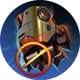

[Тир-лист](https://boostmlbb.ru/heroes/)[Предметы](https://boostmlbb.ru/items/)[Скины](https://boostmlbb.ru/skins/)[Новости и гайды](https://boostmlbb.ru/news/)

[Все предметы](https://boostmlbb.ru/items/)

# Запрет броска

Throw Forbidden

[Передвижение](https://boostmlbb.ru/items/#movement)Особый предмет[Только с героем Кусака](https://boostmlbb.ru/heroes/jawhead.html)

Цена

Бесплатно

## Эффект

Уникальный пассивный

### Тяжёлая гора

До конца матча союзный Кусака не может подхватить и бросить героя.

## Другие предметы передвижения

[Разрешение броска](https://boostmlbb.ru/items/allow-throw.html)[Разбитое сердце](https://boostmlbb.ru/items/broken-heart.html)

[Все предметы](https://boostmlbb.ru/items/#movement)

**Поднимем ранг, пока вы заняты**Цена считается в калькуляторе

[Рассчитать цену](https://boostmlbb.ru/order.html)

## Частые вопросы

Что даёт «Запрет броска»?

«Тяжёлая гора»: до конца матча союзный Кусака не может подхватить и бросить героя.
