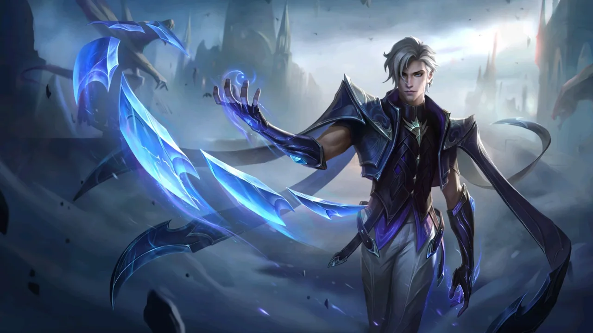
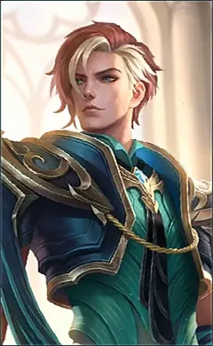

[Тир-лист](https://boostmlbb.ru/heroes/)[Предметы](https://boostmlbb.ru/items/)[Скины](https://boostmlbb.ru/skins/)[Новости и гайды](https://boostmlbb.ru/news/)

[Скины](https://boostmlbb.ru/skins/)/Эймон

# Скины Эймона

Скинов

5

Можно купить

2

Последний

[Похититель душ](https://boostmlbb.ru/skins/aamon/soul-reaver.html)2025

[Профиль героя→](https://boostmlbb.ru/heroes/aamon.html)

## Все скины

[Похититель душИзысканный · 2025](https://boostmlbb.ru/skins/aamon/soul-reaver.html)[Сосуд обманаГрандиозный · 2023](https://boostmlbb.ru/skins/aamon/vessel-of-deceit.html)[Кибер-убийцаИсключительный · 2023](https://boostmlbb.ru/skins/aamon/cyber-assassin.html)[Благо­родный гербОбычный · 2022](https://boostmlbb.ru/skins/aamon/noble-crest.html)[Лезвие ночиОбычный · 2021](https://boostmlbb.ru/skins/aamon/night-s-edge.html)

**Поднимем ранг на герое Эймон**Цена считается в калькуляторе

[Рассчитать цену](https://boostmlbb.ru/order.html?type=hero)

## Частые вопросы

Сколько скинов у Эймона?

5 скинов без стандартного облика. Последний — «Похититель душ» (Soul Reaver), 6 октября 2025.

Какие скины Эймона можно купить сейчас?

«Благородный герб» (599 алмазов), «Лезвие ночи» (269 алмазов). Остальные облики ограниченные и возвращаются только в событиях.

Какой самый редкий скин Эймона?

«Сосуд обмана» (Vessel of Deceit), класс грандиозный, серия «Сосуды души». Выходил в событии «Сосуды души». Ограниченные облики иногда возвращаются в розыгрышах событий.
