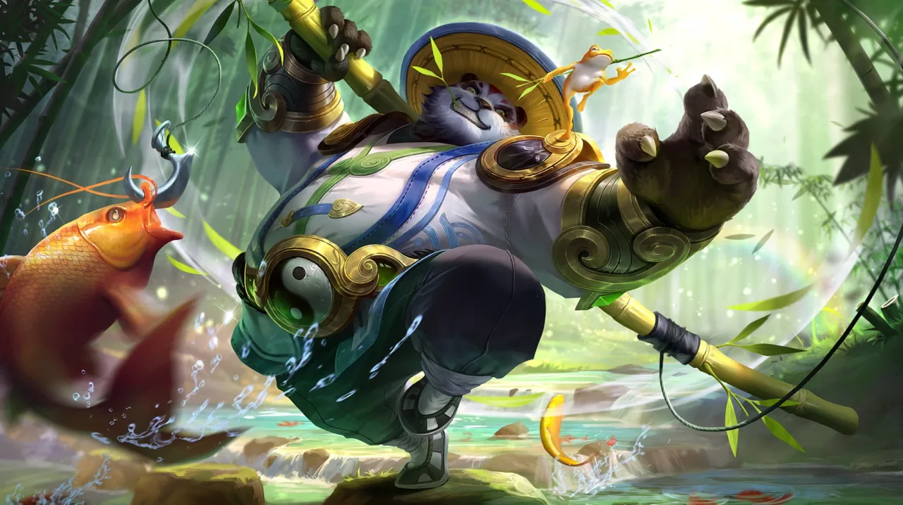

[Скины Акая](https://boostmlbb.ru/skins/akai.html)

[Скины](https://boostmlbb.ru/skins/)/[Акай](https://boostmlbb.ru/skins/akai.html)/Отшельник потока

[Скин Акая](https://boostmlbb.ru/skins/akai.html)

# Отшельник потока

Stream Recluse

Обычный CommonЭлитныйОграниченный

Как получить

Подарок за первое пополнение в сезоне 14.

Вышел

2020 год

## Что меняет облик

-   Новая внешность
-   Бонус к характеристикам

## Все скины Акая [9](https://boostmlbb.ru/skins/akai.html)

[Чудесный маэстроДелюкс · 2024](https://boostmlbb.ru/skins/akai/marvelous-maestro.html)[Тыквенный драчунИсключительный · 2023](https://boostmlbb.ru/skins/akai/pumpkin-brawler.html)[Кунг-фу ПандаГрандиозный · 2022](https://boostmlbb.ru/skins/akai/kung-fu-panda.html)[Уличный блюстительОбычный · 2021](https://boostmlbb.ru/skins/akai/street-enforcer.html)[Отшельник потокаОбычный · 2020](https://boostmlbb.ru/skins/akai/stream-recluse.html)[Самурай акадзонаэИсключительный · 2018](https://boostmlbb.ru/skins/akai/akazonae-samurai.html)[Имперский убийцаИзысканный · 2018](https://boostmlbb.ru/skins/akai/imperial-assassin.html)[МонахОбычный · 2017](https://boostmlbb.ru/skins/akai/monk.html)[Летняя вечеринкаИсключительный · 2016](https://boostmlbb.ru/skins/akai/summer-party.html)

## Серия «Элитный»

[Золотой османтусЧан'Э · 2026](https://boostmlbb.ru/skins/change/golden-osmanthus.html)[Король-воена­чальникМартис · 2025](https://boostmlbb.ru/skins/martis/warlord-king.html)[Кадет открытого моряКимми · 2024](https://boostmlbb.ru/skins/kimmy/high-seas-cadet.html)[Зелёная копейщицаСильвана · 2024](https://boostmlbb.ru/skins/silvanna/verdant-lancer.html)[Мародёр Кровавое КопытоХилос · 2024](https://boostmlbb.ru/skins/hylos/bloodhoof-marauder.html)[Изящная бабочкаГвиневра · 2024](https://boostmlbb.ru/skins/guinevere/elegant-butterfly.html)[Маркиз клинковЛанселот · 2024](https://boostmlbb.ru/skins/lancelot/marques-of-blades.html)[Привал в пустошахЧип · 2024](https://boostmlbb.ru/skins/chip/badlands-hiatus.html)

**Сколько стоит буст на герое Акай?**Выберите текущий и желаемый ранг. Стоимость появится на сайте.

[Рассчитать цену](https://boostmlbb.ru/order.html?type=hero)

## Частые вопросы

Как получить скин «Отшельник потока» на Акая?

Подарок за первое пополнение в сезоне 14.

Когда вышел скин «Отшельник потока»?

2020 год.

Какой класс у скина «Отшельник потока»?

Обычный (Common), серия «Элитный».
