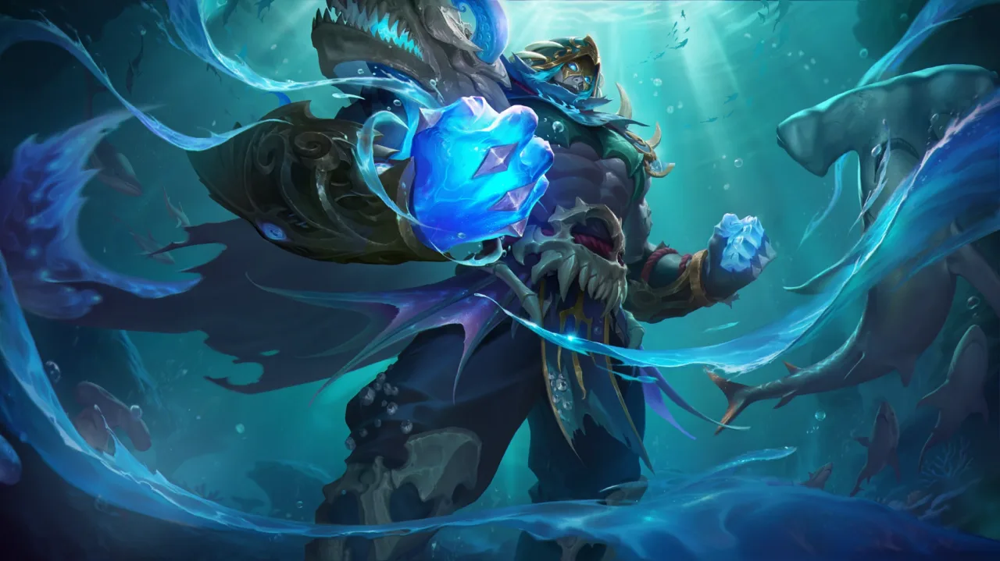

[Тир-лист](https://boostmlbb.ru/heroes/)[Предметы](https://boostmlbb.ru/items/)[Скины](https://boostmlbb.ru/skins/)[Новости и гайды](https://boostmlbb.ru/news/)

[Скины](https://boostmlbb.ru/skins/)/[Алдос](https://boostmlbb.ru/skins/aldous.html)/Ужас пучины

[Скин Алдоса](https://boostmlbb.ru/skins/aldous.html)

# Ужас пучины

Fathom Terror

Исключительный ExceptionalОсобыйОграниченный

Как получить

Выходил в магазине обликов во время события. Ограниченные облики иногда возвращаются в розыгрышах событий.

Вышел

15 августа 2025

## Что меняет облик

-   Новая внешность
-   Новые эффекты навыков
-   Анимация показа
-   Бонус к характеристикам

## Все скины Алдоса [10](https://boostmlbb.ru/skins/aldous.html)

[Ужас пучиныИсключительный · 2025](https://boostmlbb.ru/skins/aldous/fathom-terror.html)[Алдос, закли­натель туманаГрандиозный · 2023](https://boostmlbb.ru/skins/aldous/mistbender-aldous.html)[СтарскримГрандиозный · 2022](https://boostmlbb.ru/skins/aldous/starscream.html)[Страж мировИзысканный · 2021](https://boostmlbb.ru/skins/aldous/realm-watcher.html)[Пылающая силаДелюкс · 2020](https://boostmlbb.ru/skins/aldous/blazing-force.html)[Король превос­ходстваДелюкс · 2019](https://boostmlbb.ru/skins/aldous/king-of-supremacy.html)[Бесчувствен­ныйИсключительный · 2019](https://boostmlbb.ru/skins/aldous/the-insentient.html)[СмертьОбычный · 2019](https://boostmlbb.ru/skins/aldous/death.html)[Красная мантияОбычный · 2018](https://boostmlbb.ru/skins/aldous/red-mantle.html)[Наёмник2018](https://boostmlbb.ru/skins/aldous/contractor.html)

## Серия «Особый»

[Тайный вердиктМатильда · 2026](https://boostmlbb.ru/skins/mathilda/arcane-verdict.html)[Вальс на ветруВэйл · 2026](https://boostmlbb.ru/skins/vale/windborne-waltz.html)[Капитан потерянныхФранко · 2026](https://boostmlbb.ru/skins/franco/captain-of-the-lost.html)[ВолнорезЛи Сун-Син · 2025](https://boostmlbb.ru/skins/yi-sun-shin/wavebreaker.html)[Стальные рукиБаданг · 2025](https://boostmlbb.ru/skins/badang/steel-arms.html)[Леди с зонтикомКагура · 2025](https://boostmlbb.ru/skins/kagura/lady-parasol.html)[Труппа лунного светаЧан'Э · 2025](https://boostmlbb.ru/skins/change/moonglow-troupe.html)[Тайный магистратЭстес · 2025](https://boostmlbb.ru/skins/estes/arcane-magistrate.html)

**Поднимем ранг на герое Алдос**Цена считается в калькуляторе

[Рассчитать цену](https://boostmlbb.ru/order.html?type=hero)

## Частые вопросы

Как получить скин «Ужас пучины» на Алдоса?

Выходил в магазине обликов во время события. Ограниченные облики иногда возвращаются в розыгрышах событий.

Когда вышел скин «Ужас пучины»?

15 августа 2025.

Какой класс у скина «Ужас пучины»?

Исключительный (Exceptional), серия «Особый».
