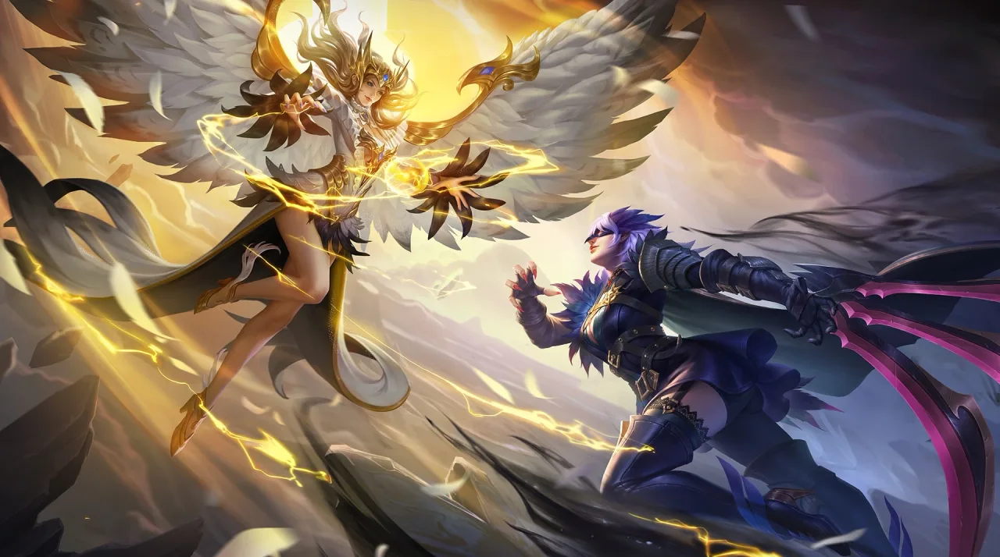

[Скины Алисы](https://boostmlbb.ru/skins/alice.html)

[Скины](https://boostmlbb.ru/skins/)/[Алиса](https://boostmlbb.ru/skins/alice.html)/Божественная сова

[Скин Алисы](https://boostmlbb.ru/skins/alice.html)

# Божественная сова

Divine Owl

Исключительный ExceptionalОсобыйВ продаже

Как получить

Продаётся в магазине обликов за 749 алмазов.

Цена

749 алмазов

Вышел

2018 год

## Что меняет облик

-   Новая внешность
-   Новые эффекты навыков
-   Анимация показа
-   Бонус к характеристикам

## Перекраски

Тот же облик в других цветах. Перекраска открывается, только если у вас уже есть сам облик.

-   **Божественный феникс** Divine Phoenix188 алмазов

## Все скины Алисы [7](https://boostmlbb.ru/skins/alice.html)

[Монархиня грёз2026](https://boostmlbb.ru/skins/alice/dreaming-monarch.html)[Соблазни­тельница даркнетаДелюкс · 2024](https://boostmlbb.ru/skins/alice/darknet-temptress.html)[Нефритовая импе­ратрицаОбычный · 2023](https://boostmlbb.ru/skins/alice/jade-empress.html)[Паровой планерИсключительный · 2019](https://boostmlbb.ru/skins/alice/steam-glider.html)[Божествен­ная соваИсключительный · 2018](https://boostmlbb.ru/skins/alice/divine-owl.html)[Учи­тельница магииИзысканный · 2017](https://boostmlbb.ru/skins/alice/wizardry-teacher.html)[Дух-покрови­тельницаОбычный · 2016](https://boostmlbb.ru/skins/alice/spirit-woman.html)

## Серия «Особый»

[Тайный вердиктМатильда · 2026](https://boostmlbb.ru/skins/mathilda/arcane-verdict.html)[Вальс на ветруВэйл · 2026](https://boostmlbb.ru/skins/vale/windborne-waltz.html)[Капитан потерянныхФранко · 2026](https://boostmlbb.ru/skins/franco/captain-of-the-lost.html)[ВолнорезЛи Сун-Син · 2025](https://boostmlbb.ru/skins/yi-sun-shin/wavebreaker.html)[Стальные рукиБаданг · 2025](https://boostmlbb.ru/skins/badang/steel-arms.html)[Леди с зонтикомКагура · 2025](https://boostmlbb.ru/skins/kagura/lady-parasol.html)[Ужас пучиныАлдос · 2025](https://boostmlbb.ru/skins/aldous/fathom-terror.html)[Труппа лунного светаЧан'Э · 2025](https://boostmlbb.ru/skins/change/moonglow-troupe.html)

**Сколько стоит буст на герое Алиса?**Выберите текущий и желаемый ранг. Стоимость появится на сайте.

[Рассчитать цену](https://boostmlbb.ru/order.html?type=hero)

## Частые вопросы

Как получить скин «Божественная сова» на Алису?

Продаётся в магазине обликов за 749 алмазов.

Когда вышел скин «Божественная сова»?

2018 год.

Какой класс у скина «Божественная сова»?

Исключительный (Exceptional), серия «Особый».
