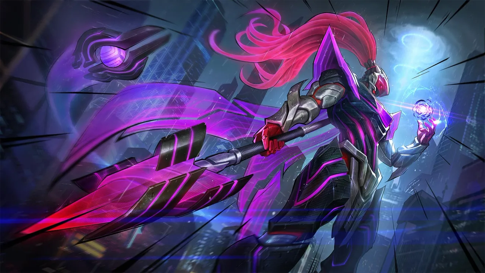
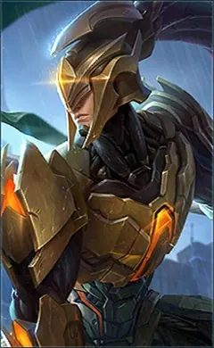

[Тир-лист](https://boostmlbb.ru/heroes/)[Предметы](https://boostmlbb.ru/items/)[Скины](https://boostmlbb.ru/skins/)[Новости и гайды](https://boostmlbb.ru/news/)

[Скины](https://boostmlbb.ru/skins/)/[Альфа](https://boostmlbb.ru/skins/alpha.html)/Генерал Пустота

[Скин Альфы](https://boostmlbb.ru/skins/alpha.html)

# Генерал Пустота

General Void

Грандиозный GrandABYSSОграниченный

Как получить

Выходил в событии «ABYSS». Ограниченные облики иногда возвращаются в розыгрышах событий.

Вышел

7 октября 2023

## Что меняет облик

-   Новая внешность
-   Новые эффекты навыков
-   Звуки навыков
-   Своя озвучка
-   Анимация показа
-   Сцена показа
-   Бонус к характеристикам

## Все скины Альфы [9](https://boostmlbb.ru/skins/alpha.html)

[Призрак розВысший · 2025](https://boostmlbb.ru/skins/alpha/revenant-of-roses.html)[Меха-король ПерсейИзысканный · 2024](https://boostmlbb.ru/skins/alpha/mecha-king-perseus.html)[Генерал ПустотаГрандиозный · 2023](https://boostmlbb.ru/skins/alpha/general-void.html)[Звёздный стражИсключительный · 2023](https://boostmlbb.ru/skins/alpha/star-enforcer.html)[Багровый воинИсключительный · 2020](https://boostmlbb.ru/skins/alpha/crimson-warrior.html)[Морской гладиаторОбычный · 2018](https://boostmlbb.ru/skins/alpha/sea-gladiator.html)[Свирепый драконОбычный · 2017](https://boostmlbb.ru/skins/alpha/fierce-dragon.html)[Командир ОнимусяИзысканный · 2017](https://boostmlbb.ru/skins/alpha/onimusha-commander.html)[Эдикт песков](https://boostmlbb.ru/skins/alpha/edict-of-the-sands.html)

## Серия «ABYSS»

[Воплощение рокаМосков · 2023](https://boostmlbb.ru/skins/moskov/doom-incarnate.html)[Рыцарь тениЛеоморд · 2023](https://boostmlbb.ru/skins/leomord/shadow-knight.html)[Леди МестьСелена · 2021](https://boostmlbb.ru/skins/selena/lady-vengeance.html)

**Поднимем ранг на герое Альфа**Цена считается в калькуляторе

[Рассчитать цену](https://boostmlbb.ru/order.html?type=hero)

## Частые вопросы

Как получить скин «Генерал Пустота» на Альфу?

Выходил в событии «ABYSS». Ограниченные облики иногда возвращаются в розыгрышах событий.

Когда вышел скин «Генерал Пустота»?

7 октября 2023.

Какой класс у скина «Генерал Пустота»?

Грандиозный (Grand), серия «ABYSS».
