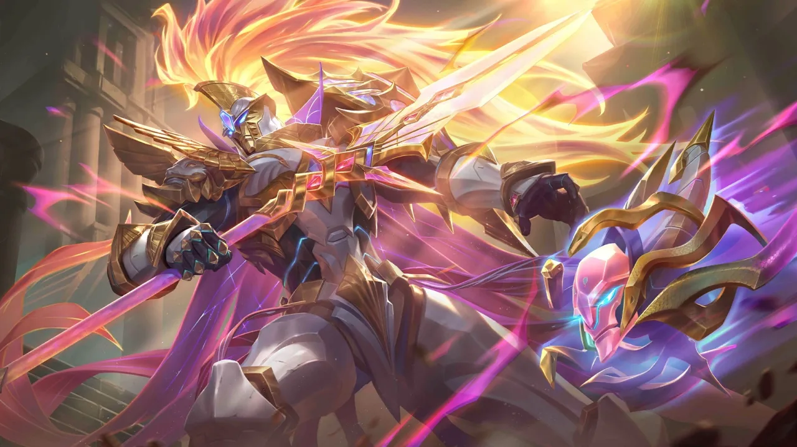

[Тир-лист](https://boostmlbb.ru/heroes/)[Предметы](https://boostmlbb.ru/items/)[Скины](https://boostmlbb.ru/skins/)[Новости и гайды](https://boostmlbb.ru/news/)

[Скины](https://boostmlbb.ru/skins/)/[Альфа](https://boostmlbb.ru/skins/alpha.html)/Меха-король Персей

[Скин Альфы](https://boostmlbb.ru/skins/alpha.html)

# Меха-король Персей

Mecha-King Perseus

Изысканный ExquisiteКоллекционныйОграниченный

Как получить

Главный приз розыгрыша в коллекционном событии, попытки покупаются за алмазы. Ограниченные облики иногда возвращаются в розыгрышах событий.

Вышел

май 2024

## Что меняет облик

-   Новая внешность
-   Новые эффекты навыков
-   Звуки навыков
-   Своя озвучка
-   Анимация показа
-   Сцена показа
-   Музыка показа
-   Особые действия
-   Бонус к характеристикам

## Все скины Альфы [9](https://boostmlbb.ru/skins/alpha.html)

[Призрак розВысший · 2025](https://boostmlbb.ru/skins/alpha/revenant-of-roses.html)[Меха-король ПерсейИзысканный · 2024](https://boostmlbb.ru/skins/alpha/mecha-king-perseus.html)[Генерал ПустотаГрандиозный · 2023](https://boostmlbb.ru/skins/alpha/general-void.html)[Звёздный стражИсключительный · 2023](https://boostmlbb.ru/skins/alpha/star-enforcer.html)[Багровый воинИсключительный · 2020](https://boostmlbb.ru/skins/alpha/crimson-warrior.html)[Морской гладиаторОбычный · 2018](https://boostmlbb.ru/skins/alpha/sea-gladiator.html)[Свирепый драконОбычный · 2017](https://boostmlbb.ru/skins/alpha/fierce-dragon.html)[Командир ОнимусяИзысканный · 2017](https://boostmlbb.ru/skins/alpha/onimusha-commander.html)[Эдикт песков](https://boostmlbb.ru/skins/alpha/edict-of-the-sands.html)

## Серия «Коллекционный»

[ОчистительБруно · 2026](https://boostmlbb.ru/skins/bruno/the-purifier.html)[Небесный бунтарьСан · 2026](https://boostmlbb.ru/skins/sun/celestial-rebel.html)[Кайдзю глубинХелкарт · 2026](https://boostmlbb.ru/skins/helcurt/kaiju-of-the-deep.html)[Звёздный дозорныйКимми · 2026](https://boostmlbb.ru/skins/kimmy/starbound-sentry.html)[Монархиня грёзАлиса · 2026](https://boostmlbb.ru/skins/alice/dreaming-monarch.html)[Дрожь глубинГрок · 2026](https://boostmlbb.ru/skins/grock/tremor-of-the-deep.html)[Небесный генералТигрил · 2026](https://boostmlbb.ru/skins/tigreal/celestial-general.html)[Монарх, рождённый солнцемКсавьер · 2026](https://boostmlbb.ru/skins/xavier/sunborn-monarch.html)

**Поднимем ранг на герое Альфа**Цена считается в калькуляторе

[Рассчитать цену](https://boostmlbb.ru/order.html?type=hero)

## Частые вопросы

Как получить скин «Меха-король Персей» на Альфу?

Главный приз розыгрыша в коллекционном событии, попытки покупаются за алмазы. Ограниченные облики иногда возвращаются в розыгрышах событий.

Когда вышел скин «Меха-король Персей»?

Май 2024.

Какой класс у скина «Меха-король Персей»?

Изысканный (Exquisite), серия «Коллекционный».
