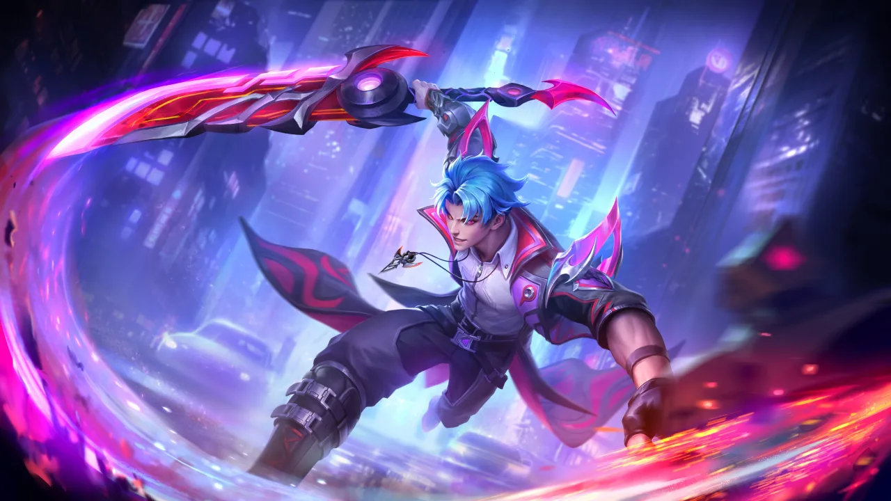

[Тир-лист](https://boostmlbb.ru/heroes/)[Предметы](https://boostmlbb.ru/items/)[Скины](https://boostmlbb.ru/skins/)[Новости и гайды](https://boostmlbb.ru/news/)

[Скины](https://boostmlbb.ru/skins/)/[Алукард](https://boostmlbb.ru/skins/alucard.html)/Погибель демонов

[Скин Алукарда](https://boostmlbb.ru/skins/alucard.html)

# Погибель демонов

Demon's Bane

Исключительный ExceptionalОсобыйОграниченный

Как получить

Подарок за первое пополнение в сезоне 36.

Вышел

19 марта 2025

## Что меняет облик

-   Новая внешность
-   Новые эффекты навыков
-   Сцена показа
-   Бонус к характеристикам

## Все скины Алукарда [10](https://boostmlbb.ru/skins/alucard.html)

[Погибель демоновИсключительный · 2025](https://boostmlbb.ru/skins/alucard/demon-s-bane.html)[Оби-Ван КенобиГрандиозный · 2021](https://boostmlbb.ru/skins/alucard/obi-wan-kenobi.html)[Рождённый светом: УдарникДелюкс · 2019](https://boostmlbb.ru/skins/alucard/lightborn-striker.html)[Агент ИмперииОбычный · 2019](https://boostmlbb.ru/skins/alucard/empire-agent.html)[Обсидиа­новый клинокВысший · 2019](https://boostmlbb.ru/skins/alucard/obsidian-blade.html)[Романти­ческая фантазияИсключительный · 2018](https://boostmlbb.ru/skins/alucard/romantic-fantasy.html)[ВиконтИсключительный · 2017](https://boostmlbb.ru/skins/alucard/viscount.html)[Дитя осениИзысканный · 2017](https://boostmlbb.ru/skins/alucard/child-of-the-fall.html)[Огненная преис­подняяОбычный · 2017](https://boostmlbb.ru/skins/alucard/fiery-inferno.html)[Одинокий геройОбычный · 2016](https://boostmlbb.ru/skins/alucard/lone-hero.html)

## Серия «Особый»

[Тайный вердиктМатильда · 2026](https://boostmlbb.ru/skins/mathilda/arcane-verdict.html)[Вальс на ветруВэйл · 2026](https://boostmlbb.ru/skins/vale/windborne-waltz.html)[Капитан потерянныхФранко · 2026](https://boostmlbb.ru/skins/franco/captain-of-the-lost.html)[ВолнорезЛи Сун-Син · 2025](https://boostmlbb.ru/skins/yi-sun-shin/wavebreaker.html)[Стальные рукиБаданг · 2025](https://boostmlbb.ru/skins/badang/steel-arms.html)[Леди с зонтикомКагура · 2025](https://boostmlbb.ru/skins/kagura/lady-parasol.html)[Ужас пучиныАлдос · 2025](https://boostmlbb.ru/skins/aldous/fathom-terror.html)[Труппа лунного светаЧан'Э · 2025](https://boostmlbb.ru/skins/change/moonglow-troupe.html)

**Поднимем ранг на герое Алукард**Цена считается в калькуляторе

[Рассчитать цену](https://boostmlbb.ru/order.html?type=hero)

## Частые вопросы

Как получить скин «Погибель демонов» на Алукарда?

Подарок за первое пополнение в сезоне 36.

Когда вышел скин «Погибель демонов»?

19 марта 2025.

Какой класс у скина «Погибель демонов»?

Исключительный (Exceptional), серия «Особый».
