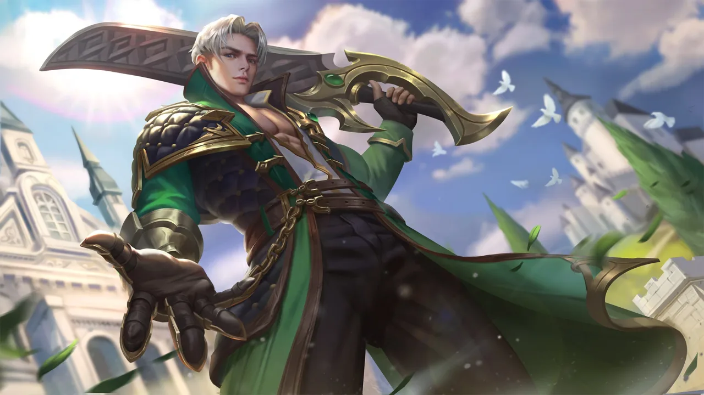

[Скины Алукарда](https://boostmlbb.ru/skins/alucard.html)

[Скины](https://boostmlbb.ru/skins/)/[Алукард](https://boostmlbb.ru/skins/alucard.html)/Одинокий герой

[Скин Алукарда](https://boostmlbb.ru/skins/alucard.html)

# Одинокий герой

Lone Hero

Обычный CommonВ продаже

Как получить

Продаётся в магазине обликов за 269 алмазов.

Цена

269 алмазов

Вышел

2016 год

## Что меняет облик

-   Бонус к характеристикам

## Все скины Алукарда [10](https://boostmlbb.ru/skins/alucard.html)

[Погибель демоновИсключительный · 2025](https://boostmlbb.ru/skins/alucard/demon-s-bane.html)[Оби-Ван КенобиГрандиозный · 2021](https://boostmlbb.ru/skins/alucard/obi-wan-kenobi.html)[Рождённый светом: УдарникДелюкс · 2019](https://boostmlbb.ru/skins/alucard/lightborn-striker.html)[Агент ИмперииОбычный · 2019](https://boostmlbb.ru/skins/alucard/empire-agent.html)[Обсидиа­новый клинокВысший · 2019](https://boostmlbb.ru/skins/alucard/obsidian-blade.html)[Романти­ческая фантазияИсключительный · 2018](https://boostmlbb.ru/skins/alucard/romantic-fantasy.html)[ВиконтИсключительный · 2017](https://boostmlbb.ru/skins/alucard/viscount.html)[Дитя осениИзысканный · 2017](https://boostmlbb.ru/skins/alucard/child-of-the-fall.html)[Огненная преис­подняяОбычный · 2017](https://boostmlbb.ru/skins/alucard/fiery-inferno.html)[Одинокий геройОбычный · 2016](https://boostmlbb.ru/skins/alucard/lone-hero.html)

**Сколько стоит буст на герое Алукард?**Выберите текущий и желаемый ранг. Стоимость появится на сайте.

[Рассчитать цену](https://boostmlbb.ru/order.html?type=hero)

## Частые вопросы

Как получить скин «Одинокий герой» на Алукарда?

Продаётся в магазине обликов за 269 алмазов.

Когда вышел скин «Одинокий герой»?

2016 год.

Какой класс у скина «Одинокий герой»?

Обычный (Common).
