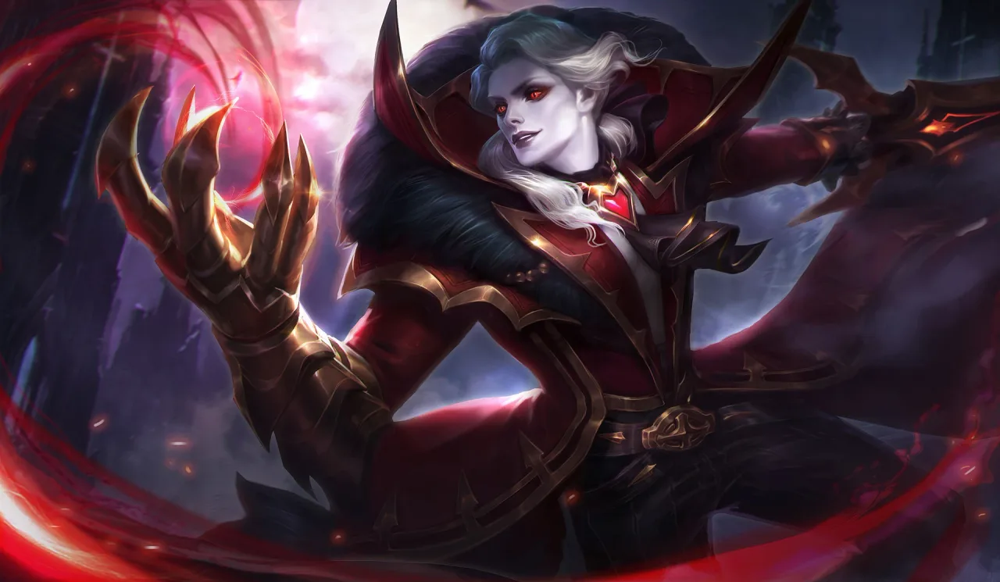

[Тир-лист](https://boostmlbb.ru/heroes/)[Предметы](https://boostmlbb.ru/items/)[Скины](https://boostmlbb.ru/skins/)[Новости и гайды](https://boostmlbb.ru/news/)

[Скины](https://boostmlbb.ru/skins/)/[Алукард](https://boostmlbb.ru/skins/alucard.html)/Виконт

[Скин Алукарда](https://boostmlbb.ru/skins/alucard.html)

# Виконт

Viscount

Исключительный ExceptionalЗвёздный участникОграниченный

Как получить

Награда «Звёздного участника» в декабре 2017.

Вышел

1 декабря 2017

## Что меняет облик

-   Новая внешность
-   Новые эффекты навыков
-   Анимация показа
-   Бонус к характеристикам

## Все скины Алукарда [10](https://boostmlbb.ru/skins/alucard.html)

[Погибель демоновИсключительный · 2025](https://boostmlbb.ru/skins/alucard/demon-s-bane.html)[Оби-Ван КенобиГрандиозный · 2021](https://boostmlbb.ru/skins/alucard/obi-wan-kenobi.html)[Рождённый светом: УдарникДелюкс · 2019](https://boostmlbb.ru/skins/alucard/lightborn-striker.html)[Агент ИмперииОбычный · 2019](https://boostmlbb.ru/skins/alucard/empire-agent.html)[Обсидиа­новый клинокВысший · 2019](https://boostmlbb.ru/skins/alucard/obsidian-blade.html)[Романти­ческая фантазияИсключительный · 2018](https://boostmlbb.ru/skins/alucard/romantic-fantasy.html)[ВиконтИсключительный · 2017](https://boostmlbb.ru/skins/alucard/viscount.html)[Дитя осениИзысканный · 2017](https://boostmlbb.ru/skins/alucard/child-of-the-fall.html)[Огненная преис­подняяОбычный · 2017](https://boostmlbb.ru/skins/alucard/fiery-inferno.html)[Одинокий геройОбычный · 2016](https://boostmlbb.ru/skins/alucard/lone-hero.html)

## Серия «Звёздный участник»

[Морячка, рождённая приливомКалеа · 2026](https://boostmlbb.ru/skins/kalea/tideborn-sailor.html)[Тень кицунэХаябуса · 2026](https://boostmlbb.ru/skins/hayabusa/kitsune-s-shadow.html)[Клыки резниХанзо · 2026](https://boostmlbb.ru/skins/hanzo/fangs-of-slaughter.html)[Тлеющая крепостьБелерик · 2026](https://boostmlbb.ru/skins/belerick/smouldering-fortress.html)[Магитех­нический призракОбсидия · 2026](https://boostmlbb.ru/skins/obsidia/magitech-wraith.html)[Элизийское сияниеЦзэтянь · 2026](https://boostmlbb.ru/skins/zetian/elysian-luminance.html)[Батальон стражейХильда · 2026](https://boostmlbb.ru/skins/hilda/guardian-battalion.html)[Мечта­тельный коиХарли · 2026](https://boostmlbb.ru/skins/harley/dreaming-koi.html)

**Поднимем ранг на герое Алукард**Цена считается в калькуляторе

[Рассчитать цену](https://boostmlbb.ru/order.html?type=hero)

## Частые вопросы

Как получить скин «Виконт» на Алукарда?

Награда «Звёздного участника» в декабре 2017.

Когда вышел скин «Виконт»?

1 декабря 2017.

Какой класс у скина «Виконт»?

Исключительный (Exceptional), серия «Звёздный участник».
