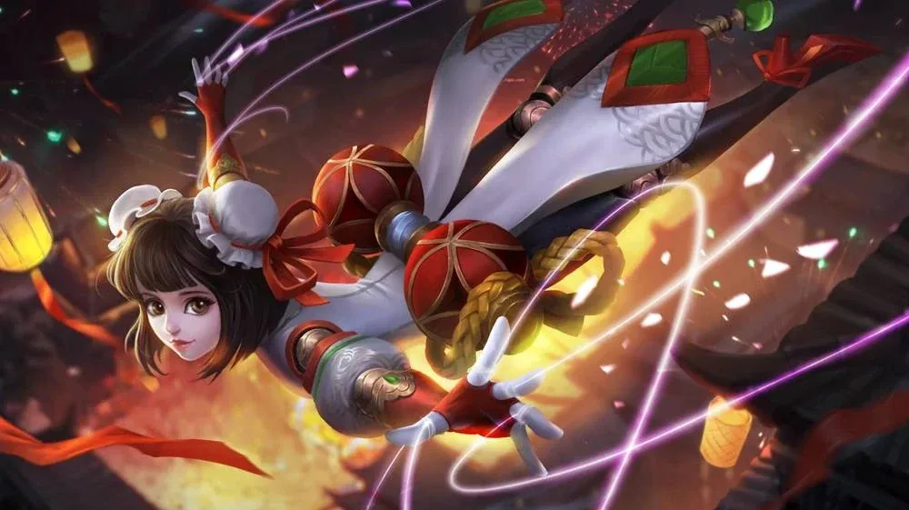

[Тир-лист](https://boostmlbb.ru/heroes/)[Предметы](https://boostmlbb.ru/items/)[Скины](https://boostmlbb.ru/skins/)[Новости и гайды](https://boostmlbb.ru/news/)

[Скины](https://boostmlbb.ru/skins/)/[Ангела](https://boostmlbb.ru/skins/angela.html)/Шанхайская дева

[Скин Ангелы](https://boostmlbb.ru/skins/angela.html)

# Шанхайская дева

Shanghai Maiden

Исключительный ExceptionalЗвёздный участникОграниченный

Как получить

Награда «Звёздного участника» в июле 2018.

Вышел

1 июля 2018

## Что меняет облик

-   Новая внешность
-   Новые эффекты навыков
-   Анимация показа
-   Бонус к характеристикам

## Все скины Ангелы [11](https://boostmlbb.ru/skins/angela.html)

[Нити судьбыГрандиозный · 2025](https://boostmlbb.ru/skins/angela/strings-of-fate.html)[Аватар времениИзысканный · 2023](https://boostmlbb.ru/skins/angela/avatar-of-time.html)[Струны сердцаГрандиозный · 2022](https://boostmlbb.ru/skins/angela/heartstring.html)[Цветочная эльфийкаИзысканный · 2021](https://boostmlbb.ru/skins/angela/floral-elf.html)[Кибер-херувимГрандиозный · 2020](https://boostmlbb.ru/skins/angela/cyber-cherubin.html)[Кричащая куклаИсключительный · 2019](https://boostmlbb.ru/skins/angela/scream-doll.html)[Оса V.E.N.O.M.Делюкс · 2019](https://boostmlbb.ru/skins/angela/v-e-n-o-m-vespid.html)[Летнее настроениеИсключительный · 2019](https://boostmlbb.ru/skins/angela/summer-vibes.html)[Шанхайская деваИсключительный · 2018](https://boostmlbb.ru/skins/angela/shanghai-maiden.html)[Голубка любвиОбычный · 2018](https://boostmlbb.ru/skins/angela/dove-love.html)[Заводная курьерша](https://boostmlbb.ru/skins/angela/wind-up-courier.html)

## Серия «Звёздный участник»

[Морячка, рождённая приливомКалеа · 2026](https://boostmlbb.ru/skins/kalea/tideborn-sailor.html)[Тень кицунэХаябуса · 2026](https://boostmlbb.ru/skins/hayabusa/kitsune-s-shadow.html)[Клыки резниХанзо · 2026](https://boostmlbb.ru/skins/hanzo/fangs-of-slaughter.html)[Тлеющая крепостьБелерик · 2026](https://boostmlbb.ru/skins/belerick/smouldering-fortress.html)[Магитех­нический призракОбсидия · 2026](https://boostmlbb.ru/skins/obsidia/magitech-wraith.html)[Элизийское сияниеЦзэтянь · 2026](https://boostmlbb.ru/skins/zetian/elysian-luminance.html)[Батальон стражейХильда · 2026](https://boostmlbb.ru/skins/hilda/guardian-battalion.html)[Мечта­тельный коиХарли · 2026](https://boostmlbb.ru/skins/harley/dreaming-koi.html)

**Поднимем ранг на герое Ангела**Цена считается в калькуляторе

[Рассчитать цену](https://boostmlbb.ru/order.html?type=hero)

## Частые вопросы

Как получить скин «Шанхайская дева» на Ангелу?

Награда «Звёздного участника» в июле 2018.

Когда вышел скин «Шанхайская дева»?

1 июля 2018.

Какой класс у скина «Шанхайская дева»?

Исключительный (Exceptional), серия «Звёздный участник».
