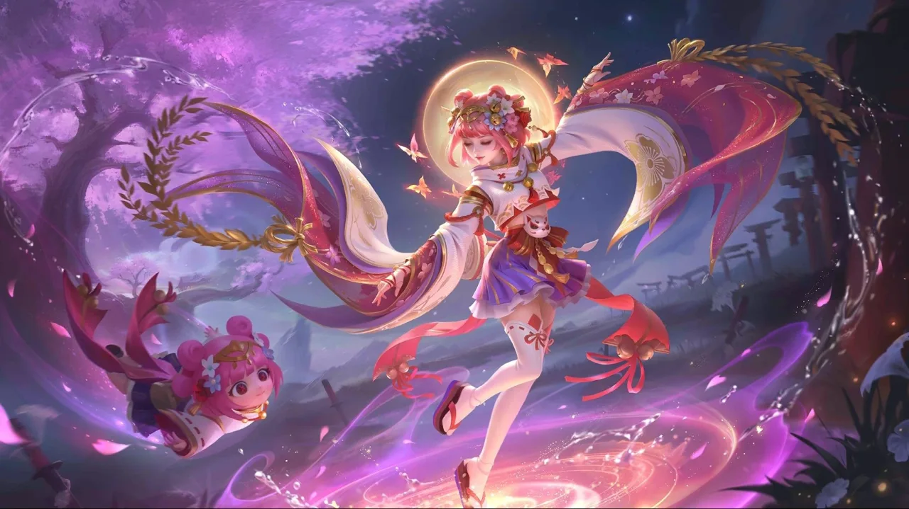
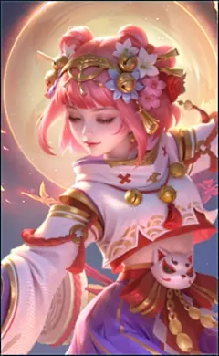

[Тир-лист](https://boostmlbb.ru/heroes/)[Предметы](https://boostmlbb.ru/items/)[Скины](https://boostmlbb.ru/skins/)[Новости и гайды](https://boostmlbb.ru/news/)

[Скины](https://boostmlbb.ru/skins/)/[Ангела](https://boostmlbb.ru/skins/angela.html)/Нити судьбы

[Скин Ангелы](https://boostmlbb.ru/skins/angela.html)

# Нити судьбы

Strings of Fate

Грандиозный GrandКисин дэнсэцуОграниченный

Как получить

Выходил в событии «Кисин дэнсэцу». Ограниченные облики иногда возвращаются в розыгрышах событий.

Вышел

7 февраля 2025

## Что меняет облик

-   Новая внешность
-   Новые эффекты навыков
-   Звуки навыков
-   Своя озвучка
-   Иконки навыков
-   Анимация показа
-   Сцена показа
-   Музыка показа
-   Анимация появления
-   Особые действия
-   Бонус к характеристикам

## Все скины Ангелы [11](https://boostmlbb.ru/skins/angela.html)

[Нити судьбыГрандиозный · 2025](https://boostmlbb.ru/skins/angela/strings-of-fate.html)[Аватар времениИзысканный · 2023](https://boostmlbb.ru/skins/angela/avatar-of-time.html)[Струны сердцаГрандиозный · 2022](https://boostmlbb.ru/skins/angela/heartstring.html)[Цветочная эльфийкаИзысканный · 2021](https://boostmlbb.ru/skins/angela/floral-elf.html)[Кибер-херувимГрандиозный · 2020](https://boostmlbb.ru/skins/angela/cyber-cherubin.html)[Кричащая куклаИсключительный · 2019](https://boostmlbb.ru/skins/angela/scream-doll.html)[Оса V.E.N.O.M.Делюкс · 2019](https://boostmlbb.ru/skins/angela/v-e-n-o-m-vespid.html)[Летнее настроениеИсключительный · 2019](https://boostmlbb.ru/skins/angela/summer-vibes.html)[Шанхайская деваИсключительный · 2018](https://boostmlbb.ru/skins/angela/shanghai-maiden.html)[Голубка любвиОбычный · 2018](https://boostmlbb.ru/skins/angela/dove-love.html)[Заводная курьерша](https://boostmlbb.ru/skins/angela/wind-up-courier.html)

## Серия «Кисин дэнсэцу»

[Страж святилищаЛанселот · 2025](https://boostmlbb.ru/skins/lancelot/guardian-of-the-shrine.html)[Дыхание НаракиКэрри · 2025](https://boostmlbb.ru/skins/karrie/breath-of-naraka.html)

**Поднимем ранг на герое Ангела**Цена считается в калькуляторе

[Рассчитать цену](https://boostmlbb.ru/order.html?type=hero)

## Частые вопросы

Как получить скин «Нити судьбы» на Ангелу?

Выходил в событии «Кисин дэнсэцу». Ограниченные облики иногда возвращаются в розыгрышах событий.

Когда вышел скин «Нити судьбы»?

7 февраля 2025.

Какой класс у скина «Нити судьбы»?

Грандиозный (Grand), серия «Кисин дэнсэцу».
