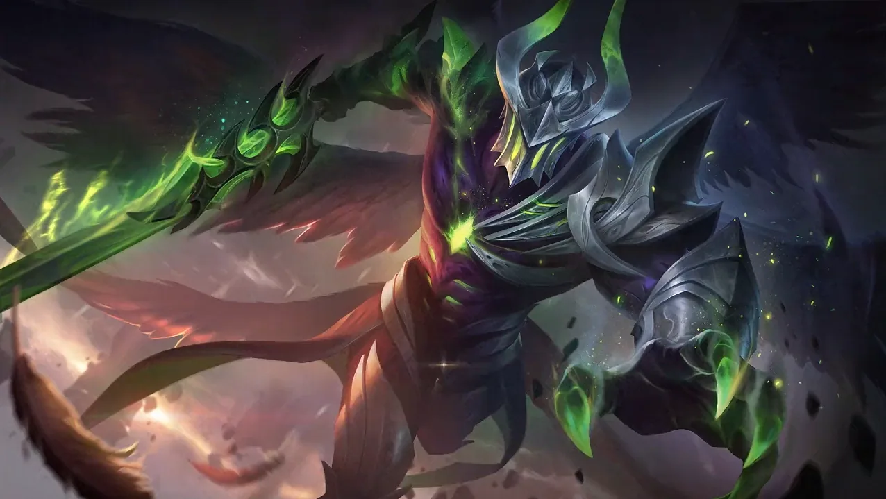

[Тир-лист](https://boostmlbb.ru/heroes/)[Предметы](https://boostmlbb.ru/items/)[Скины](https://boostmlbb.ru/skins/)[Новости и гайды](https://boostmlbb.ru/news/)

[Скины](https://boostmlbb.ru/skins/)/Аргус

# Скины Аргуса

Скинов

6

Можно купить

2

Последний

[Райден-мару](https://boostmlbb.ru/skins/argus/raiden-maru.html)2026

[Профиль героя→](https://boostmlbb.ru/heroes/argus.html)

## Все скины

[Райден-маруИзысканный · 2026](https://boostmlbb.ru/skins/argus/raiden-maru.html)[Дарт ВейдерГрандиозный · 2021](https://boostmlbb.ru/skins/argus/darth-vader.html)[Крылатый кошмарОбычный · 2019](https://boostmlbb.ru/skins/argus/winged-nightmare.html)[КатастрофаОбычный · 2018](https://boostmlbb.ru/skins/argus/catastrophe.html)[Тёмный драконИсключительный · 2017](https://boostmlbb.ru/skins/argus/dark-draconic.html)[Свет зариОбычный · 2017](https://boostmlbb.ru/skins/argus/light-of-dawn.html)

**Поднимем ранг на герое Аргус**Цена считается в калькуляторе

[Рассчитать цену](https://boostmlbb.ru/order.html?type=hero)

## Частые вопросы

Сколько скинов у Аргуса?

6 скинов без стандартного облика. Последний — «Райден-мару» (Raiden Maru), 1 сентября 2026.

Какие скины Аргуса можно купить сейчас?

«Катастрофа» (599 алмазов), «Свет зари» (269 алмазов). Остальные облики ограниченные и возвращаются только в событиях.

Какой самый редкий скин Аргуса?

«Дарт Вейдер» (Darth Vader), класс грандиозный, серия «Звёздные войны». Выходил в событии коллаборации MLBB × Звёздные войны. Ограниченные облики иногда возвращаются в розыгрышах событий.
