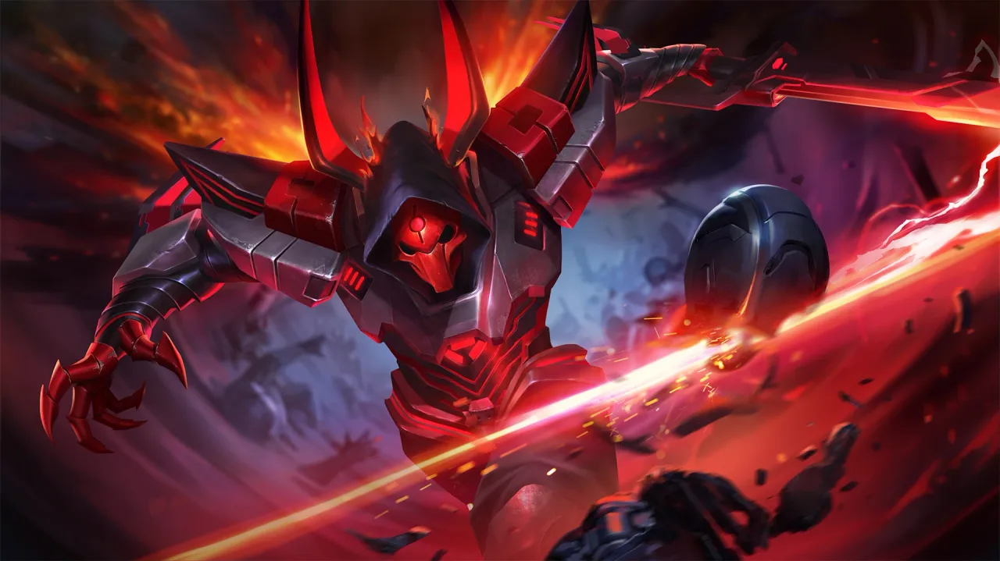

[Скины Аргуса](https://boostmlbb.ru/skins/argus.html)

[Скины](https://boostmlbb.ru/skins/)/[Аргус](https://boostmlbb.ru/skins/argus.html)/Катастрофа

[Скин Аргуса](https://boostmlbb.ru/skins/argus.html)

# Катастрофа

Catastrophe

Обычный CommonЭлитныйВ продаже

Как получить

Продаётся в магазине обликов за 599 алмазов.

Цена

599 алмазов

Вышел

2018 год

## Что меняет облик

-   Новая внешность
-   Другой цвет эффектов
-   Анимация показа
-   Бонус к характеристикам

## Перекраски

Тот же облик в других цветах. Перекраска открывается, только если у вас уже есть сам облик.

-   **Проклятие** Malediction188 алмазов

## Все скины Аргуса [6](https://boostmlbb.ru/skins/argus.html)

[Райден-маруИзысканный · 2026](https://boostmlbb.ru/skins/argus/raiden-maru.html)[Дарт ВейдерГрандиозный · 2021](https://boostmlbb.ru/skins/argus/darth-vader.html)[Крылатый кошмарОбычный · 2019](https://boostmlbb.ru/skins/argus/winged-nightmare.html)[КатастрофаОбычный · 2018](https://boostmlbb.ru/skins/argus/catastrophe.html)[Тёмный драконИсключительный · 2017](https://boostmlbb.ru/skins/argus/dark-draconic.html)[Свет зариОбычный · 2017](https://boostmlbb.ru/skins/argus/light-of-dawn.html)

## Серия «Элитный»

[Золотой османтусЧан'Э · 2026](https://boostmlbb.ru/skins/change/golden-osmanthus.html)[Король-воена­чальникМартис · 2025](https://boostmlbb.ru/skins/martis/warlord-king.html)[Кадет открытого моряКимми · 2024](https://boostmlbb.ru/skins/kimmy/high-seas-cadet.html)[Зелёная копейщицаСильвана · 2024](https://boostmlbb.ru/skins/silvanna/verdant-lancer.html)[Мародёр Кровавое КопытоХилос · 2024](https://boostmlbb.ru/skins/hylos/bloodhoof-marauder.html)[Изящная бабочкаГвиневра · 2024](https://boostmlbb.ru/skins/guinevere/elegant-butterfly.html)[Маркиз клинковЛанселот · 2024](https://boostmlbb.ru/skins/lancelot/marques-of-blades.html)[Привал в пустошахЧип · 2024](https://boostmlbb.ru/skins/chip/badlands-hiatus.html)

**Сколько стоит буст на герое Аргус?**Выберите текущий и желаемый ранг. Стоимость появится на сайте.

[Рассчитать цену](https://boostmlbb.ru/order.html?type=hero)

## Частые вопросы

Как получить скин «Катастрофа» на Аргуса?

Продаётся в магазине обликов за 599 алмазов.

Когда вышел скин «Катастрофа»?

2018 год.

Какой класс у скина «Катастрофа»?

Обычный (Common), серия «Элитный».
