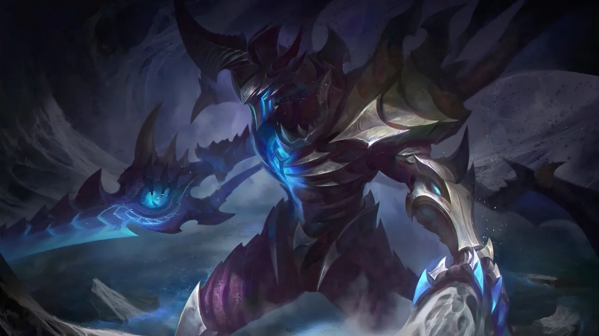
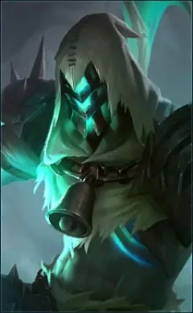

[Скины Аргуса](https://boostmlbb.ru/skins/argus.html)

[Скины](https://boostmlbb.ru/skins/)/[Аргус](https://boostmlbb.ru/skins/argus.html)/Тёмный дракон

[Скин Аргуса](https://boostmlbb.ru/skins/argus.html)

# Тёмный дракон

Dark Draconic

Исключительный ExceptionalЗвёздный участникОграниченный

Как получить

Награда «Звёздного участника» в ноябре 2017.

Вышел

1 ноября 2017

## Что меняет облик

-   Новая внешность
-   Новые эффекты навыков
-   Анимация показа
-   Бонус к характеристикам

## Все скины Аргуса [6](https://boostmlbb.ru/skins/argus.html)

[Райден-маруИзысканный · 2026](https://boostmlbb.ru/skins/argus/raiden-maru.html)[Дарт ВейдерГрандиозный · 2021](https://boostmlbb.ru/skins/argus/darth-vader.html)[Крылатый кошмарОбычный · 2019](https://boostmlbb.ru/skins/argus/winged-nightmare.html)[КатастрофаОбычный · 2018](https://boostmlbb.ru/skins/argus/catastrophe.html)[Тёмный драконИсключительный · 2017](https://boostmlbb.ru/skins/argus/dark-draconic.html)[Свет зариОбычный · 2017](https://boostmlbb.ru/skins/argus/light-of-dawn.html)

## Серия «Звёздный участник»

[Морячка, рождённая приливомКалеа · 2026](https://boostmlbb.ru/skins/kalea/tideborn-sailor.html)[Тень кицунэХаябуса · 2026](https://boostmlbb.ru/skins/hayabusa/kitsune-s-shadow.html)[Клыки резниХанзо · 2026](https://boostmlbb.ru/skins/hanzo/fangs-of-slaughter.html)[Тлеющая крепостьБелерик · 2026](https://boostmlbb.ru/skins/belerick/smouldering-fortress.html)[Магитех­нический призракОбсидия · 2026](https://boostmlbb.ru/skins/obsidia/magitech-wraith.html)[Элизийское сияниеЦзэтянь · 2026](https://boostmlbb.ru/skins/zetian/elysian-luminance.html)[Батальон стражейХильда · 2026](https://boostmlbb.ru/skins/hilda/guardian-battalion.html)[Мечта­тельный коиХарли · 2026](https://boostmlbb.ru/skins/harley/dreaming-koi.html)

**Сколько стоит буст на герое Аргус?**Выберите текущий и желаемый ранг. Стоимость появится на сайте.

[Рассчитать цену](https://boostmlbb.ru/order.html?type=hero)

## Частые вопросы

Как получить скин «Тёмный дракон» на Аргуса?

Награда «Звёздного участника» в ноябре 2017.

Когда вышел скин «Тёмный дракон»?

1 ноября 2017.

Какой класс у скина «Тёмный дракон»?

Исключительный (Exceptional), серия «Звёздный участник».
