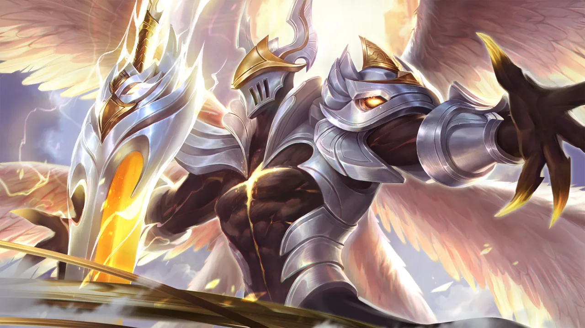

[Скины Аргуса](https://boostmlbb.ru/skins/argus.html)

[Скины](https://boostmlbb.ru/skins/)/[Аргус](https://boostmlbb.ru/skins/argus.html)/Свет зари

[Скин Аргуса](https://boostmlbb.ru/skins/argus.html)

# Свет зари

Light of Dawn

Обычный CommonВ продаже

Как получить

Продаётся в магазине обликов за 269 алмазов.

Цена

269 алмазов

Вышел

29 сентября 2017

## Что меняет облик

-   Бонус к характеристикам

## Все скины Аргуса [6](https://boostmlbb.ru/skins/argus.html)

[Райден-маруИзысканный · 2026](https://boostmlbb.ru/skins/argus/raiden-maru.html)[Дарт ВейдерГрандиозный · 2021](https://boostmlbb.ru/skins/argus/darth-vader.html)[Крылатый кошмарОбычный · 2019](https://boostmlbb.ru/skins/argus/winged-nightmare.html)[КатастрофаОбычный · 2018](https://boostmlbb.ru/skins/argus/catastrophe.html)[Тёмный драконИсключительный · 2017](https://boostmlbb.ru/skins/argus/dark-draconic.html)[Свет зариОбычный · 2017](https://boostmlbb.ru/skins/argus/light-of-dawn.html)

**Сколько стоит буст на герое Аргус?**Выберите текущий и желаемый ранг. Стоимость появится на сайте.

[Рассчитать цену](https://boostmlbb.ru/order.html?type=hero)

## Частые вопросы

Как получить скин «Свет зари» на Аргуса?

Продаётся в магазине обликов за 269 алмазов.

Когда вышел скин «Свет зари»?

29 сентября 2017.

Какой класс у скина «Свет зари»?

Обычный (Common).
