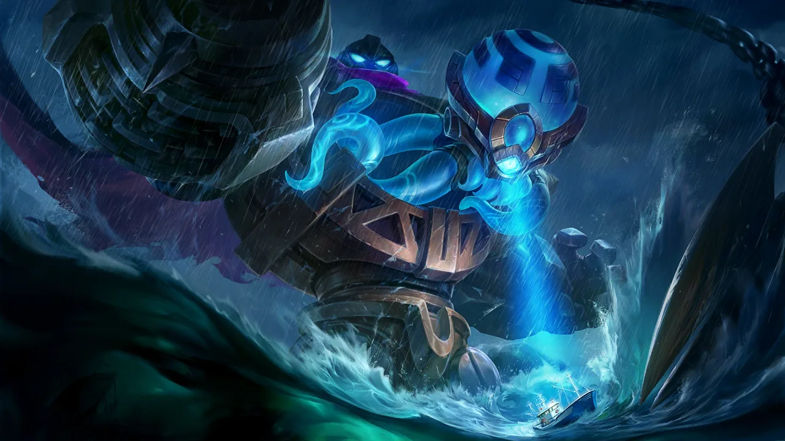

[Тир-лист](https://boostmlbb.ru/heroes/)[Предметы](https://boostmlbb.ru/items/)[Скины](https://boostmlbb.ru/skins/)[Новости и гайды](https://boostmlbb.ru/news/)

[Скины](https://boostmlbb.ru/skins/)/Атлас

# Скины Атласа

Скинов

7

Можно купить

2

Последний

[Затонувшее проклятие](https://boostmlbb.ru/skins/atlas/sunken-curse.html)2026

[Профиль героя→](https://boostmlbb.ru/heroes/atlas.html)

## Все скины

ВсеИзысканныйДелюксИсключительныйОбычный

[Затонувшее проклятиеДелюкс · 2026](https://boostmlbb.ru/skins/atlas/sunken-curse.html)[Меха-ИнфернусИзысканный · 2024](https://boostmlbb.ru/skins/atlas/mecha-infernus.html)[Руна часовогоДелюкс · 2023](https://boostmlbb.ru/skins/atlas/rune-of-sentinel.html)[Косми­ческий мехИсключительный · 2022](https://boostmlbb.ru/skins/atlas/space-mech.html)[Топливная турбинаОбычный · 2020](https://boostmlbb.ru/skins/atlas/fuel-turbine.html)[Ядро реактораОбычный · 2020](https://boostmlbb.ru/skins/atlas/reactor-core.html)[Тень водоворота](https://boostmlbb.ru/skins/atlas/maelstrom-lurker.html)

**Поднимем ранг на герое Атлас**Цена считается в калькуляторе

[Рассчитать цену](https://boostmlbb.ru/order.html?type=hero)

## Частые вопросы

Сколько скинов у Атласа?

7 скинов без стандартного облика. Последний — «Затонувшее проклятие» (Sunken Curse), 9 февраля 2026.

Какие скины Атласа можно купить сейчас?

«Топливная турбина» (599 алмазов), «Ядро реактора» (269 алмазов). Остальные облики ограниченные и возвращаются только в событиях.

Какой самый редкий скин Атласа?

«Меха-Инфернус» (Mecha Infernus), класс изысканный, серия «Коллекционный». Главный приз розыгрыша в коллекционном событии, попытки покупаются за алмазы. Ограниченные облики иногда возвращаются в розыгрышах событий.
