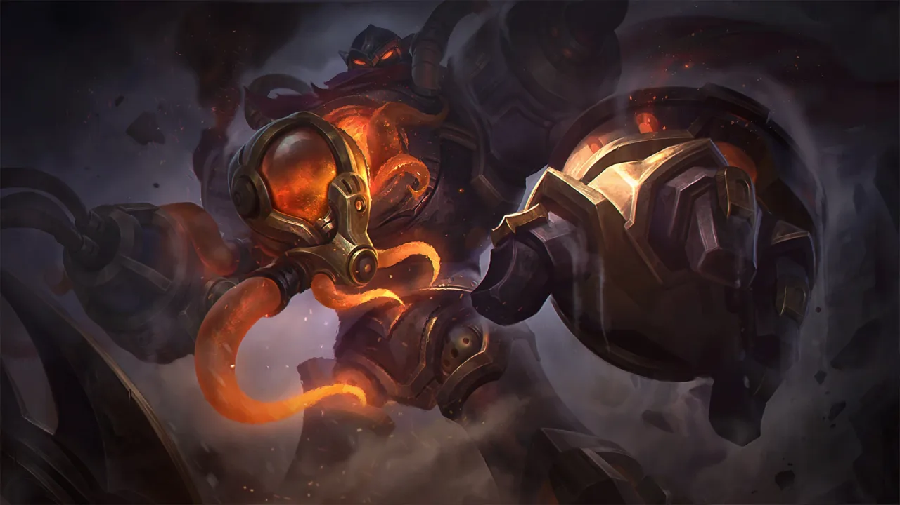

[Тир-лист](https://boostmlbb.ru/heroes/)[Предметы](https://boostmlbb.ru/items/)[Скины](https://boostmlbb.ru/skins/)[Новости и гайды](https://boostmlbb.ru/news/)

[Скины](https://boostmlbb.ru/skins/)/[Атлас](https://boostmlbb.ru/skins/atlas.html)/Топливная турбина

[Скин Атласа](https://boostmlbb.ru/skins/atlas.html)

# Топливная турбина

Fuel Turbine

Обычный CommonЭлитныйВ продаже

Как получить

Продаётся в магазине обликов за 599 алмазов.

Цена

599 алмазов

Вышел

7 сентября 2020

## Что меняет облик

-   Новая внешность
-   Другой цвет эффектов
-   Анимация показа
-   Бонус к характеристикам

## Перекраски

Тот же облик в других цветах. Перекраска открывается, только если у вас уже есть сам облик.

-   **Боевая турбина** Battle TurbineНаграда «Звёздного участника» в марте 2022.

## Все скины Атласа [7](https://boostmlbb.ru/skins/atlas.html)

[Затонувшее проклятиеДелюкс · 2026](https://boostmlbb.ru/skins/atlas/sunken-curse.html)[Меха-ИнфернусИзысканный · 2024](https://boostmlbb.ru/skins/atlas/mecha-infernus.html)[Руна часовогоДелюкс · 2023](https://boostmlbb.ru/skins/atlas/rune-of-sentinel.html)[Косми­ческий мехИсключительный · 2022](https://boostmlbb.ru/skins/atlas/space-mech.html)[Топливная турбинаОбычный · 2020](https://boostmlbb.ru/skins/atlas/fuel-turbine.html)[Ядро реактораОбычный · 2020](https://boostmlbb.ru/skins/atlas/reactor-core.html)[Тень водоворота](https://boostmlbb.ru/skins/atlas/maelstrom-lurker.html)

## Серия «Элитный»

[Золотой османтусЧан'Э · 2026](https://boostmlbb.ru/skins/change/golden-osmanthus.html)[Король-воена­чальникМартис · 2025](https://boostmlbb.ru/skins/martis/warlord-king.html)[Кадет открытого моряКимми · 2024](https://boostmlbb.ru/skins/kimmy/high-seas-cadet.html)[Зелёная копейщицаСильвана · 2024](https://boostmlbb.ru/skins/silvanna/verdant-lancer.html)[Мародёр Кровавое КопытоХилос · 2024](https://boostmlbb.ru/skins/hylos/bloodhoof-marauder.html)[Изящная бабочкаГвиневра · 2024](https://boostmlbb.ru/skins/guinevere/elegant-butterfly.html)[Маркиз клинковЛанселот · 2024](https://boostmlbb.ru/skins/lancelot/marques-of-blades.html)[Привал в пустошахЧип · 2024](https://boostmlbb.ru/skins/chip/badlands-hiatus.html)

**Поднимем ранг на герое Атлас**Цена считается в калькуляторе

[Рассчитать цену](https://boostmlbb.ru/order.html?type=hero)

## Частые вопросы

Как получить скин «Топливная турбина» на Атласа?

Продаётся в магазине обликов за 599 алмазов.

Когда вышел скин «Топливная турбина»?

7 сентября 2020.

Какой класс у скина «Топливная турбина»?

Обычный (Common), серия «Элитный».
