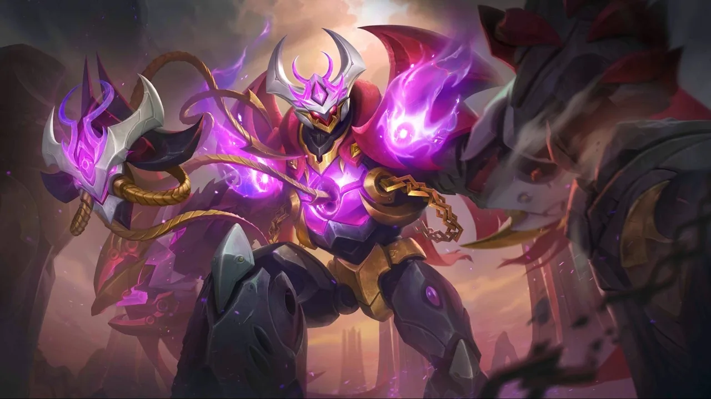

[Тир-лист](https://boostmlbb.ru/heroes/)[Предметы](https://boostmlbb.ru/items/)[Скины](https://boostmlbb.ru/skins/)[Новости и гайды](https://boostmlbb.ru/news/)

[Скины](https://boostmlbb.ru/skins/)/[Атлас](https://boostmlbb.ru/skins/atlas.html)/Меха-Инфернус

[Скин Атласа](https://boostmlbb.ru/skins/atlas.html)

# Меха-Инфернус

Mecha Infernus

Изысканный ExquisiteКоллекционныйОграниченный

Как получить

Главный приз розыгрыша в коллекционном событии, попытки покупаются за алмазы. Ограниченные облики иногда возвращаются в розыгрышах событий.

Вышел

сентябрь 2024

## Что меняет облик

-   Новая внешность
-   Новые эффекты навыков
-   Звуки навыков
-   Своя озвучка
-   Анимация показа
-   Сцена показа
-   Музыка показа
-   Особые действия
-   Бонус к характеристикам

## Все скины Атласа [7](https://boostmlbb.ru/skins/atlas.html)

[Затонувшее проклятиеДелюкс · 2026](https://boostmlbb.ru/skins/atlas/sunken-curse.html)[Меха-ИнфернусИзысканный · 2024](https://boostmlbb.ru/skins/atlas/mecha-infernus.html)[Руна часовогоДелюкс · 2023](https://boostmlbb.ru/skins/atlas/rune-of-sentinel.html)[Косми­ческий мехИсключительный · 2022](https://boostmlbb.ru/skins/atlas/space-mech.html)[Топливная турбинаОбычный · 2020](https://boostmlbb.ru/skins/atlas/fuel-turbine.html)[Ядро реактораОбычный · 2020](https://boostmlbb.ru/skins/atlas/reactor-core.html)[Тень водоворота](https://boostmlbb.ru/skins/atlas/maelstrom-lurker.html)

## Серия «Коллекционный»

[ОчистительБруно · 2026](https://boostmlbb.ru/skins/bruno/the-purifier.html)[Небесный бунтарьСан · 2026](https://boostmlbb.ru/skins/sun/celestial-rebel.html)[Кайдзю глубинХелкарт · 2026](https://boostmlbb.ru/skins/helcurt/kaiju-of-the-deep.html)[Звёздный дозорныйКимми · 2026](https://boostmlbb.ru/skins/kimmy/starbound-sentry.html)[Монархиня грёзАлиса · 2026](https://boostmlbb.ru/skins/alice/dreaming-monarch.html)[Дрожь глубинГрок · 2026](https://boostmlbb.ru/skins/grock/tremor-of-the-deep.html)[Небесный генералТигрил · 2026](https://boostmlbb.ru/skins/tigreal/celestial-general.html)[Монарх, рождённый солнцемКсавьер · 2026](https://boostmlbb.ru/skins/xavier/sunborn-monarch.html)

**Поднимем ранг на герое Атлас**Цена считается в калькуляторе

[Рассчитать цену](https://boostmlbb.ru/order.html?type=hero)

## Частые вопросы

Как получить скин «Меха-Инфернус» на Атласа?

Главный приз розыгрыша в коллекционном событии, попытки покупаются за алмазы. Ограниченные облики иногда возвращаются в розыгрышах событий.

Когда вышел скин «Меха-Инфернус»?

Сентябрь 2024.

Какой класс у скина «Меха-Инфернус»?

Изысканный (Exquisite), серия «Коллекционный».
