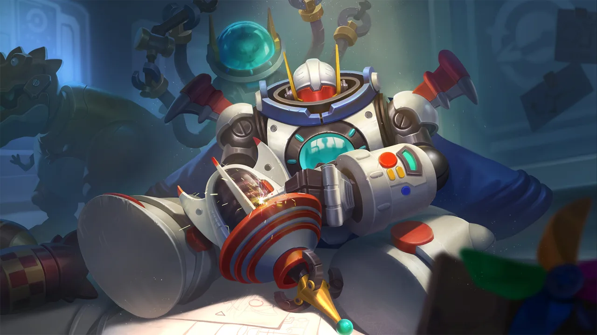
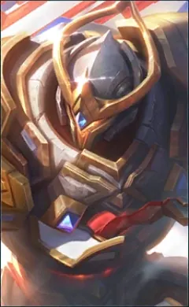
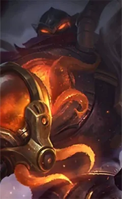

[Тир-лист](https://boostmlbb.ru/heroes/)[Предметы](https://boostmlbb.ru/items/)[Скины](https://boostmlbb.ru/skins/)[Новости и гайды](https://boostmlbb.ru/news/)

[Скины](https://boostmlbb.ru/skins/)/[Атлас](https://boostmlbb.ru/skins/atlas.html)/Космический мех

[Скин Атласа](https://boostmlbb.ru/skins/atlas.html)

# Космический мех

Space Mech

Исключительный ExceptionalЗвёздный участникОграниченный

Как получить

Награда «Звёздного участника» в сентябре 2022.

Вышел

1 сентября 2022

## Что меняет облик

-   Новая внешность
-   Новые эффекты навыков
-   Анимация показа
-   Сцена показа
-   Бонус к характеристикам

## Все скины Атласа [7](https://boostmlbb.ru/skins/atlas.html)

[Затонувшее проклятиеДелюкс · 2026](https://boostmlbb.ru/skins/atlas/sunken-curse.html)[Меха-ИнфернусИзысканный · 2024](https://boostmlbb.ru/skins/atlas/mecha-infernus.html)[Руна часовогоДелюкс · 2023](https://boostmlbb.ru/skins/atlas/rune-of-sentinel.html)[Косми­ческий мехИсключительный · 2022](https://boostmlbb.ru/skins/atlas/space-mech.html)[Топливная турбинаОбычный · 2020](https://boostmlbb.ru/skins/atlas/fuel-turbine.html)[Ядро реактораОбычный · 2020](https://boostmlbb.ru/skins/atlas/reactor-core.html)[Тень водоворота](https://boostmlbb.ru/skins/atlas/maelstrom-lurker.html)

## Серия «Звёздный участник»

[Морячка, рождённая приливомКалеа · 2026](https://boostmlbb.ru/skins/kalea/tideborn-sailor.html)[Тень кицунэХаябуса · 2026](https://boostmlbb.ru/skins/hayabusa/kitsune-s-shadow.html)[Клыки резниХанзо · 2026](https://boostmlbb.ru/skins/hanzo/fangs-of-slaughter.html)[Тлеющая крепостьБелерик · 2026](https://boostmlbb.ru/skins/belerick/smouldering-fortress.html)[Магитех­нический призракОбсидия · 2026](https://boostmlbb.ru/skins/obsidia/magitech-wraith.html)[Элизийское сияниеЦзэтянь · 2026](https://boostmlbb.ru/skins/zetian/elysian-luminance.html)[Батальон стражейХильда · 2026](https://boostmlbb.ru/skins/hilda/guardian-battalion.html)[Мечта­тельный коиХарли · 2026](https://boostmlbb.ru/skins/harley/dreaming-koi.html)

**Поднимем ранг на герое Атлас**Цена считается в калькуляторе

[Рассчитать цену](https://boostmlbb.ru/order.html?type=hero)

## Частые вопросы

Как получить скин «Космический мех» на Атласа?

Награда «Звёздного участника» в сентябре 2022.

Когда вышел скин «Космический мех»?

1 сентября 2022.

Какой класс у скина «Космический мех»?

Исключительный (Exceptional), серия «Звёздный участник».
