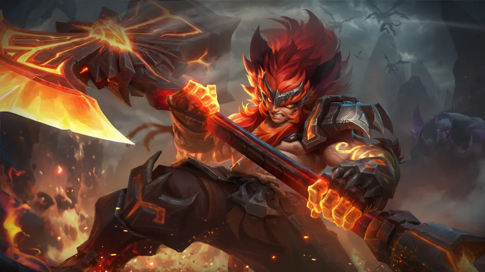
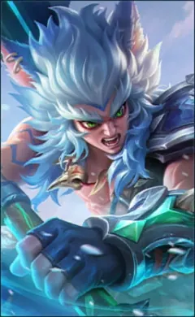

[Все скины](https://boostmlbb.ru/skins/)

[Скины](https://boostmlbb.ru/skins/)/Аулус

# Скины Аулуса

Скинов

4

Можно купить

2

Последний

[Разоритель Железная Грива](https://boostmlbb.ru/skins/aulus/ironmane-reaver.html)2024

[Профиль героя→](https://boostmlbb.ru/heroes/aulus.html)

## Все скины

[Разоритель Железная ГриваОбычный · 2024](https://boostmlbb.ru/skins/aulus/ironmane-reaver.html)[Боевой левИсключительный · 2023](https://boostmlbb.ru/skins/aulus/war-lion.html)[Первоп­роходец пустошейОбычный · 2022](https://boostmlbb.ru/skins/aulus/barren-pioneer.html)[БерсеркОбычный · 2021](https://boostmlbb.ru/skins/aulus/berserker.html)

**Сколько стоит буст на герое Аулус?**Выберите текущий и желаемый ранг. Стоимость появится на сайте.

[Рассчитать цену](https://boostmlbb.ru/order.html?type=hero)

## Частые вопросы

Сколько скинов у Аулуса?

4 скина без стандартного облика. Последний — «Разоритель Железная Грива» (Ironmane Reaver), 10 сентября 2024.

Какие скины Аулуса можно купить сейчас?

«Первопроходец пустошей» (599 алмазов), «Берсерк» (269 алмазов). Остальные облики ограниченные и возвращаются только в событиях.

Какой самый редкий скин Аулуса?

«Боевой лев» (War Lion), класс исключительный, серия «Особый». Выходил в магазине обликов во время события. Ограниченные облики иногда возвращаются в розыгрышах событий.
