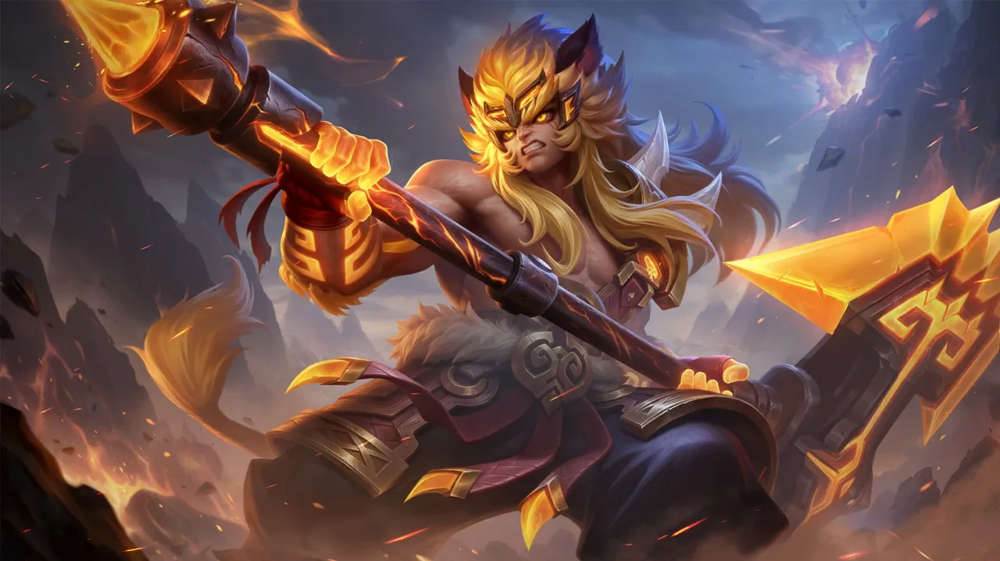

[Скины Аулуса](https://boostmlbb.ru/skins/aulus.html)

[Скины](https://boostmlbb.ru/skins/)/[Аулус](https://boostmlbb.ru/skins/aulus.html)/Берсерк

[Скин Аулуса](https://boostmlbb.ru/skins/aulus.html)

# Берсерк

Berserker

Обычный CommonВ продаже

Как получить

Продаётся в магазине обликов за 269 алмазов.

Цена

269 алмазов

Вышел

31 августа 2021

## Что меняет облик

-   Бонус к характеристикам

## Все скины Аулуса [4](https://boostmlbb.ru/skins/aulus.html)

[Разоритель Железная ГриваОбычный · 2024](https://boostmlbb.ru/skins/aulus/ironmane-reaver.html)[Боевой левИсключительный · 2023](https://boostmlbb.ru/skins/aulus/war-lion.html)[Первоп­роходец пустошейОбычный · 2022](https://boostmlbb.ru/skins/aulus/barren-pioneer.html)[БерсеркОбычный · 2021](https://boostmlbb.ru/skins/aulus/berserker.html)

**Сколько стоит буст на герое Аулус?**Выберите текущий и желаемый ранг. Стоимость появится на сайте.

[Рассчитать цену](https://boostmlbb.ru/order.html?type=hero)

## Частые вопросы

Как получить скин «Берсерк» на Аулуса?

Продаётся в магазине обликов за 269 алмазов.

Когда вышел скин «Берсерк»?

31 августа 2021.

Какой класс у скина «Берсерк»?

Обычный (Common).
