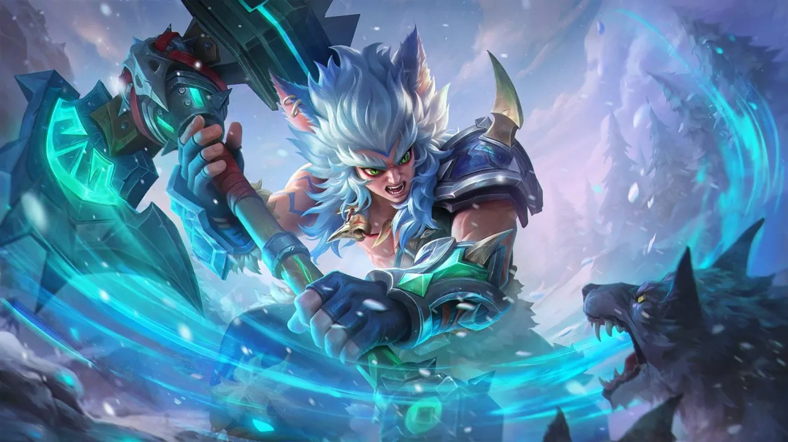

[Скины Аулуса](https://boostmlbb.ru/skins/aulus.html)

[Скины](https://boostmlbb.ru/skins/)/[Аулус](https://boostmlbb.ru/skins/aulus.html)/Разоритель Железная Грива

[Скин Аулуса](https://boostmlbb.ru/skins/aulus.html)

# Разоритель Железная Грива

Ironmane Reaver

Обычный CommonСезон 34Ограниченный

Как получить

Награда за рейтинговый сезон 34.

Вышел

10 сентября 2024

## Что меняет облик

-   Новая внешность
-   Другой цвет эффектов
-   Анимация показа
-   Бонус к характеристикам

## Все скины Аулуса [4](https://boostmlbb.ru/skins/aulus.html)

[Разоритель Железная ГриваОбычный · 2024](https://boostmlbb.ru/skins/aulus/ironmane-reaver.html)[Боевой левИсключительный · 2023](https://boostmlbb.ru/skins/aulus/war-lion.html)[Первоп­роходец пустошейОбычный · 2022](https://boostmlbb.ru/skins/aulus/barren-pioneer.html)[БерсеркОбычный · 2021](https://boostmlbb.ru/skins/aulus/berserker.html)

**Сколько стоит буст на герое Аулус?**Выберите текущий и желаемый ранг. Стоимость появится на сайте.

[Рассчитать цену](https://boostmlbb.ru/order.html?type=hero)

## Частые вопросы

Как получить скин «Разоритель Железная Грива» на Аулуса?

Награда за рейтинговый сезон 34.

Когда вышел скин «Разоритель Железная Грива»?

10 сентября 2024.

Какой класс у скина «Разоритель Железная Грива»?

Обычный (Common), серия «Сезон 34».
