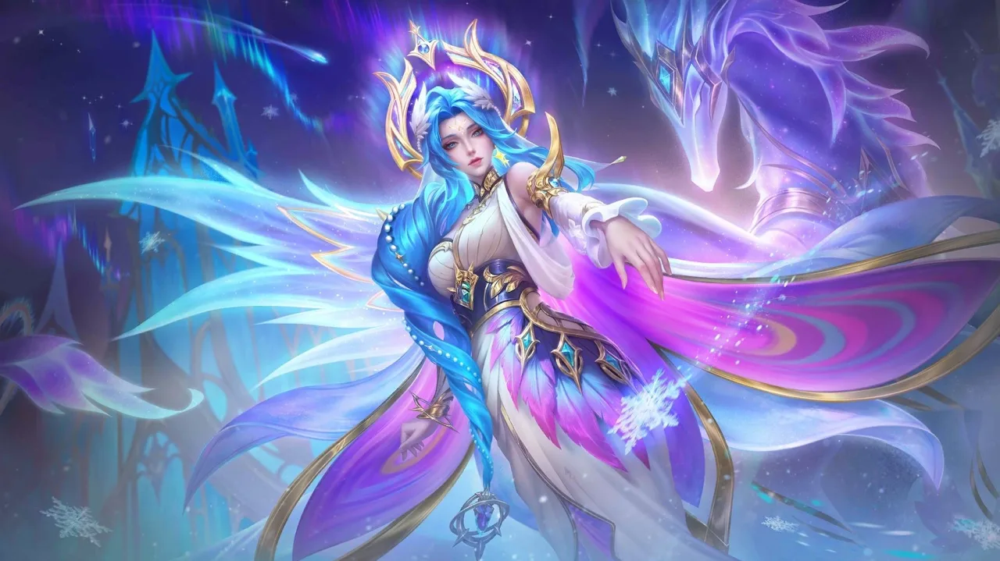

[Тир-лист](https://boostmlbb.ru/heroes/)[Предметы](https://boostmlbb.ru/items/)[Скины](https://boostmlbb.ru/skins/)[Новости и гайды](https://boostmlbb.ru/news/)

[Скины](https://boostmlbb.ru/skins/)/[Аврора](https://boostmlbb.ru/skins/aurora.html)/Вуаль небожителей

[Скин Авроры](https://boostmlbb.ru/skins/aurora.html)

# Вуаль небожителей

Veil of the Celestials

Изысканный ExquisiteКоллекционныйОграниченный

Как получить

Главный приз розыгрыша в коллекционном событии, попытки покупаются за алмазы. Ограниченные облики иногда возвращаются в розыгрышах событий.

Вышел

3 января 2025

## Что меняет облик

-   Новая внешность
-   Новые эффекты навыков
-   Звуки навыков
-   Своя озвучка
-   Анимация показа
-   Сцена показа
-   Музыка показа
-   Особые действия
-   Бонус к характеристикам

## Все скины Авроры [7](https://boostmlbb.ru/skins/aurora.html)

[Вуаль небожи­телейИзысканный · 2025](https://boostmlbb.ru/skins/aurora/veil-of-the-celestials.html)[Кула ДаймондГрандиозный · 2019](https://boostmlbb.ru/skins/aurora/kula-diamond.html)[ВодолейДелюкс · 2019](https://boostmlbb.ru/skins/aurora/aquarius.html)[Лисья ледиИсключительный · 2018](https://boostmlbb.ru/skins/aurora/foxy-lady.html)[Импе­ратрица разбитых сердецИсключительный · 2017](https://boostmlbb.ru/skins/aurora/heartbreak-empress.html)[Трон природыОбычный · 2017](https://boostmlbb.ru/skins/aurora/nature-s-throne.html)[Бдение свечи](https://boostmlbb.ru/skins/aurora/candle-s-vigil.html)

## Серия «Коллекционный»

[ОчистительБруно · 2026](https://boostmlbb.ru/skins/bruno/the-purifier.html)[Небесный бунтарьСан · 2026](https://boostmlbb.ru/skins/sun/celestial-rebel.html)[Кайдзю глубинХелкарт · 2026](https://boostmlbb.ru/skins/helcurt/kaiju-of-the-deep.html)[Звёздный дозорныйКимми · 2026](https://boostmlbb.ru/skins/kimmy/starbound-sentry.html)[Монархиня грёзАлиса · 2026](https://boostmlbb.ru/skins/alice/dreaming-monarch.html)[Дрожь глубинГрок · 2026](https://boostmlbb.ru/skins/grock/tremor-of-the-deep.html)[Небесный генералТигрил · 2026](https://boostmlbb.ru/skins/tigreal/celestial-general.html)[Монарх, рождённый солнцемКсавьер · 2026](https://boostmlbb.ru/skins/xavier/sunborn-monarch.html)

**Поднимем ранг на герое Аврора**Цена считается в калькуляторе

[Рассчитать цену](https://boostmlbb.ru/order.html?type=hero)

## Частые вопросы

Как получить скин «Вуаль небожителей» на Аврору?

Главный приз розыгрыша в коллекционном событии, попытки покупаются за алмазы. Ограниченные облики иногда возвращаются в розыгрышах событий.

Когда вышел скин «Вуаль небожителей»?

3 января 2025.

Какой класс у скина «Вуаль небожителей»?

Изысканный (Exquisite), серия «Коллекционный».
