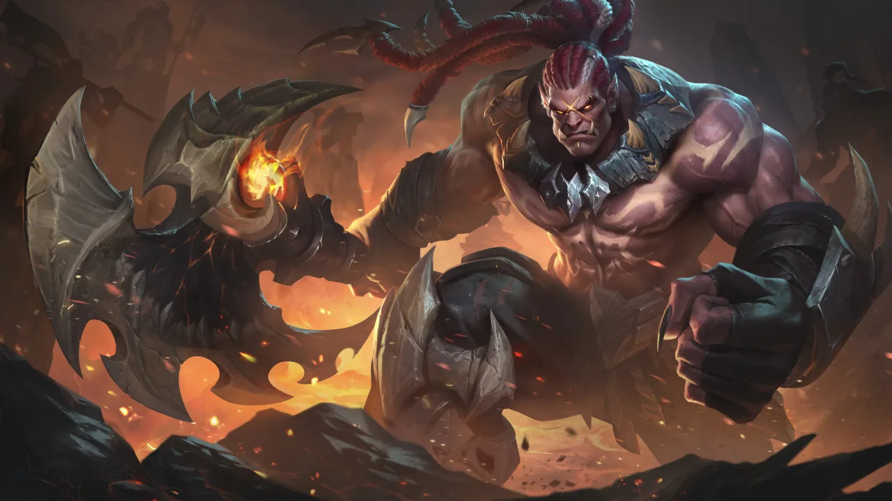

[Все скины](https://boostmlbb.ru/skins/)

[Скины](https://boostmlbb.ru/skins/)/Бальмонд

# Скины Бальмонда

Скинов

9

Можно купить

5

Последний

[Бритвенный клинок](https://boostmlbb.ru/skins/balmond/razor-edge.html)2025

[Профиль героя→](https://boostmlbb.ru/heroes/balmond.html)

## Все скины

ВсеИзысканныйДелюксИсключительныйОбычный

[Бритвенный клинокИсключительный · 2025](https://boostmlbb.ru/skins/balmond/razor-edge.html)[Адский полководецДелюкс · 2023](https://boostmlbb.ru/skins/balmond/infernal-warlord.html)[БиороидИсключительный · 2022](https://boostmlbb.ru/skins/balmond/bioroid.html)[Бог горИзысканный · 2021](https://boostmlbb.ru/skins/balmond/god-of-mountains.html)[Свирепый разыгры­вающийИсключительный · 2018](https://boostmlbb.ru/skins/balmond/savage-pointguard.html)[Дикий охотникОбычный · 2017](https://boostmlbb.ru/skins/balmond/savage-hunter.html)[Ярость гуляОбычный · 2016](https://boostmlbb.ru/skins/balmond/ghoul-s-fury.html)[Источник силыОбычный · 2016](https://boostmlbb.ru/skins/balmond/power-source.html)[Желез­ношкурый берсеркОбычный](https://boostmlbb.ru/skins/balmond/ironhide-berserker.html)

**Сколько стоит буст на герое Бальмонд?**Выберите текущий и желаемый ранг. Стоимость появится на сайте.

[Рассчитать цену](https://boostmlbb.ru/order.html?type=hero)

## Частые вопросы

Сколько скинов у Бальмонда?

9 скинов без стандартного облика. Последний — «Бритвенный клинок» (Razor Edge), 6 января 2025.

Какие скины Бальмонда можно купить сейчас?

«Адский полководец» (899 алмазов), «Свирепый разыгрывающий» (749 алмазов), «Дикий охотник» (599 алмазов), «Ярость гуля» (399 алмазов), «Источник силы» (269 алмазов). Остальные облики ограниченные и возвращаются только в событиях.

Какой самый редкий скин Бальмонда?

«Бог гор» (God of Mountains), класс изысканный, серия «Коллекционный». Главный приз розыгрыша в коллекционном событии, попытки покупаются за алмазы. Ограниченные облики иногда возвращаются в розыгрышах событий.
