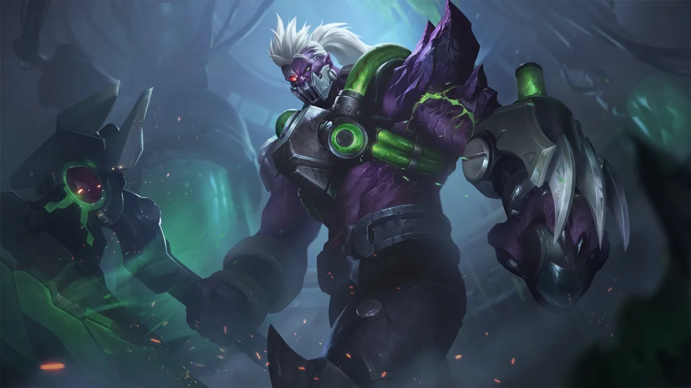

[Тир-лист](https://boostmlbb.ru/heroes/)[Предметы](https://boostmlbb.ru/items/)[Скины](https://boostmlbb.ru/skins/)[Новости и гайды](https://boostmlbb.ru/news/)

[Скины](https://boostmlbb.ru/skins/)/[Бальмонд](https://boostmlbb.ru/skins/balmond.html)/Биороид

[Скин Бальмонда](https://boostmlbb.ru/skins/balmond.html)

# Биороид

Bioroid

Исключительный ExceptionalЗвёздный участникОграниченный

Как получить

Награда «Звёздного участника» в апреле 2022.

Вышел

1 апреля 2022

## Что меняет облик

-   Новая внешность
-   Новые эффекты навыков
-   Анимация показа
-   Сцена показа
-   Бонус к характеристикам

## Все скины Бальмонда [9](https://boostmlbb.ru/skins/balmond.html)

[Бритвенный клинокИсключительный · 2025](https://boostmlbb.ru/skins/balmond/razor-edge.html)[Адский полководецДелюкс · 2023](https://boostmlbb.ru/skins/balmond/infernal-warlord.html)[БиороидИсключительный · 2022](https://boostmlbb.ru/skins/balmond/bioroid.html)[Бог горИзысканный · 2021](https://boostmlbb.ru/skins/balmond/god-of-mountains.html)[Свирепый разыгры­вающийИсключительный · 2018](https://boostmlbb.ru/skins/balmond/savage-pointguard.html)[Дикий охотникОбычный · 2017](https://boostmlbb.ru/skins/balmond/savage-hunter.html)[Ярость гуляОбычный · 2016](https://boostmlbb.ru/skins/balmond/ghoul-s-fury.html)[Источник силыОбычный · 2016](https://boostmlbb.ru/skins/balmond/power-source.html)[Желез­ношкурый берсеркОбычный](https://boostmlbb.ru/skins/balmond/ironhide-berserker.html)

## Серия «Звёздный участник»

[Морячка, рождённая приливомКалеа · 2026](https://boostmlbb.ru/skins/kalea/tideborn-sailor.html)[Тень кицунэХаябуса · 2026](https://boostmlbb.ru/skins/hayabusa/kitsune-s-shadow.html)[Клыки резниХанзо · 2026](https://boostmlbb.ru/skins/hanzo/fangs-of-slaughter.html)[Тлеющая крепостьБелерик · 2026](https://boostmlbb.ru/skins/belerick/smouldering-fortress.html)[Магитех­нический призракОбсидия · 2026](https://boostmlbb.ru/skins/obsidia/magitech-wraith.html)[Элизийское сияниеЦзэтянь · 2026](https://boostmlbb.ru/skins/zetian/elysian-luminance.html)[Батальон стражейХильда · 2026](https://boostmlbb.ru/skins/hilda/guardian-battalion.html)[Мечта­тельный коиХарли · 2026](https://boostmlbb.ru/skins/harley/dreaming-koi.html)

**Поднимем ранг на герое Бальмонд**Цена считается в калькуляторе

[Рассчитать цену](https://boostmlbb.ru/order.html?type=hero)

## Частые вопросы

Как получить скин «Биороид» на Бальмонда?

Награда «Звёздного участника» в апреле 2022.

Когда вышел скин «Биороид»?

1 апреля 2022.

Какой класс у скина «Биороид»?

Исключительный (Exceptional), серия «Звёздный участник».
