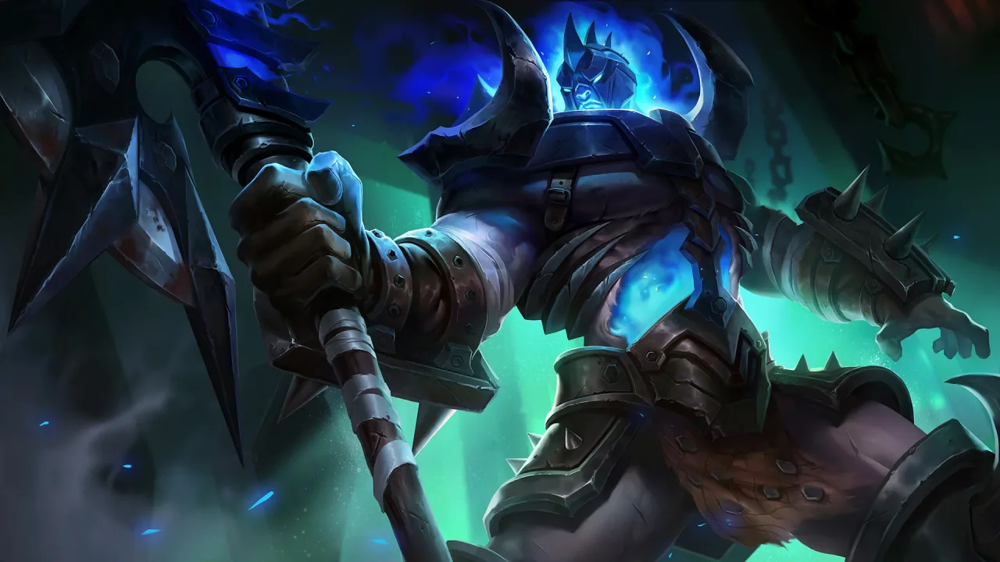
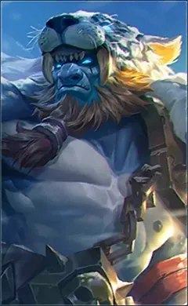

[Скины Бальмонда](https://boostmlbb.ru/skins/balmond.html)

[Скины](https://boostmlbb.ru/skins/)/[Бальмонд](https://boostmlbb.ru/skins/balmond.html)/Ярость гуля

[Скин Бальмонда](https://boostmlbb.ru/skins/balmond.html)

# Ярость гуля

Ghoul's Fury

Обычный CommonЭлитныйВ продаже

Как получить

Продаётся в магазине обликов за 399 алмазов.

Цена

399 алмазов

Вышел

2016 год

## Что меняет облик

-   Бонус к характеристикам

## Все скины Бальмонда [9](https://boostmlbb.ru/skins/balmond.html)

[Бритвенный клинокИсключительный · 2025](https://boostmlbb.ru/skins/balmond/razor-edge.html)[Адский полководецДелюкс · 2023](https://boostmlbb.ru/skins/balmond/infernal-warlord.html)[БиороидИсключительный · 2022](https://boostmlbb.ru/skins/balmond/bioroid.html)[Бог горИзысканный · 2021](https://boostmlbb.ru/skins/balmond/god-of-mountains.html)[Свирепый разыгры­вающийИсключительный · 2018](https://boostmlbb.ru/skins/balmond/savage-pointguard.html)[Дикий охотникОбычный · 2017](https://boostmlbb.ru/skins/balmond/savage-hunter.html)[Ярость гуляОбычный · 2016](https://boostmlbb.ru/skins/balmond/ghoul-s-fury.html)[Источник силыОбычный · 2016](https://boostmlbb.ru/skins/balmond/power-source.html)[Желез­ношкурый берсеркОбычный](https://boostmlbb.ru/skins/balmond/ironhide-berserker.html)

## Серия «Элитный»

[Золотой османтусЧан'Э · 2026](https://boostmlbb.ru/skins/change/golden-osmanthus.html)[Король-воена­чальникМартис · 2025](https://boostmlbb.ru/skins/martis/warlord-king.html)[Кадет открытого моряКимми · 2024](https://boostmlbb.ru/skins/kimmy/high-seas-cadet.html)[Зелёная копейщицаСильвана · 2024](https://boostmlbb.ru/skins/silvanna/verdant-lancer.html)[Мародёр Кровавое КопытоХилос · 2024](https://boostmlbb.ru/skins/hylos/bloodhoof-marauder.html)[Изящная бабочкаГвиневра · 2024](https://boostmlbb.ru/skins/guinevere/elegant-butterfly.html)[Маркиз клинковЛанселот · 2024](https://boostmlbb.ru/skins/lancelot/marques-of-blades.html)[Привал в пустошахЧип · 2024](https://boostmlbb.ru/skins/chip/badlands-hiatus.html)

**Сколько стоит буст на герое Бальмонд?**Выберите текущий и желаемый ранг. Стоимость появится на сайте.

[Рассчитать цену](https://boostmlbb.ru/order.html?type=hero)

## Частые вопросы

Как получить скин «Ярость гуля» на Бальмонда?

Продаётся в магазине обликов за 399 алмазов.

Когда вышел скин «Ярость гуля»?

2016 год.

Какой класс у скина «Ярость гуля»?

Обычный (Common), серия «Элитный».
