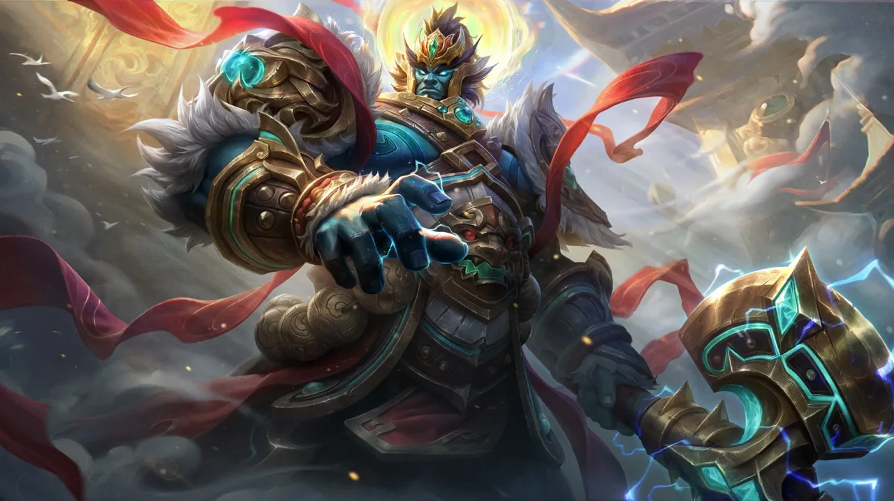

[Скины Бальмонда](https://boostmlbb.ru/skins/balmond.html)

[Скины](https://boostmlbb.ru/skins/)/[Бальмонд](https://boostmlbb.ru/skins/balmond.html)/Бог гор

[Скин Бальмонда](https://boostmlbb.ru/skins/balmond.html)

# Бог гор

God of Mountains

Изысканный ExquisiteКоллекционныйОграниченный

Как получить

Главный приз розыгрыша в коллекционном событии, попытки покупаются за алмазы. Ограниченные облики иногда возвращаются в розыгрышах событий.

Вышел

август 2021

## Что меняет облик

-   Новая внешность
-   Новые эффекты навыков
-   Звуки навыков
-   Своя озвучка
-   Анимация показа
-   Сцена показа
-   Бонус к характеристикам

## Все скины Бальмонда [9](https://boostmlbb.ru/skins/balmond.html)

[Бритвенный клинокИсключительный · 2025](https://boostmlbb.ru/skins/balmond/razor-edge.html)[Адский полководецДелюкс · 2023](https://boostmlbb.ru/skins/balmond/infernal-warlord.html)[БиороидИсключительный · 2022](https://boostmlbb.ru/skins/balmond/bioroid.html)[Бог горИзысканный · 2021](https://boostmlbb.ru/skins/balmond/god-of-mountains.html)[Свирепый разыгры­вающийИсключительный · 2018](https://boostmlbb.ru/skins/balmond/savage-pointguard.html)[Дикий охотникОбычный · 2017](https://boostmlbb.ru/skins/balmond/savage-hunter.html)[Ярость гуляОбычный · 2016](https://boostmlbb.ru/skins/balmond/ghoul-s-fury.html)[Источник силыОбычный · 2016](https://boostmlbb.ru/skins/balmond/power-source.html)[Желез­ношкурый берсеркОбычный](https://boostmlbb.ru/skins/balmond/ironhide-berserker.html)

## Серия «Коллекционный»

[ОчистительБруно · 2026](https://boostmlbb.ru/skins/bruno/the-purifier.html)[Небесный бунтарьСан · 2026](https://boostmlbb.ru/skins/sun/celestial-rebel.html)[Кайдзю глубинХелкарт · 2026](https://boostmlbb.ru/skins/helcurt/kaiju-of-the-deep.html)[Звёздный дозорныйКимми · 2026](https://boostmlbb.ru/skins/kimmy/starbound-sentry.html)[Монархиня грёзАлиса · 2026](https://boostmlbb.ru/skins/alice/dreaming-monarch.html)[Дрожь глубинГрок · 2026](https://boostmlbb.ru/skins/grock/tremor-of-the-deep.html)[Небесный генералТигрил · 2026](https://boostmlbb.ru/skins/tigreal/celestial-general.html)[Монарх, рождённый солнцемКсавьер · 2026](https://boostmlbb.ru/skins/xavier/sunborn-monarch.html)

**Сколько стоит буст на герое Бальмонд?**Выберите текущий и желаемый ранг. Стоимость появится на сайте.

[Рассчитать цену](https://boostmlbb.ru/order.html?type=hero)

## Частые вопросы

Как получить скин «Бог гор» на Бальмонда?

Главный приз розыгрыша в коллекционном событии, попытки покупаются за алмазы. Ограниченные облики иногда возвращаются в розыгрышах событий.

Когда вышел скин «Бог гор»?

Август 2021.

Какой класс у скина «Бог гор»?

Изысканный (Exquisite), серия «Коллекционный».
